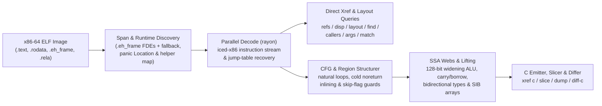

<div align="center">


# XRef Code (`xref`)

**Ultra blazing fast cross-references, struct layout recovery, program slicing & structured pseudo-C for x86-64 ELF binaries.**

Zero-index binary analysis in pure safe Rust (`#![forbid(unsafe_code)]`). Function boundaries come directly from `.eh_frame` unwind tables (with span fallback) and whole-binary queries decode across all CPU cores in milliseconds — even on completely stripped Rust release binaries where symbol tables are empty.

<br/>

[**Interactive Workbench (xrefcode.com)**](https://xrefcode.com) · By [Alexander Panasenko](https://prod.codes/about/)

<br/>

[](https://github.com/alex09x/xref/releases)
[](https://github.com/alex09x/xref/actions)
[](LICENSE-MIT)
[](Cargo.toml)
[](Cargo.toml)

<br/>

[**Why**](#why) · [**Install**](#installation) · [**Quick Start**](#quick-start) · [**Recorded Examples**](#recorded-examples) · [**CLI Reference**](#command-reference) · [**Architecture**](#architecture) · [**Benchmarks**](#recorded-performance) · [**Limitations**](#scope--limitations) · [**Citation**](#citation)

</div>

---

## Why

Traditional reverse-engineering suites assume one interactive analyst willing to wait minutes for an upfront whole-program database import before asking the first question. Stripped Rust binaries make this worse: symbols are gone, strings are non-NUL `(ptr, len)` slices in `.rodata` pools, and bounds-check panics shatter loops into cold edges that turn naive decompilers into unreadable `goto` spaghetti.

**XRef Code** (`xref`) is built for fast iterative investigation by both reverse engineers and autonomous AI agents:

- **Zero index, zero stale cache.** Every invocation maps the ELF image in memory, extracts exact function ranges from `.eh_frame` unwind records (with automatic span fallback), and scans functions in parallel via `rayon`.
- **Native structured typed pseudo-C (`xref c`).** Lifts x86-64 machine code directly to readable C without external tools — recovering immutable `arg_0..arg_5` signatures, SSA live-range webs (`ptr_*`, `v_*`, `slot_*`), element-indexed SIB arrays, 1-operand `128-bit` widening `mul`/`imul`/`div`/`idiv`, multi-precision `adc`/`sbb` carry/borrow chains, signed arithmetic overflow intrinsics, and structured `if`/`else`/`while`/`do-while`/`switch` regions.
- **Rust-aware stripped binary recovery.** Recognizes stripped Rust runtime helpers (`rust_panic_bounds_check`, `rust_slice_index_fail`, `rust_capacity_overflow`), slices exact `(ptr, len)` `&str` literals, maps `core::panic::Location` (`file:line:col`) descriptors back to original crate paths, and resolves `Display` jump-table arms.
- **Slicing & cross-build diffing (`xref slice`, `xref match`, `xref diff-c`).** Isolates balanced statements and control guards reaching an exact call or instruction IP, relocates shifted stripped functions across builds, and diffs normalized pseudo-C with volatile hex addresses abstracted away.

Explore **114 verbatim recorded CLI runs** against stripped `xref` itself in the static browser workbench at **[xrefcode.com](https://xrefcode.com)**.

---

## Installation

### Prebuilt Linux `x86_64` Binary

Prebuilt archives target `x86_64-unknown-linux-gnu` (**requires `glibc >= 2.34`**, e.g. Ubuntu 22.04+, Debian 12+, RHEL/Rocky 9+, Fedora 35+, Arch) and bundle `xref`, `README.md`, `LICENSE-MIT`, `LICENSE-APACHE`, and `CITATION.cff`:

```bash
curl -fsSLO https://github.com/alex09x/xref/releases/download/v0.0.5/xref-v0.0.5-x86_64-unknown-linux-gnu.tar.gz
curl -fsSLO https://github.com/alex09x/xref/releases/download/v0.0.5/SHA256SUMS
sha256sum -c SHA256SUMS
tar -xzf xref-v0.0.5-x86_64-unknown-linux-gnu.tar.gz
./xref --version
```

### Build from Source (Linux & macOS)

Requires a Rust toolchain supporting Edition 2024 (`rustc 1.85+`). Note that `xref` analyzes `x86-64` ELF images on any host OS (including macOS Apple Silicon and Linux):

```bash
cargo install --git https://github.com/alex09x/xref --tag v0.0.5 --locked
```

---

## Quick Start

Pass `-b <ELF>` on each command or export `XREF_BIN=/path/to/binary.elf` once per shell session. Addresses use ELF virtual numbering (`objdump` addresses) in `0x` hex or decimal:

```bash
export XREF_BIN=./xref.stripped

xref stats                                      # function count, .text bytes, pointers, panic locations
xref refs "goto L_"                             # code & data references to strings or addresses (--inline)
xref where src/loops.rs                         # stripped function ranges compiled from a Rust source file
xref layout 0xa2270 --reg rsi --callees         # recover struct field offsets, sizes, strides & 1-hop callees
xref c 0x9a8a0 --fields                         # structured typed pseudo-C with inferred ->f_<off> hints
xref slice 0xc7d60 --to fn_160bb0               # backward slice of statements & guards reaching a target
```

---

## Recorded Examples

All outputs below are verbatim, unedited runs of `xref 0.0.5` against `xref.stripped` (`1,962,608` bytes, `0` symbols, `sha256:3f3ba3b311f3eca8e26a929285d4fc9ffef4e4b6e8fc015105766180a2a6869d`).

### 1. Structured Typed Pseudo-C with Field Offset Hints (`xref c --fields`)

```c
$ xref -b xref.stripped c 0x9a8a0 --fields
/* field offsets: arg_0 [+0x0:u64, +0x8:u64, +0x10:u64, +0x18:u64] */
/*
 * fn_9a8a0 — 0x9a8a0..0x9a97a (218 bytes, 1 direct caller; synthetic FDE entry)
 *   source: src/cfg.rs:154:22, src/cfg.rs:75:25, src/cfg.rs:154:57
 *   params:
 *     arg_0 (rdi): const void * — reads +0x0 (8B), +0x8 (8B), +0x10 (8B), +0x18 (8B)
 *     arg_1 (rsi): unk64 — 64-bit register (signedness unconstrained)
 *     arg_2 (rdx): unk64 — 64-bit register (signedness unconstrained)
 *   return: u8 in rax (consumed by 1/1 direct call site)
 */
u8 fn_9a8a0(const void *arg_0, unk64 arg_1, unk64 arg_2) {
  usize v_1 = arg_1; /* rsi */
  u64 v_6; /* rbx */
  const u8 *ptr_9; /* rax */
  unk64 slot_0; /* [rsp+0x0], addr-taken */
  unk64 slot_8; /* [rsp+0x8] */

  if (v_1 == 0) {
    ptr_9 = 0;
    return ptr_9;
  }
  u64 v_2 = arg_0->f_8;
  if (v_1 >= v_2) {
    usize v_12 = v_1;
    /* [runtime] rust_panic_bounds_check(index, len, loc) -> noreturn */
    rust_panic_bounds_check(v_12, v_2, "src/cfg.rs:154:22");
  }
  if (((u64 *)arg_0->f_0)[v_1] != 1) {
    ptr_9 = 0;
    return ptr_9;
  }
  ...
```

### 2. Interprocedural Struct Layout Recovery (`xref layout --callees`)

```text
$ xref -b xref.stripped layout 0xa2270 --reg rsi --callees
layout of rsi in 0xa2270..0xa2566:
  +0       size  4  u32   r:0  w:2
  +8       size  8  u64   r:2  w:0
  +10      size  8  u64   r:2  w:0
  +20      size  8  u64   r:1  w:0
  +28      size  8  u64   r:1  w:0
5 fields (min span 0x30)
other pointer args: rdi (3 fields), rdx (1 fields)  (use --reg <REG>)
```

### 3. Backward Program Slicing (`xref slice`)

```c
$ xref -b xref.stripped slice 0xc7d60 --to fn_160bb0
/* slice of 0xc7d60..0xc7fbf -> fn_160bb0 (37/131 lines) */
void fn_c7d60(void *arg_0, const void *arg_1, usize arg_2) {
  u8 slot_28; /* [rsp+0x28], addr-taken */
  usize slot_30; /* [rsp+0x30] */
  unk64 slot_40; /* [rsp+0x40], addr-taken */
  if (arg_2 == 0) {
    return; /* callers ignore rax */
  }
  const void *ptr_1 = arg_1;
  const void *v_2 = arg_1 + arg_2 * 24;
  void *v_4 = &slot_40;
  do {
    const u8 *ptr_6 = *(u64 *)(ptr_1 + 8);
    usize v_7 = *(u64 *)(ptr_1 + 16);
    /* fn_160550: source core/src/str/pattern.rs:1398; calls fn_1606e0, fn_160a43, fn_1605f8 */
    fn_160550(v_4, ptr_6, v_7, "goto L_", 7);
    /* fn_124d50: source core/src/str/pattern.rs:1131; calls fn_124e3a, fn_160bb0, fn_124e29 */
    fn_124d50(&slot_28, v_4);
    if (slot_28 != 0) {
      usize v_8 = slot_30;
      usize v_9 = (v_8 + 7);
      if (v_9 != 0) {
        if (v_9 < v_7) {
          if ((i64)((u8 *)ptr_6)[v_9] < 192) {
            /* fn_160bb0: noreturn; source core/src/str/mod.rs:486; calls fn_160bc0 */
            fn_160bb0(ptr_6, v_7, v_9, v_7, "src/loops.rs:45:36");
          }
        } else {
          if (v_9 != v_7) {
            /* fn_160bb0: noreturn; source core/src/str/mod.rs:486; calls fn_160bc0 */
            fn_160bb0(ptr_6, v_7, v_9, v_7, "src/loops.rs:45:36");
          }
        }
      }
    }
    ptr_1 = (ptr_1 + 24);
  } while (ptr_1 != v_2);
}
```

### 4. Cross-Build Relocation & Normalized Pseudo-C Diff (`xref diff-c`)

```diff
$ xref -b xref.stripped diff-c --other xref-v0.0.2.stripped 0xd57c0
=== diff 0xd57c0..0xd6301 (current) vs 0xd5530..0xd6071 (other, score 384: locs:240 strs:0 imms:4 disps:10 nbrs:105 size:0xb41 callees:8) ===
  ...
      }
      @var_11 = (@slot_10 + @var_8);
-     @var_1 = 0xc2bc;
+     @var_1 = 0xc518;
      @var_32 = @slot_9;
      switch (*(u64 *)(@var_11)) {
  ...
```

---

## Command Reference

### Inventory, Symbols & Cross-References
```text
xref -b BIN stats                                    # functions, .text bytes, pointers, imports, panic locations
xref -b BIN sym PATTERN                              # symbol search (non-stripped binaries)
xref -b BIN func 0xa1b50                             # function span containing an address
xref -b BIN refs "goto L_" 0xa1b50                   # .rodata / pointer / code xrefs (--inline for mov/movabs stores)
xref -b BIN istr "text"                              # shorthand for refs --inline
xref -b BIN imm 24 --in 0xa1b50                      # immediate constants (--store, --cmp, --in FN)
xref -b BIN find --src src/loops.rs --calls 0x160bb0 # single-pass multi-predicate function search (--any K)
```

### Struct Layouts, Displacements & Call Graphs
```text
xref -b BIN disp 0x20 0x28 --all                     # field loads/stores/leas (--write, --lea, --stride, --in FN)
xref -b BIN layout 0xa2270 --reg rsi --callees       # aggregate field offsets, widths, strides & 1-hop callees
xref -b BIN callers 0xcafb0                          # direct calls/tail-jumps, address-taken & pointer-table xrefs
xref -b BIN calls 0xcafb0                            # outgoing calls and tail-jumps in instruction order
xref -b BIN args 0xa2270 --max 20                    # constant & symbolic arguments across all call sites
xref -b BIN path 0xc7fc0 0x160bb0 --depth 8          # shortest call chains between two functions
xref -b BIN tree 0xd0aa0 --callers --depth 2         # indented caller/callee tree with panic source anchors
```

### Disassembly, Pseudo-C, Slicing, Crate Export & Diffing
```text
xref -b BIN asm 0xc7d60 --from A --to B              # annotated Intel disassembly (strings, slots, targets)
xref -b BIN c 0x9a8a0 --fields                       # structured typed pseudo-C (--out DIR for parallel batch export)
xref -b BIN slice 0xc7d60 --to fn_160bb0 --fields    # backward slice to target call, hex IP, offset, or string
xref -b BIN dump --out DIR --src src/loops.rs        # parallel modular .c export grouped by panic source paths
xref -b BIN match --other OLD_BIN 0xc7d60 --top 3    # relocate shifted stripped functions across two builds
xref -b BIN diff-c --other OLD_BIN 0xd57c0           # normalized cross-build pseudo-C LCS diff
```

### Rust Source Locations & Enum Jump Tables
```text
xref -b BIN src 0x9a8a0                              # core::panic::Location (file:line:col) descriptors in function
xref -b BIN where src/image.rs --line 46             # stripped functions referencing a Rust file (and line)
xref -b BIN files src/                               # distinct Rust source files recovered from panic descriptors
xref -b BIN error "invalid"                          # jump-table discriminant whose Display arm names text
xref -b BIN variant 0xc7fc0 1 2                      # inverse of error: texts referenced by jump-table arms
xref -b BIN arm 0xc8010                              # jump-table indices whose arm contains an address
```

---

## Architecture



---

## Recorded Performance

Single-run CLI wall times reported by `xref 0.0.5` (`stderr`) on `AMD Ryzen 9 9950X` (16 cores / 32 threads, Linux 6.8 `x86_64`, warm OS page cache) analyzing stripped `xref.stripped` (`1.96 MB`, `1,974` functions, `0` symbols):

| Operation | Command | ELF Load | Total Time |
|---|---|---:|---:|
| Binary inventory (`1,974` functions, `588` panic locations) | `xref -b xref.stripped stats` | `0.84 ms` | **`2.2 ms`** |
| Whole-binary string & pointer cross-reference scan | `xref -b xref.stripped refs "goto L_"` | `0.80 ms` | **`3.9 ms`** |
| Rust module mapping from embedded panic locations | `xref -b xref.stripped where src/loops.rs` | `0.79 ms` | **`3.4 ms`** |
| Interprocedural struct layout recovery (1-hop callees) | `xref -b xref.stripped layout 0xa2270 --reg rsi --callees` | `0.81 ms` | **`2.6 ms`** |
| Backward program slice + field offset hints (`37 / 131` lines) | `xref -b xref.stripped slice 0xc7d60 --to fn_160bb0 --fields` | `0.81 ms` | **`5.1 ms`** |
| Cross-build function matching & normalized pseudo-C diff | `xref -b xref.stripped diff-c --other xref-v0.0.2.stripped 0xc7d60` | `0.86 ms` | **`13.4 ms`** |

---

## Scope & Limitations

- **Supported input format:** `x86-64` ELF binaries and shared objects (`ET_EXEC`, `ET_DYN`). PE/Mach-O and AArch64 are outside current scope.
- **Function boundary discovery:** Exact function spans come from `.eh_frame` unwind tables (emitted by default by `rustc`, `clang`, and `gcc` on `x86-64` even after `strip --strip-all`), with gap/call-target span fallback when unwind entries are absent. Binaries stripped of `.eh_frame` (`strip -R .eh_frame`) rely on heuristic span boundaries.
- **Static pseudo-C & offset inference:** Parameter signatures (`arg_*`), inferred pointer/integer types (`const void *`, `usize`, `unk64`, etc.), and `--fields` offset hints (`->f_<off>`) are conservative static reconstructions from machine-code uses, not DWARF source types. Unmodeled SIMD/system instructions are preserved inline as explicit `/* 0xaddr: ... */` assembly comments rather than silently dropped — always cross-check critical invariants with `xref asm`.

---

## Development & Testing

`rustc` must be available on `PATH` when running tests: the end-to-end suite compiles `tests/fixtures/sample.rs` into a temporary ELF fixture and verifies CLI subcommands against it.

```bash
cargo fmt --all -- --check
cargo clippy --workspace --all-targets --locked -- -D warnings
cargo test --workspace --locked
```

---

## Citation

If you use **XRef Code** in research, security audits, or engineering publications, please cite it via [`CITATION.cff`](CITATION.cff):

> Alexander Panasenko (2026). *XRef Code: Zero-index x86-64 ELF cross-references and structured pseudo-C decompiler*. https://github.com/alex09x/xref · https://xrefcode.com

---

## License

Copyright © 2026 [Alexander Panasenko](https://prod.codes/about/) (`alex@prod.codes`).

Dual-licensed under either of:
- **Apache License, Version 2.0** ([`LICENSE-APACHE`](LICENSE-APACHE) or http://www.apache.org/licenses/LICENSE-2.0)
- **MIT License** ([`LICENSE-MIT`](LICENSE-MIT) or http://opensource.org/licenses/MIT)

at your option.
