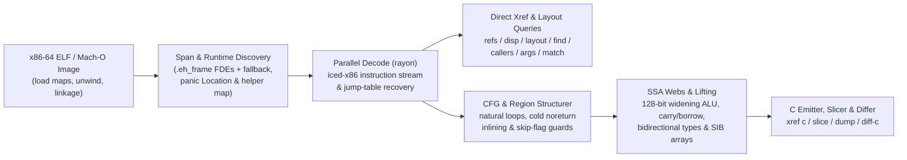

<div align="center">


<br/><br/>

**English** · [Русский](https://github.com/alex09x/xref/blob/main/readme/README.ru.md) · [简体中文](https://github.com/alex09x/xref/blob/main/readme/README.zh-CN.md) · [Español](https://github.com/alex09x/xref/blob/main/readme/README.es.md) · [Português (Brasil)](https://github.com/alex09x/xref/blob/main/readme/README.pt-BR.md) · [日本語](https://github.com/alex09x/xref/blob/main/readme/README.ja.md) · [Deutsch](https://github.com/alex09x/xref/blob/main/readme/README.de.md) · [Français](https://github.com/alex09x/xref/blob/main/readme/README.fr.md) · [한국어](https://github.com/alex09x/xref/blob/main/readme/README.ko.md) · [العربية](https://github.com/alex09x/xref/blob/main/readme/README.ar.md)

**Ultra blazing fast cross-references, struct layout recovery, program slicing & structured pseudo-C for x86-64 ELF / Mach-O binaries — plus live Linux process inspection tied to the same static evidence.**

Zero-index binary analysis in pure safe Rust (`#![forbid(unsafe_code)]`). Function boundaries come directly from `.eh_frame` unwind tables (with span fallback) and whole-binary queries decode across all CPU cores in milliseconds — even on completely stripped Rust release binaries where symbol tables are empty.

<br/>

[**Interactive Workbench (xrefcode.com)**](https://xrefcode.com) · By [Alexander Panasenko](https://prod.codes/about/)

<br/>

[](https://github.com/alex09x/xref/releases)
[](https://crates.io/crates/xref-code)
[](https://doi.org/10.5281/zenodo.23878789)
[](https://github.com/alex09x/xref/actions)
[](LICENSE-MIT)
[](Cargo.toml)
[](Cargo.toml)

<br/>

[**Why**](#why) · [**Install**](#installation) · [**Quick Start**](#quick-start) · [**Live Analysis**](#live-analysis-linux-x86-64) · [**Recorded Examples**](#recorded-examples) · [**CLI Reference**](#command-reference) · [**Architecture**](#architecture) · [**Benchmarks**](#recorded-performance) · [**Limitations**](#scope--limitations) · [**Citation**](#citation)

</div>

---

## Why

Traditional reverse-engineering suites assume one interactive analyst willing to wait minutes for an upfront whole-program database import before asking the first question. Stripped Rust binaries make this worse: symbols are gone, strings are non-NUL `(ptr, len)` slices in `.rodata` pools, and bounds-check panics shatter loops into cold edges that turn naive decompilers into unreadable `goto` spaghetti.

**XRef** (`xref`) is built for fast iterative investigation by both reverse engineers and autonomous AI agents:

- **No upfront index, no stale cache.** Analysis commands map the ELF image in memory, extract exact function ranges from `.eh_frame` unwind records (with automatic span fallback), and scan functions in parallel via `rayon`. `xref field` is the exception: it keeps an optional on-disk index keyed by the input and xref executable contents, and may replay a stored report or ask a background field daemon, both keyed by the canonical file path and its metadata (device, inode, size, modification and change times); any change rebuilds or bypasses them.
- **Native structured typed pseudo-C (`xref c`).** Lifts x86-64 machine code directly to readable C without external tools — recovering immutable `arg_0..arg_5` signatures, SSA live-range webs (`ptr_*`, `v_*`, `slot_*`), element-indexed SIB arrays, 1-operand `128-bit` widening `mul`/`imul`/`div`/`idiv`, multi-precision `adc`/`sbb` carry/borrow chains, signed arithmetic overflow intrinsics, scalar SSE/AVX floating point (`f32`/`f64` parameters, returns and call results), indirect calls through constant vtables listed with the branch condition that selects each target, and structured `if`/`else`/`while`/`do-while`/`switch` regions.
- **Rust-aware stripped binary recovery.** Recognizes stripped Rust runtime helpers (`rust_panic_bounds_check`, `rust_slice_index_fail`, `rust_capacity_overflow`), slices exact `(ptr, len)` `&str` literals, maps `core::panic::Location` (`file:line:col`) descriptors back to original crate paths, and resolves `Display` jump-table arms.
- **Slicing & cross-build diffing (`xref slice`, `xref match`, `xref diff-c`).** Isolates balanced statements and control guards reaching an exact call or instruction IP, relocates shifted stripped functions across builds, and diffs normalized pseudo-C with volatile hex addresses abstracted away.
- **Serialized field search (`xref field`).** Connects serialized key strings to struct field offsets with instruction witnesses and ranks candidate writer functions, optionally only those writing through a returned, argument or loaded pointer (`--writer-root`). Results are candidates with their evidence, not proof of a source type.
- **Error origins & constant arguments (`xref origin`, `xref callargs`).** `origin` starts from an error message and lists the code that builds it: stores of its enum tag with the matching value, width and layout, inner-to-outer conversions, calls that pass the tag to the store, and the conditions guarding each site. A passed tag is followed through callee-saved copies, spills, stack objects, frame pointers, stack argument slots, copies into records, and the loops that later read those records by value. `callargs` lists every call passing a constant, grouped by callee. Sites are candidates with their evidence.
- **Provenance & typed data (`xref deps`, `xref data`).** Reads the dependency manifest [`cargo-auditable`](https://github.com/rust-secure-code/cargo-auditable) embeds in Rust binaries (`.dep-v0`) and the Go module list (`.go.buildinfo`), with compiler/linker strings and the Build-ID; `data` reads typed values (`u8`..`u64`, `f32`/`f64`, bytes, strings) at a virtual address.
- **Structured output for agents (`xref query`, `xref mcp`).** Versioned JSON for one immutable image: `info` starts with a first-contact triage (language, toolchains, embedded dependencies, ready-to-run next queries), every answer carries a confidence tier (`observed`, `derived`, `inferred`) and a deterministic evidence ID, and binary contents are marked as untrusted data. `--compact` keeps MCP responses short.
- **Live Linux process inspection (`xref live`).** Attaches the static view to a running x86-64 Linux process: finds values in its memory, resolves runtime pointers to static functions, counts calls and callers with bounded uprobes, names the instruction that writes a field with hardware watchpoints, records ordered per-thread call windows (`live trace`) and bounded CPU profiles (`live profile`) — each result states its coverage and limits.
- **Profiles & offline traces (`xref profile`, `xref symbolize`, `xref edges`).** Summarizes, annotates and compares `.xprof` recordings, imports `perf.data` (including bounded Intel PT decoding) and `perf script` text, and maps saved stacks and observed call edges onto the selected executable.

Explore **114 verbatim recorded CLI runs** against stripped `xref` itself in the static browser workbench at **[xrefcode.com](https://xrefcode.com)**.

---

## Installation

### One line (macOS Apple Silicon & Linux `x86_64`)

```bash
curl -fsSL https://xrefcode.com/install.sh | sh
```

The script picks the method itself: the release binary for your platform, checked against its published SHA-256, or `cargo install xref-code --locked` when no prebuilt binary fits. `XREF_VERSION=v0.5.0` pins a release; `XREF_INSTALL_DIR` sets the directory (default `/usr/local/bin` when writable, otherwise `~/.local/bin`). [Read the script](https://xrefcode.com/install.sh) first if you prefer.

### Homebrew (macOS Apple Silicon & Linux `x86_64`)

Installs the prebuilt `xref` binary directly from the [`alex09x/homebrew-apps`](https://github.com/alex09x/homebrew-apps) tap (no Cargo compilation required):

```bash
brew tap alex09x/apps
brew install xref
xref --version
```

### Prebuilt Release Tarballs (Linux `x86_64` & macOS `arm64`)

Prebuilt archives (`x86_64-unknown-linux-gnu`, requiring `glibc >= 2.34`, and `aarch64-apple-darwin`) bundle `xref`, `README.md`, `LICENSE-MIT`, `LICENSE-APACHE`, and `CITATION.cff`:

```bash
curl -fsSLO https://github.com/alex09x/xref/releases/download/v0.5.0/xref-v0.5.0-x86_64-unknown-linux-gnu.tar.gz
curl -fsSLO https://github.com/alex09x/xref/releases/download/v0.5.0/xref-v0.5.0-x86_64-unknown-linux-gnu.tar.gz.sha256
sha256sum -c xref-v0.5.0-x86_64-unknown-linux-gnu.tar.gz.sha256
tar -xzf xref-v0.5.0-x86_64-unknown-linux-gnu.tar.gz
./xref --version
```

### Cargo & `crates.io` (Linux & macOS)

Published on [`crates.io` as `xref-code`](https://crates.io/crates/xref-code), which installs the `xref` CLI binary (requires `rustc 1.88+` for Edition 2024 `let` chains; prebuilt binaries also work via [`cargo-binstall`](https://github.com/cargo-bins/cargo-binstall)):

```bash
cargo install xref-code --locked
# or prebuilt via cargo-binstall:
cargo binstall xref-code -y
# or directly from the pinned release tag:
cargo install --git https://github.com/alex09x/xref --tag v0.5.0 --locked
```

---

## Quick Start

Pass `-b <BINARY>` on each command or export `XREF_BIN=/path/to/binary` once per shell session. Addresses are static image VAs in `0x` hex or decimal; Mach-O RVAs use `__TEXT.vmaddr` as the base.

```bash
export XREF_BIN=./xref.stripped

xref stats                                      # function count, .text bytes, pointers, panic locations
xref refs "goto L_"                             # code & data references to strings or addresses (--inline)
xref where src/loops.rs                         # stripped function ranges compiled from a Rust source file
xref layout 0xa2270 --reg rsi --callees         # recover struct field offsets, sizes, strides & 1-hop callees
xref c 0x9a8a0 --fields                         # structured typed pseudo-C with inferred ->f_<off> hints
xref c 0x9a8a0 --only-paths-to 0x9a950          # pseudo-C containing only basic blocks that reach ADDR
xref slice 0xc7d60 --to fn_160bb0               # backward slice of statements & guards reaching a target
xref origin "number out of range"               # code that builds an error message: tag stores, conversions, guards
xref deps                                       # embedded cargo-auditable / Go build manifest, toolchains, Build-ID
xref query '{"operation":"info"}'              # versioned JSON for one immutable image
xref mcp                                       # local read-only stdio MCP server
```

---

## Live Analysis (Linux x86-64)

Starting with v0.3.0, `xref live` connects a running Linux x86-64 process to the static analysis of its verified executable. Pass the same ELF with `-b`; xref checks it against `/proc/<pid>/exe` (GNU build-id or SHA-256) before it translates any address.

```bash
xref -b ./app live maps --pid PID                        # mappings, binary match, PIE slide
xref -b ./app live memscan --pid PID 0x4441454d4f4e5632  # find u64 values; classify neighbouring words
xref -b ./app live resolve --pid PID 0x55d1c0ffc9d0      # runtime address -> static VA, function, file offset
sudo xref -b ./app live probe --pid PID --callers 0x1f9f0       # bounded uprobe hit counts, callers, registers
sudo xref -b ./app live watch --pid PID 0x55d1e1c3adc8          # DR0-DR3 write watch: writer instruction and value
sudo xref -b ./app live trace --pid PID --start 0x1f9f0 --stop-return 0x1f9f0 --callees-of 0x1f9f0 # ordered per-thread call windows
sudo xref -b ./app live profile --pid PID --duration 10s --out app.xprof # bounded CPU sampling profile
xref -b ./app mcp --allow-live-pid PID                   # opt-in xref_live MCP tool pinned to one process
```

- `maps`, `resolve` and `memscan` only read `/proc/<pid>/maps` and `/proc/<pid>/mem` (ptrace access to the target is required; the process is not stopped).
- `probe` and `watch` open perf events on the target and need privileged perf access (root or `CAP_PERFMON`). Every hit is a trap in the target, so keep observation windows short on busy processes.
- `trace` uses an isolated `tracefs` uprobe instance and needs writable tracefs (normally root); its windows close on the stated stop address or return and stop at explicit window, event and time limits. `profile` samples with perf events and fails when the kernel policy does not permit the requested events instead of silently switching them.
- Results distinguish observation from inference: a zero count covers only the stated window and threads, a reported writer is a candidate with an explicit confidence, and dropped events or late-attached threads make counts a lower bound.

Step-by-step recorded session (memory search → static function → call counts → field writer → buffer move): **[Live Analysis walkthrough](https://xrefcode.com/live-walkthrough)**. Contract and limits: [docs/live.md](https://github.com/alex09x/xref/blob/main/docs/live.md); MCP: [docs/mcp.md](https://github.com/alex09x/xref/blob/main/docs/mcp.md).

---

## Recorded Examples

All outputs below are complete, unedited runs captured against `xref.stripped` (`1,962,608` bytes, `0` symbols, `sha256:3f3ba3b311f3eca8e26a929285d4fc9ffef4e4b6e8fc015105766180a2a6869d`) and verified in CI to match `docs/recorded-data.js` line-for-line (modulo trailing line-end spaces).

### 1. Structured Typed Pseudo-C with Field Offset Hints (`xref c --fields`)

```c
$ xref -b xref.stripped c 0x9a8a0 --fields
/* field offsets: arg_0 [+0x0:u64, +0x8:u64, +0x10:u64, +0x18:u64] */
/*
 * fn_9a8a0 — 0x9a8a0..0x9a97a (218 bytes, 1 direct caller; synthetic FDE entry)
 *   source: src/cfg.rs:154:22, src/cfg.rs:75:25, src/cfg.rs:154:57
 *   params:
 *     arg_0 (rdi): const void * — reads +0x0 (8B), +0x8 (8B), +0x10 (8B), +0x18 (8B)
 *     arg_1 (rsi): unk64 — 64-bit register (signedness unconstrained)
 *     arg_2 (rdx): unk64 — 64-bit register (signedness unconstrained)
 *   return: u8 in rax (consumed by 1/1 direct call site)
 */
u8 fn_9a8a0(const void *arg_0, unk64 arg_1, unk64 arg_2) {
  usize v_1 = arg_1; /* rsi */
  u64 v_6; /* rbx */
  const u8 *ptr_9; /* rax */
  unk64 slot_0; /* [rsp+0x0], addr-taken */
  unk64 slot_8; /* [rsp+0x8] */

  if (v_1 == 0) {
    ptr_9 = 0;
    return ptr_9;
  }
  u64 v_2 = arg_0->f_8;
  if (v_1 >= v_2) {
    usize v_12 = v_1;
    /* [runtime] rust_panic_bounds_check(index, len, loc) -> noreturn */
    rust_panic_bounds_check(v_12, v_2, "src/cfg.rs:154:22");
  }
  if (((u64 *)arg_0->f_0)[v_1] != 1) {
    ptr_9 = 0;
    return ptr_9;
  }
  const void *ptr_3 = arg_0->f_18;
  unk64 v_4 = *(u64 *)(arg_0->f_10);
  if (v_1 == v_4 + 2) {
    usize v_5 = (v_4 + 1);
    v_6 = *(u64 *)(ptr_3 + 16);
    if (v_5 >= v_6) {
      /* [runtime] rust_panic_bounds_check(index, len, loc) -> noreturn */
      rust_panic_bounds_check(v_5, v_6, "src/cfg.rs:154:57");
    }
    usize v_7 = v_1;
    unk64 v_8 = ((v_5 * 96) + *(u64 *)(ptr_3 + 8));
    slot_8 = arg_2;
    slot_0 = 1;
    /* fn_fb8e0: calls fn_fb9c6, fn_fb920 */
    ptr_9 = fn_fb8e0(v_8, &slot_0);
    u32 v_10 = ptr_9;
    ptr_9 = 1;
    v_1 = v_7;
    if (v_10 != 0) {
      return ptr_9;
    }
  } else {
    v_6 = *(u64 *)(ptr_3 + 16);
  }
  usize v_11 = (v_1 - 1);
  if (v_11 < v_6) {
    ptr_9 = *(u64 *)(ptr_3 + 8);
    ptr_9 = (((u8 *)ptr_9)[(v_11 * 96)] & 5) != 0;
    return ptr_9;
  }
  usize v_13 = v_11;
  /* [runtime] rust_panic_bounds_check(index, len, loc) -> noreturn */
  rust_panic_bounds_check(v_13, v_6, "src/cfg.rs:75:25");
}
```

### 2. Interprocedural Struct Layout Recovery (`xref layout --callees`)

```text
$ xref -b xref.stripped layout 0xa2270 --reg rsi --callees
layout of rsi in 0xa2270..0xa2566:
  +0       size  4  u32   r:0  w:2
  +8       size  8  u64   r:2  w:0
  +10      size  8  u64   r:2  w:0
  +20      size  8  u64   r:1  w:0
  +28      size  8  u64   r:1  w:0
5 fields (min span 0x30)
other pointer args: rdi (3 fields), rdx (1 fields)  (use --reg <REG>)
```

### 3. Backward Program Slicing (`xref slice`)

```c
$ xref -b xref.stripped slice 0xc7d60 --to fn_160bb0
/* slice of 0xc7d60..0xc7fbf -> fn_160bb0 (37/131 lines) */
void fn_c7d60(void *arg_0, const void *arg_1, usize arg_2) {
  u8 slot_28; /* [rsp+0x28], addr-taken */
  usize slot_30; /* [rsp+0x30] */
  unk64 slot_40; /* [rsp+0x40], addr-taken */
  if (arg_2 == 0) {
    return; /* callers ignore rax */
  }
  const void *ptr_1 = arg_1;
  const void *v_2 = arg_1 + arg_2 * 24;
  void *v_4 = &slot_40;
  do {
    const u8 *ptr_6 = *(u64 *)(ptr_1 + 8);
    usize v_7 = *(u64 *)(ptr_1 + 16);
    /* fn_160550: source core/src/str/pattern.rs:1398; calls fn_1606e0, fn_160a43, fn_1605f8 */
    fn_160550(v_4, ptr_6, v_7, "goto L_", 7);
    /* fn_124d50: source core/src/str/pattern.rs:1131; calls fn_124e3a, fn_160bb0, fn_124e29 */
    fn_124d50(&slot_28, v_4);
    if (slot_28 != 0) {
      usize v_8 = slot_30;
      usize v_9 = (v_8 + 7);
      if (v_9 != 0) {
        if (v_9 < v_7) {
          if ((i8)((u8 *)ptr_6)[v_9] < -64) {
            /* fn_160bb0: noreturn; source core/src/str/mod.rs:486; calls fn_160bc0 */
            fn_160bb0(ptr_6, v_7, v_9, v_7, "src/loops.rs:45:36");
          }
        } else {
          if (v_9 != v_7) {
            /* fn_160bb0: noreturn; source core/src/str/mod.rs:486; calls fn_160bc0 */
            fn_160bb0(ptr_6, v_7, v_9, v_7, "src/loops.rs:45:36");
          }
        }
      }
    }
    ptr_1 = (ptr_1 + 24);
  } while (ptr_1 != v_2);
}
```

### 4. Cross-Build Relocation & Normalized Pseudo-C Diff (`xref diff-c`)

The indented `  ...` lines below are emitted directly by `xref diff-c` to mark unchanged normalized lines outside the diff hunk:

```diff
$ xref -b xref.stripped diff-c --other xref-v0.0.2.stripped 0xd57c0
  warning: scores, ratios and pseudo-C similarities are heuristics, not calibrated probabilities or semantic equivalence proof
  warning: candidate list capped at 128 of 396; omitted plausible candidates keep ambiguity
  warning: pseudo-C ordering is heuristic inference; structural scores remain explicit
=== diff 0xd57c0..0xd6301 (current) vs 0xd5530..0xd6071 (other, score 384: locs:240 strs:0 imms:4 disps:10 nbrs:105 size:0xb41 callees:8) ===
  ...
      }
      @var_11 = (@slot_10 + @var_8);
-     @var_1 = 0xc2bc;
+     @var_1 = 0xc518;
      @var_32 = @slot_9;
      switch (*(u64 *)(@var_11)) {
  ...
```

---

## Command Reference

See [advanced options](https://github.com/alex09x/xref/blob/main/docs/advanced-options.md) for stack displacement searches and label-preserving output.

[Structured queries and local MCP](https://github.com/alex09x/xref/blob/main/docs/mcp.md) provide machine-readable access to the same analysis core.

[Bounded investigations](https://github.com/alex09x/xref/blob/main/docs/investigations.md) connect strings, references, calls, argument evidence and an explicitly selected slice while preserving alternatives and limits.

[Field-origin investigations](https://github.com/alex09x/xref/blob/main/docs/field-origin.md) distinguish entry-relative addresses from loaded values and attach memory/callee instruction evidence.

### Inventory, Symbols & Cross-References
```text
xref -b BIN stats                                    # functions, .text bytes, pointers, imports, panic locations
xref -b BIN sym PATTERN                              # symbol search (non-stripped binaries)
xref -b BIN func 0xa1b50                             # function span containing an address
xref -b BIN refs "goto L_" 0xa1b50                   # .rodata / pointer / code xrefs (--inline for mov/movabs stores)
xref -b BIN istr "text"                              # shorthand for refs --inline
xref -b BIN imm 24 --in 0xa1b50                      # immediate constants (--store, --cmp, --in FN)
xref -b BIN find --src src/loops.rs --calls 0x160bb0 # single-pass multi-predicate function search (--any K)
xref -b BIN find --insn 'divsd xmm*' --size 0x10..0x400 # functions containing matching instructions
```

### Struct Layouts, Displacements & Call Graphs
```text
xref -b BIN disp 0x20 0x28 --all                     # field loads/stores/leas (--write, --lea, --stride, --in FN)
xref -b BIN layout 0xa2270 --reg rsi --callees       # aggregate field offsets, widths, strides & 1-hop callees
xref -b BIN card 0xa2270                             # function summary card: inputs, exits, stores, callees (--json)
xref -b BIN field --keys c,m,e --write --writes-all-of m,e # serialized keys -> field layout & ranked writers
xref -b BIN callers 0xcafb0                          # direct calls/tail-jumps, address-taken & pointer-table xrefs
xref -b BIN calls 0xcafb0                            # outgoing calls and tail-jumps in instruction order
xref -b BIN args 0xa2270 --max 20                    # constant & symbolic arguments across all call sites
xref -b BIN args 0xa2270 --filter 'rdx == 0'         # preflight probe filter against call-site arguments
xref -b BIN callargs 39 --arg r9                     # every call passing 39 in r9, grouped by callee
xref -b BIN path 0xc7fc0 0x160bb0 --depth 8          # shortest call chains between two functions
xref -b BIN tree 0xd0aa0 --callers --depth 2         # indented caller/callee tree with panic source anchors
```

### Disassembly, Pseudo-C, Slicing, Crate Export & Diffing
```text
xref -b BIN asm 0xc7d60 --from A --to B              # annotated Intel disassembly (strings, slots, targets)
xref -b BIN c 0x9a8a0 --fields                       # structured typed pseudo-C (--out DIR for parallel batch export)
xref -b BIN slice 0xc7d60 --to fn_160bb0 --fields    # backward slice to target call, hex IP, offset, or string
xref -b BIN slice 0xc7d60 --to-field "+0x10 of rax@0xc7d60" # slice focused on accesses to a struct field
xref -b BIN dump --out DIR --src src/loops.rs        # parallel modular .c export grouped by panic source paths
xref -b BIN match --other OLD_BIN 0xc7d60 --top 3    # relocate shifted stripped functions across two builds
xref -b BIN diff-c --other OLD_BIN 0xd57c0           # normalized cross-build pseudo-C LCS diff
```

### Rust Source Locations & Enum Jump Tables
```text
xref -b BIN src 0x9a8a0                              # core::panic::Location (file:line:col) descriptors in function
xref -b BIN where src/image.rs --line 46             # stripped functions referencing a Rust file (and line)
xref -b BIN files src/                               # distinct Rust source files recovered from panic descriptors
xref -b BIN error "invalid"                          # jump-table discriminant whose Display arm names text
xref -b BIN variant 0xc7fc0 1 2                      # inverse of error: texts referenced by jump-table arms
xref -b BIN arm 0xc8010                              # jump-table indices whose arm contains an address
```

### Error Origins, Provenance & Typed Data
```text
xref -b BIN origin "number out of range"            # tag stores, conversions, passed tags, guards & record readers
xref -b BIN deps --filter tokio --json               # embedded cargo-auditable / Go manifest, toolchains, Build-ID
xref -b BIN data 0x492c0b --as str                   # typed values at a VA (u8..u64, i8..i64, f32, f64, bytes, str)
xref -b BIN table 0x1da3e0 --stride 0x20             # fixed-size records / vtables with their relocated pointers
```

### Profiles & Offline Traces
```text
xref -b BIN profile report app.xprof --by function --top 30 # summarize a recorded or imported profile
xref -b BIN profile annotate app.xprof 0x1234 --c    # sample shares on pseudo-C (or assembly without --c)
xref -b BIN profile diff before.xprof after.xprof    # compare two profiles normalized by their sample counts
xref -b BIN profile import perf.data --out app.xprof # native perf.data / perf script import (bounded Intel PT)
xref -b BIN symbolize --input addresses.txt --base 0x555555554000 # saved addresses/stacks -> static functions
xref -b BIN edges import --format perf --input stacks.perf.txt --out observed.json # observed call edges for callers/tree/path
```

---

## Architecture



---

## Recorded Performance

Single-run CLI wall times reported by `xref 0.0.5` (`stderr`) on `AMD Ryzen 9 9950X` (16 cores / 32 threads, Linux 6.8 `x86_64`, warm OS page cache) analyzing stripped `xref.stripped` (`1.96 MB`, `1,974` functions, `0` symbols):

| Operation | Command | ELF Load | Total Time |
|---|---|---:|---:|
| Binary inventory (`1,974` functions, `588` panic locations) | `xref -b xref.stripped stats` | `0.84 ms` | **`2.2 ms`** |
| Whole-binary string & pointer cross-reference scan | `xref -b xref.stripped refs "goto L_"` | `0.80 ms` | **`3.9 ms`** |
| Rust module mapping from embedded panic locations | `xref -b xref.stripped where src/loops.rs` | `0.79 ms` | **`3.4 ms`** |
| Interprocedural struct layout recovery (1-hop callees) | `xref -b xref.stripped layout 0xa2270 --reg rsi --callees` | `0.81 ms` | **`2.6 ms`** |
| Backward program slice + field offset hints | `xref -b xref.stripped slice 0xc7d60 --to fn_160bb0 --fields` | `0.81 ms` | **`5.1 ms`** |
| Cross-build function matching & normalized pseudo-C diff | `xref -b xref.stripped diff-c --other xref-v0.0.2.stripped 0xc7d60` | `0.86 ms` | **`13.4 ms`** |

---

## Scope & Limitations

- **Supported input:** `x86-64` ELF binaries/shared objects (`ET_EXEC`, `ET_DYN`). Starting with v0.2.0, xref also supports thin little-endian x86-64 Mach-O executables, dylibs and bundles with DWARF unwind metadata; see [Mach-O inputs](https://github.com/alex09x/xref/blob/main/docs/macho.md). Published v0.1.0 remains ELF-only. ARM64, PE, fat/universal and compact-unwind-only inputs are unsupported.
- **Function boundary discovery:** Exact function spans come from `.eh_frame` unwind tables (emitted by default by `rustc`, `clang`, and `gcc` on `x86-64` even after `strip --strip-all`), with gap/call-target span fallback when unwind entries are absent. Binaries stripped of `.eh_frame` (`strip -R .eh_frame`) rely on heuristic span boundaries.
- **Live analysis:** Linux x86-64 only, one target executable per session. Writers and callers inside shared libraries are reported as outside the target executable without a static function or written value. `probe`, `watch` and `trace` require privileged perf or tracefs access and add traps to the observed process. Whether `profile` runs unprivileged depends on the kernel `perf_event_paranoid` policy, ptrace access to the target and the selected events; its `--trigger-probe` mode needs system-wide perf access and writable tracefs.
- **Serialized field search:** writer ranking is a heuristic over instruction evidence, not proof that a function handles a given object. Whole-image scans are bounded (262,144 functions, 128 MiB of code, edge and 30-second budgets) and report in their coverage when a limit was hit.
- **Error origins:** `origin` lists candidate sites, ranked by how much of the tag's value, width and layout matches, with the guards around them; it does not prove that a site runs. A passed tag is followed through at most `--arg-depth` calls and 64 functions; a record field moved by a 16- or 32-byte vector load is listed at that load and not followed further.
- **Provenance:** `deps` reports only what the binary embeds. A Rust binary built without `cargo-auditable` has no manifest, and crates are not guessed from strings; versions are the recorded strings, not checked against a registry or advisory database.
- **Static pseudo-C & offset inference:** Parameter signatures (`arg_*`), inferred pointer/integer types (`const void *`, `usize`, `unk64`, etc.), and `--fields` offset hints (`->f_<off>`) are conservative static reconstructions from machine-code uses, not DWARF source types. Unmodeled SIMD/system instructions are preserved inline as explicit `/* 0xaddr: ... */` assembly comments rather than silently dropped — always cross-check critical invariants with `xref asm`.

---

## Development & Testing

`rustc` must be available on `PATH` when running tests: the end-to-end suite compiles `tests/fixtures/sample.rs` into a temporary ELF fixture and verifies CLI subcommands against it.

```bash
cargo fmt --all -- --check
cargo clippy --workspace --all-targets --locked -- -D warnings
cargo test --workspace --locked
```

---

## Citation

For machine-readable software metadata, see [`CITATION.cff`](CITATION.cff). The entry below is the latest archived snapshot (`v0.4.0`); prior `v0.3.0` snapshot: [10.5281/zenodo.23932112](https://doi.org/10.5281/zenodo.23932112); `v0.2.0` snapshot: [10.5281/zenodo.23902824](https://doi.org/10.5281/zenodo.23902824); `v0.1.0` snapshot: [10.5281/zenodo.23878790](https://doi.org/10.5281/zenodo.23878790).

```bibtex
@software{panasenko_2026_23968336,
  author       = {Panasenko, Alexander},
  title        = {XRef — Ultra Blazing Fast x86-64 ELF and Mach-O
                   Analysis, Live Linux Process Inspection, Pseudo-C
                   and Local MCP
                  },
  month        = nov,
  year         = 2026,
  publisher    = {Zenodo},
  version      = {0.4.0},
  doi          = {10.5281/zenodo.23968336},
  url          = {https://doi.org/10.5281/zenodo.23968336}
}
```

- Alexander Panasenko (2026). *XRef — Ultra Blazing Fast x86-64 ELF and Mach-O Analysis, Live Linux Process Inspection, Pseudo-C and Local MCP* (v0.4.0). Zenodo. https://doi.org/10.5281/zenodo.23968336 ([concept DOI: 10.5281/zenodo.23878789](https://doi.org/10.5281/zenodo.23878789))

---

## License

Copyright © 2026 [Alexander Panasenko](https://prod.codes/about/) (`alex@prod.codes`).

Dual-licensed under either of:
- **Apache License, Version 2.0** ([`LICENSE-APACHE`](LICENSE-APACHE) or http://www.apache.org/licenses/LICENSE-2.0)
- **MIT License** ([`LICENSE-MIT`](LICENSE-MIT) or http://opensource.org/licenses/MIT)

at your option.
