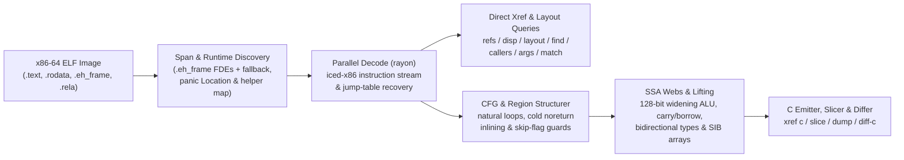

<!-- translation-source: 2d64e7f757b4814d816d65327e346208c9870ad3 -->

> [!NOTE]
> هذه ترجمة للتوثيق الإنجليزي الأصلي لـ [الإيداع 2d64e7f](https://github.com/alex09x/xref/blob/2d64e7f757b4814d816d65327e346208c9870ad3/README.md). النسخة القياسية والأحدث متاحة دائمًا بـ [اللغة الإنجليزية](https://github.com/alex09x/xref/blob/main/README.md).

<div dir="rtl">

<div align="center" dir="ltr">

[English](https://github.com/alex09x/xref/blob/main/README.md) | [Русский](https://github.com/alex09x/xref/blob/main/readme/README.ru.md) | [简体中文](https://github.com/alex09x/xref/blob/main/readme/README.zh-CN.md) | [Español](https://github.com/alex09x/xref/blob/main/readme/README.es.md) | [Português (Brasil)](https://github.com/alex09x/xref/blob/main/readme/README.pt-BR.md) | [日本語](https://github.com/alex09x/xref/blob/main/readme/README.ja.md) | [Deutsch](https://github.com/alex09x/xref/blob/main/readme/README.de.md) | [Français](https://github.com/alex09x/xref/blob/main/readme/README.fr.md) | [한국어](https://github.com/alex09x/xref/blob/main/readme/README.ko.md) | **[العربية](https://github.com/alex09x/xref/blob/main/readme/README.ar.md)**

<br/>


<br/><br/>

**مراجع متقاطعة فائقة السرعة، استعادة تخطيط البنى (structs)، تجزيء البرامج (slicing)، وشبه كود C مهيكل لملفات x86-64 ELF الثنائية.**

تحليل ثنائي بدون فهرسة مسبقة (zero-index) بلغة Rust الآمنة تمامًا (`#![forbid(unsafe_code)]`). تُستخرج حدود الدوال مباشرة من جداول تتبع المكدس `.eh_frame` (مع دعم بديل للنطاقات)، وتُفكك الاستعلامات عبر الملف الثنائي بالكامل عبر جميع أنوية المعالج في أجزاء من الثانية — حتى على ملفات Rust الثنائية المجردة تمامًا من الرموز (stripped) حيث تكون جداول الرموز فارغة.

<br/>

[**بيئة العمل التفاعلية (xrefcode.com)**](https://xrefcode.com) · بواسطة [Alexander Panasenko](https://prod.codes/about/)

<br/>

[](https://github.com/alex09x/xref/releases)
[](https://crates.io/crates/xref-code)
[](https://doi.org/10.5281/zenodo.23878789)
[](https://github.com/alex09x/xref/actions)
[](../LICENSE-MIT)
[](../Cargo.toml)
[](../Cargo.toml)

<br/>

[**لماذا**](#why) · [**التثبيت**](#installation) · [**البدء السريع**](#quick-start) · [**أمثلة مسجلة**](#recorded-examples) · [**دليل الأوامر**](#command-reference) · [**البنية المعمارية**](#architecture) · [**الأداء**](#recorded-performance) · [**القيود والمدى**](#scope--limitations) · [**الاقتباس**](#citation)

</div>

---

<a name="why"></a>
## لماذا

تفترض حزم الهندسة العكسية التقليدية وجود محلل تفاعلي واحد مستعد للانتظار لدقائق لاستيراد قاعدة بيانات البرنامج بالكامل قبل طرح السؤال الأول. وتزداد الأمور تعقيدًا مع ملفات Rust الثنائية المجردة من الرموز (stripped): فالرموز مفقودة، والسلاسل النصية عبارة عن شرائح `(ptr, len)` غير منتهية بقيمة صفرية في تجمعات `.rodata`، كما أن حالات الذعر الناتجة عن فحص الحدود (bounds-check panics) تفتت الحلقات التكرارية إلى مسارات باردة تحيل مخرجات أدوات فك الترجمة البسيطة إلى فوضى غير مقروءة من تعليمات `goto`.

تم بناء **XRef Code** (`xref`) للتحقيق التكراري السريع من قبل مهندسي الهندسة العكسية ووكلاء الذكاء الاصطناعي المستقلين على حد سواء:

- **صفر فهرسة، ولا تخزين مؤقت قديم.** تقوم كل عملية تشغيل بتعيين صورة ELF في الذاكرة، واستخراج نطاقات الدوال الدقيقة من سجلات `.eh_frame` (مع دعم تلقائي بديل للنطاقات)، ومسح الدوال بالتوازي عبر `rayon`.
- **شبه كود C أصلي ومُهيكل ومُحدد الأنواع (`xref c`).** يرفع كود آلة x86-64 مباشرة إلى كود C مقروء دون أدوات خارجية — مستعيدًا تواقيع المعاملات غير القابلة للتغيير `arg_0..arg_5`، وشبكات مدى حياة SSA (`ptr_*` و `v_*` و `slot_*`)، ومصفوفات مفهرسة بنمط SIB، وعمليات توسيع `128-بت` أحادية المعامل `mul`/`imul`/`div`/`idiv`، وسلاسل الحمل والاستعارة متعددة الدقة `adc`/`sbb`، وعمليات مدمجة لاكتشاف فيض العمليات الحسابية ذات الإشارة، وتراكيب التحكم المهيكلة `if`/`else`/`while`/`do-while`/`switch`.
- **استعادة مخصصة لملفات Rust الثنائية المجردة.** يتعرف على دوال بيئة تشغيل Rust المجردة (`rust_panic_bounds_check` و `rust_slice_index_fail` و `rust_capacity_overflow`)، ويستخرج نصوص `&str` الدقيقة كشرائح `(ptr, len)`، ويربط واصفات `core::panic::Location` (`الملف:السطر:العمود`) بمسارات الحزم البرمجية الأصلية، ويحل فروع جداول القفز لـ `Display`.
- **التجزيء والمقارنة عبر البناءات (`xref slice` و `xref match` و `xref diff-c`).** يعزل التعليمات المتوازنة وحراس التحكم المؤديين إلى استدعاء محدد أو عنوان تعليمة IP، ويعيد تحديد مواقع الدوال المجردة المنقولة بين البناءات المختلفة، ويقارن كود C المعياري المجرد من عناوين الذاكرة الست عشرية المتغيرة.

استكشف **114 تشغيلًا مسجلاً بالكامل دون تعديل** لأوامر CLI على ملف `xref` المجرد نفسه في بيئة العمل الثابتة للمتصفح عبر **[xrefcode.com](https://xrefcode.com)**.

---

<a name="installation"></a>
## التثبيت

### عبر Homebrew (لأجهزة macOS مع معالجات Apple Silicon ولينكس `x86_64`)

يثبت الملف الثنائي المترجم مسبقًا لـ `xref` مباشرة من مستودع [`alex09x/homebrew-apps`](https://github.com/alex09x/homebrew-apps) (دون البناء من المصدر باستخدام Cargo):

<div dir="ltr">

```bash
brew tap alex09x/apps
brew install xref
xref --version
```

</div>

### الأرشيفات المترجمة مسبقًا للإصدارات (لينكس `x86_64` و macOS `arm64`)

تتضمن الأرشيفات الجاهزة (`x86_64-unknown-linux-gnu`، التي تتطلب `glibc >= 2.34`، و `aarch64-apple-darwin`) كلاً من `xref` و `README.md` و `LICENSE-MIT` و `LICENSE-APACHE` و `CITATION.cff`:

<div dir="ltr">

```bash
curl -fsSLO https://github.com/alex09x/xref/releases/download/v0.1.0/xref-v0.1.0-x86_64-unknown-linux-gnu.tar.gz
curl -fsSLO https://github.com/alex09x/xref/releases/download/v0.1.0/xref-v0.1.0-x86_64-unknown-linux-gnu.tar.gz.sha256
sha256sum -c xref-v0.1.0-x86_64-unknown-linux-gnu.tar.gz.sha256
tar -xzf xref-v0.1.0-x86_64-unknown-linux-gnu.tar.gz
./xref --version
```

</div>

### عبر Cargo و `crates.io` (لينكس و macOS)

منشور على [`crates.io` باسم `xref-code`](https://crates.io/crates/xref-code)، ويثبت ملف CLI الثنائي `xref` (يتطلب `rustc 1.88+` لدعم سلاسل `let` في إصدار 2024؛ كما تعمل الثنائيات المترجمة مسبقًا عبر [`cargo-binstall`](https://github.com/cargo-bins/cargo-binstall)):

<div dir="ltr">

```bash
cargo install xref-code --locked
# or prebuilt via cargo-binstall:
cargo binstall xref-code -y
# or directly from the pinned release tag:
cargo install --git https://github.com/alex09x/xref --tag v0.1.0 --locked
```

</div>

---

<a name="quick-start"></a>
## البدء السريع

مرر المعامل `-b <ELF>` مع كل أمر أو عيّن المتغير `XREF_BIN=/path/to/binary.elf` مرة واحدة لكل جلسة لمفسّر الأوامر (shell). تستخدم العناوين الترقيم الافتراضي لـ ELF (عناوين `objdump`) بصيغة ست عشرية تبدأ بـ `0x` أو بالصيغة العشرية:

<div dir="ltr">

```bash
export XREF_BIN=./xref.stripped

xref stats                                      # function count, .text bytes, pointers, panic locations
xref refs "goto L_"                             # code & data references to strings or addresses (--inline)
xref where src/loops.rs                         # stripped function ranges compiled from a Rust source file
xref layout 0xa2270 --reg rsi --callees         # recover struct field offsets, sizes, strides & 1-hop callees
xref c 0x9a8a0 --fields                         # structured typed pseudo-C with inferred ->f_<off> hints
xref slice 0xc7d60 --to fn_160bb0               # backward slice of statements & guards reaching a target
```

</div>

---

<a name="recorded-examples"></a>
## أمثلة مسجلة

جميع المخرجات أدناه عبارة عن تشغيلات حقيقية كاملة وغير معدلة سُجلت من `xref.stripped` (`1,962,608` بايت، و `0` رموز، و `sha256:3f3ba3b311f3eca8e26a929285d4fc9ffef4e4b6e8fc015105766180a2a6869d`) وتم التحقق منها في CI لتطابق `docs/recorded-data.js` سطرًا بسطر (باستثناء المسافات البيضاء في نهايات الأسطر).

### 1. شبه كود C مهيكل ومحدد الأنواع مع تلميحات إزاحة الحقول (`xref c --fields`)

<div dir="ltr">

```c
$ xref -b xref.stripped c 0x9a8a0 --fields
/* field offsets: arg_0 [+0x0:u64, +0x8:u64, +0x10:u64, +0x18:u64] */
/*
 * fn_9a8a0 — 0x9a8a0..0x9a97a (218 bytes, 1 direct caller; synthetic FDE entry)
 *   source: src/cfg.rs:154:22, src/cfg.rs:75:25, src/cfg.rs:154:57
 *   params:
 *     arg_0 (rdi): const void * — reads +0x0 (8B), +0x8 (8B), +0x10 (8B), +0x18 (8B)
 *     arg_1 (rsi): unk64 — 64-bit register (signedness unconstrained)
 *     arg_2 (rdx): unk64 — 64-bit register (signedness unconstrained)
 *   return: u8 in rax (consumed by 1/1 direct call site)
 */
u8 fn_9a8a0(const void *arg_0, unk64 arg_1, unk64 arg_2) {
  usize v_1 = arg_1; /* rsi */
  u64 v_6; /* rbx */
  const u8 *ptr_9; /* rax */
  unk64 slot_0; /* [rsp+0x0], addr-taken */
  unk64 slot_8; /* [rsp+0x8] */

  if (v_1 == 0) {
    ptr_9 = 0;
    return ptr_9;
  }
  u64 v_2 = arg_0->f_8;
  if (v_1 >= v_2) {
    usize v_12 = v_1;
    /* [runtime] rust_panic_bounds_check(index, len, loc) -> noreturn */
    rust_panic_bounds_check(v_12, v_2, "src/cfg.rs:154:22");
  }
  if (((u64 *)arg_0->f_0)[v_1] != 1) {
    ptr_9 = 0;
    return ptr_9;
  }
  const void *ptr_3 = arg_0->f_18;
  unk64 v_4 = *(u64 *)(arg_0->f_10);
  if (v_1 == v_4 + 2) {
    usize v_5 = (v_4 + 1);
    v_6 = *(u64 *)(ptr_3 + 16);
    if (v_5 >= v_6) {
      /* [runtime] rust_panic_bounds_check(index, len, loc) -> noreturn */
      rust_panic_bounds_check(v_5, v_6, "src/cfg.rs:154:57");
    }
    usize v_7 = v_1;
    unk64 v_8 = ((v_5 * 96) + *(u64 *)(ptr_3 + 8));
    slot_8 = arg_2;
    slot_0 = 1;
    /* fn_fb8e0: calls fn_fb9c6, fn_fb920 */
    ptr_9 = fn_fb8e0(v_8, &slot_0);
    u32 v_10 = ptr_9;
    ptr_9 = 1;
    v_1 = v_7;
    if (v_10 != 0) {
      return ptr_9;
    }
  } else {
    v_6 = *(u64 *)(ptr_3 + 16);
  }
  usize v_11 = (v_1 - 1);
  if (v_11 < v_6) {
    ptr_9 = *(u64 *)(ptr_3 + 8);
    ptr_9 = (((u8 *)ptr_9)[(v_11 * 96)] & 5) != 0;
    return ptr_9;
  }
  usize v_13 = v_11;
  /* [runtime] rust_panic_bounds_check(index, len, loc) -> noreturn */
  rust_panic_bounds_check(v_13, v_6, "src/cfg.rs:75:25");
}
```

</div>

### 2. استعادة تخطيط البنى عبر الإجراءات (`xref layout --callees`)

<div dir="ltr">

```text
$ xref -b xref.stripped layout 0xa2270 --reg rsi --callees
layout of rsi in 0xa2270..0xa2566:
  +0       size  4  u32   r:0  w:2
  +8       size  8  u64   r:2  w:0
  +10      size  8  u64   r:2  w:0
  +20      size  8  u64   r:1  w:0
  +28      size  8  u64   r:1  w:0
5 fields (min span 0x30)
other pointer args: rdi (3 fields), rdx (1 fields)  (use --reg <REG>)
```

</div>

### 3. تجزيء البرامج العكسي (`xref slice`)

<div dir="ltr">

```c
$ xref -b xref.stripped slice 0xc7d60 --to fn_160bb0
/* slice of 0xc7d60..0xc7fbf -> fn_160bb0 (37/131 lines) */
void fn_c7d60(void *arg_0, const void *arg_1, usize arg_2) {
  u8 slot_28; /* [rsp+0x28], addr-taken */
  usize slot_30; /* [rsp+0x30] */
  unk64 slot_40; /* [rsp+0x40], addr-taken */
  if (arg_2 == 0) {
    return; /* callers ignore rax */
  }
  const void *ptr_1 = arg_1;
  const void *v_2 = arg_1 + arg_2 * 24;
  void *v_4 = &slot_40;
  do {
    const u8 *ptr_6 = *(u64 *)(ptr_1 + 8);
    usize v_7 = *(u64 *)(ptr_1 + 16);
    /* fn_160550: source core/src/str/pattern.rs:1398; calls fn_1606e0, fn_160a43, fn_1605f8 */
    fn_160550(v_4, ptr_6, v_7, "goto L_", 7);
    /* fn_124d50: source core/src/str/pattern.rs:1131; calls fn_124e3a, fn_160bb0, fn_124e29 */
    fn_124d50(&slot_28, v_4);
    if (slot_28 != 0) {
      usize v_8 = slot_30;
      usize v_9 = (v_8 + 7);
      if (v_9 != 0) {
        if (v_9 < v_7) {
          if ((i64)((u8 *)ptr_6)[v_9] < 192) {
            /* fn_160bb0: noreturn; source core/src/str/mod.rs:486; calls fn_160bc0 */
            fn_160bb0(ptr_6, v_7, v_9, v_7, "src/loops.rs:45:36");
          }
        } else {
          if (v_9 != v_7) {
            /* fn_160bb0: noreturn; source core/src/str/mod.rs:486; calls fn_160bc0 */
            fn_160bb0(ptr_6, v_7, v_9, v_7, "src/loops.rs:45:36");
          }
        }
      }
    }
    ptr_1 = (ptr_1 + 24);
  } while (ptr_1 != v_2);
}
```

</div>

### 4. نقل العناوين عبر البناءات وفروقات كود C المعياري (`xref diff-c`)

السطور المزاحة بمسافة `  ...` أدناه صادرة مباشرة من أمر `xref diff-c` لتمييز الأسطر المعيارية غير المتغيرة خارج مقطع الفروقات:

<div dir="ltr">

```diff
$ xref -b xref.stripped diff-c --other xref-v0.0.2.stripped 0xd57c0
=== diff 0xd57c0..0xd6301 (current) vs 0xd5530..0xd6071 (other, score 384: locs:240 strs:0 imms:4 disps:10 nbrs:105 size:0xb41 callees:8) ===
  ...
      }
      @var_11 = (@slot_10 + @var_8);
-     @var_1 = 0xc2bc;
+     @var_1 = 0xc518;
      @var_32 = @slot_9;
      switch (*(u64 *)(@var_11)) {
  ...
```

</div>

---

<a name="command-reference"></a>
## دليل الأوامر

تشرح [الخيارات المتقدمة](https://github.com/alex09x/xref/blob/main/docs/advanced-options.md) البحث عن إزاحات المكدس ووضع الإخراج الذي يحتفظ بتسميات القفز.

تتيح [الاستعلامات المهيكلة وMCP المحلي](https://github.com/alex09x/xref/blob/main/docs/mcp.md) الوصول البرمجي إلى نواة التحليل نفسها.

### الجرد والرموز والمراجع المتقاطعة

<div dir="ltr">

```text
xref -b BIN stats                                    # functions, .text bytes, pointers, imports, panic locations
xref -b BIN sym PATTERN                              # symbol search (non-stripped binaries)
xref -b BIN func 0xa1b50                             # function span containing an address
xref -b BIN refs "goto L_" 0xa1b50                   # .rodata / pointer / code xrefs (--inline for mov/movabs stores)
xref -b BIN istr "text"                              # shorthand for refs --inline
xref -b BIN imm 24 --in 0xa1b50                      # immediate constants (--store, --cmp, --in FN)
xref -b BIN find --src src/loops.rs --calls 0x160bb0 # single-pass multi-predicate function search (--any K)
```

</div>

### تخطيط البنى والإزاحات ومخططات الاستدعاء

<div dir="ltr">

```text
xref -b BIN disp 0x20 0x28 --all                     # field loads/stores/leas (--write, --lea, --stride, --in FN)
xref -b BIN layout 0xa2270 --reg rsi --callees       # aggregate field offsets, widths, strides & 1-hop callees
xref -b BIN callers 0xcafb0                          # direct calls/tail-jumps, address-taken & pointer-table xrefs
xref -b BIN calls 0xcafb0                            # outgoing calls and tail-jumps in instruction order
xref -b BIN args 0xa2270 --max 20                    # constant & symbolic arguments across all call sites
xref -b BIN path 0xc7fc0 0x160bb0 --depth 8          # shortest call chains between two functions
xref -b BIN tree 0xd0aa0 --callers --depth 2         # indented caller/callee tree with panic source anchors
```

</div>

### التفكيك، وشبه كود C، والتجزيء، وتصدير الحزم، والمقارنة

<div dir="ltr">

```text
xref -b BIN asm 0xc7d60 --from A --to B              # annotated Intel disassembly (strings, slots, targets)
xref -b BIN c 0x9a8a0 --fields                       # structured typed pseudo-C (--out DIR for parallel batch export)
xref -b BIN slice 0xc7d60 --to fn_160bb0 --fields    # backward slice to target call, hex IP, offset, or string
xref -b BIN dump --out DIR --src src/loops.rs        # parallel modular .c export grouped by panic source paths
xref -b BIN match --other OLD_BIN 0xc7d60 --top 3    # relocate shifted stripped functions across two builds
xref -b BIN diff-c --other OLD_BIN 0xd57c0           # normalized cross-build pseudo-C LCS diff
```

</div>

### مواقع مصادر Rust وجداول قفز التعدادات (Enums)

<div dir="ltr">

```text
xref -b BIN src 0x9a8a0                              # core::panic::Location (file:line:col) descriptors in function
xref -b BIN where src/image.rs --line 46             # stripped functions referencing a Rust file (and line)
xref -b BIN files src/                               # distinct Rust source files recovered from panic descriptors
xref -b BIN error "invalid"                          # jump-table discriminant whose Display arm names text
xref -b BIN variant 0xc7fc0 1 2                      # inverse of error: texts referenced by jump-table arms
xref -b BIN arm 0xc8010                              # jump-table indices whose arm contains an address
```

</div>

---

<a name="architecture"></a>
## البنية المعمارية

<div dir="ltr">



</div>

---

<a name="recorded-performance"></a>
## الأداء المسجل

أوقات التنفيذ الفعلية لأوامر CLI كما سجلتها أداة `xref 0.0.5` (عبر `stderr`) على معالج `AMD Ryzen 9 9950X` (بـ 16 نواة / 32 خيط معالجة، على Linux 6.8 `x86_64`، مع ذاكرة تخزين مؤقت دافئة لصفحات نظام التشغيل) أثناء تحليل الملف الثنائي المجرد `xref.stripped` بحجم (`1.96 MB`، و `1,974` دالة، و `0` رموز):

| العملية | الأمر | تحميل ELF | الوقت الإجمالي |
|---|---|---:|---:|
| جرد الملف الثنائي (`1,974` دالة، `588` موقع ذعر) | `xref -b xref.stripped stats` | `0.84 ms` | **`2.2 ms`** |
| مسح المراجع المتقاطعة للنصوص والمؤشرات عبر كامل الملف الثنائي | `xref -b xref.stripped refs "goto L_"` | `0.80 ms` | **`3.9 ms`** |
| مطابقة وحدات Rust من مواقع الذعر المضمنة | `xref -b xref.stripped where src/loops.rs` | `0.79 ms` | **`3.4 ms`** |
| استعادة تخطيط البنى عبر الإجراءات (دوال من المستوى الأول) | `xref -b xref.stripped layout 0xa2270 --reg rsi --callees` | `0.81 ms` | **`2.6 ms`** |
| تجزيء البرنامج العكسي + تلميحات إزاحة الحقول (`37 / 131` سطرًا) | `xref -b xref.stripped slice 0xc7d60 --to fn_160bb0 --fields` | `0.81 ms` | **`5.1 ms`** |
| مطابقة الدوال عبر البناءات ومقارنة كود C المعياري | `xref -b xref.stripped diff-c --other xref-v0.0.2.stripped 0xc7d60` | `0.86 ms` | **`13.4 ms`** |

---

<a name="scope--limitations"></a>
## النطاق والقيود

- **صيغ المدخلات المدعومة:** ملفات `x86-64` ELF الثنائية والكائنات المشتركة (`ET_EXEC` و `ET_DYN`). صيغ PE/Mach-O ومعمارية AArch64 خارج النطاق الحالي.
- **تحديد حدود الدوال:** تُستخرج نطاقات الدوال الدقيقة من جداول تتبع المكدس `.eh_frame` (المولدة افتراضيًا بواسطة `rustc` و `clang` و `gcc` على معماريات `x86-64` حتى بعد تنفيذ `strip --strip-all`)، مع الرجوع التلقائي إلى الفجوات وعناوين أهداف الاستدعاء عند غياب سجلات التتبع. وتعتمد الملفات الثنائية التي حُذفت منها سجلات `.eh_frame` تمامًا (`strip -R .eh_frame`) على حدود النطاقات الاستدلالية.
- **شبه كود C الثابت واستنتاج الإزاحات:** تمثل تواقيع المعاملات (`arg_*`)، والأنواع المستنتجة للمؤشرات والأعداد الصحيحة (`const void *` و `usize` و `unk64` وغيرها)، وتلميحات إزاحة الحقول مع المعامل `--fields` (`->f_<off>`) عمليات إعادة بناء استاتيكية متحفظة مشتقة من استخدامات كود الآلة، وليست أنواع DWARF الأصلية المصدرية. كما يُحتفظ بتعليمات SIMD وتعليمات النظام غير المنمذجة بشكل صريح كتعليقات تجميعية `/* 0xaddr: ... */` مدمجة بدلاً من إسقاطها بصمت — تحقق دائمًا من الفرضيات الأساسية عبر `xref asm`.

---

<a name="development--testing"></a>
## التطوير والاختبار

يجب أن يكون `rustc` متاحًا في متغير البيئة `PATH` عند تشغيل الاختبارات: تقوم حزمة الاختبارات الشاملة (end-to-end) بترجمة `tests/fixtures/sample.rs` إلى ملف ELF تجريبي مؤقت وتتحقق من صحة أوامر CLI الفرعية عليه.

<div dir="ltr">

```bash
cargo fmt --all -- --check
cargo clippy --workspace --all-targets --locked -- -D warnings
cargo test --workspace --locked
```

</div>

---

<a name="citation"></a>
## الاقتباس

للاستشهاد الأكاديمي، أو في تقارير الأمان، أو في الأرشفة، يُرجى الاستشهاد بإصدار `v0.1.0` المنشور عبر Zenodo أو عبر ملف [`CITATION.cff`](../CITATION.cff):

<div dir="ltr">

```bibtex
@software{panasenko_2026_23878790,
  author       = {Panasenko, Alexander},
  title        = {XRef Code — Ultra Blazing Fast x86-64 ELF Cross-References \& Pseudo-C Decompiler},
  month        = nov,
  year         = 2026,
  publisher    = {Zenodo},
  version      = {0.1.0},
  doi          = {10.5281/zenodo.23878790},
  url          = {https://doi.org/10.5281/zenodo.23878790}
}
```

</div>

- Alexander Panasenko (2026). *XRef Code — Ultra Blazing Fast x86-64 ELF Cross-References & Pseudo-C Decompiler* (v0.1.0). Zenodo. https://doi.org/10.5281/zenodo.23878790 ([معرّف DOI الجامع لجميع الإصدارات: 10.5281/zenodo.23878789](https://doi.org/10.5281/zenodo.23878789))

---

<a name="license"></a>
## الترخيص

حقوق النشر © 2026 [Alexander Panasenko](https://prod.codes/about/) (`alex@prod.codes`).

مرخص بترخيص مزدوج تحت أي من:
- **رخصة أباتشي، الإصدار 2.0** ([`LICENSE-APACHE`](../LICENSE-APACHE) أو http://www.apache.org/licenses/LICENSE-2.0)
- **رخصة MIT** ([`LICENSE-MIT`](../LICENSE-MIT) أو http://opensource.org/licenses/MIT)

حسب اختيارك.

</div>
