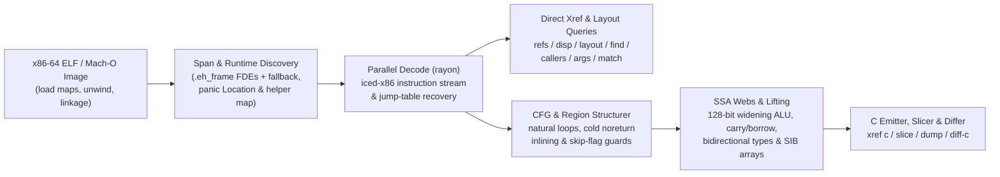

<!-- translation-source: 5718cdf5b751d7fc5551ccf5c44f95c9123915df -->

> [!NOTE]
> Dies ist eine Übersetzung der englischen Originaldokumentation für [Commit 5718cdf](https://github.com/alex09x/xref/blob/5718cdf5b751d7fc5551ccf5c44f95c9123915df/README.md). Die kanonische und aktuellste Version ist stets auf [Englisch](https://github.com/alex09x/xref/blob/main/README.md) verfügbar.

<div align="center">

[English](https://github.com/alex09x/xref/blob/main/README.md) | [Русский](https://github.com/alex09x/xref/blob/main/readme/README.ru.md) | [简体中文](https://github.com/alex09x/xref/blob/main/readme/README.zh-CN.md) | [Español](https://github.com/alex09x/xref/blob/main/readme/README.es.md) | [Português (Brasil)](https://github.com/alex09x/xref/blob/main/readme/README.pt-BR.md) | [日本語](https://github.com/alex09x/xref/blob/main/readme/README.ja.md) | **[Deutsch](https://github.com/alex09x/xref/blob/main/readme/README.de.md)** | [Français](https://github.com/alex09x/xref/blob/main/readme/README.fr.md) | [한국어](https://github.com/alex09x/xref/blob/main/readme/README.ko.md) | [العربية](https://github.com/alex09x/xref/blob/main/readme/README.ar.md)

<br/>


<br/><br/>

**Ultraschnelle Querverweise, Rekonstruktion von Struct-Layouts, Program-Slicing und strukturierter Pseudo-C-Code für x86-64-ELF / Mach-O-Binärdateien.**

Binäranalyse ohne Vorindizierung in reinem, sicherem Rust (`#![forbid(unsafe_code)]`). Funktionsgrenzen stammen direkt aus `.eh_frame`-Unwind-Tabellen (mit heuristischem Fallback) und binärweite Abfragen dekodieren über alle CPU-Kerne in Millisekunden — selbst bei vollständig gestrippten Rust-Release-Binärdateien ohne Symboltabellen.

<br/>

[**Interaktive Workbench (xrefcode.com)**](https://xrefcode.com) · Von [Alexander Panasenko](https://prod.codes/about/)

<br/>

[](https://github.com/alex09x/xref/releases)
[](https://crates.io/crates/xref-code)
[](https://doi.org/10.5281/zenodo.23878789)
[](https://github.com/alex09x/xref/actions)
[](../LICENSE-MIT)
[](../Cargo.toml)
[](../Cargo.toml)

<br/>

[**Warum**](#why) · [**Installation**](#installation) · [**Schnellstart**](#quick-start) · [**Aufgezeichnete Beispiele**](#recorded-examples) · [**CLI-Referenz**](#command-reference) · [**Architektur**](#architecture) · [**Performance**](#recorded-performance) · [**Einschränkungen**](#scope--limitations) · [**Zitierung**](#citation)

</div>

---

<a name="why"></a>
## Warum

Klassische Reverse-Engineering-Suites setzen einen interaktiven Analysten voraus, der bereit ist, vor der ersten Frage minutenlang auf den vorab durchgeführten Import der gesamten Binärdatei in eine Datenbank zu warten. Bei gestrippten Rust-Binärdateien verschärft sich das Problem: Symbole fehlen, Zeichenketten sind nicht nullterminierte `(ptr, len)`-Slices in `.rodata`-Pools, und Bounds-Check-Panics zerlegen Schleifen in kalte Pfade, die einfache Decompiler in unleserliches `goto`-Spaghetti verwandeln.

**XRef** (`xref`) wurde für die schnelle iterative Analyse sowohl durch Reverse Engineers als auch durch autonome KI-Agenten entwickelt:

- **Ohne vorab angelegten Index und ohne veraltete Caches.** Jeder Aufruf mappt das ELF-Abbild im Arbeitsspeicher, extrahiert exakte Funktionsbereiche aus `.eh_frame`-Unwind-Datensätzen (mit automatischem Intervall-Fallback) und durchsucht Funktionen parallel via `rayon`.
- **Live-Analyse:** Nur Linux x86-64, eine Zielbinärdatei pro Sitzung. Schreiber und Aufrufer in Shared Libraries werden als außerhalb der Zielbinärdatei liegend gemeldet (ohne statische Funktion oder geschriebenen Wert). `probe` und `watch` erfordern privilegierten perf-Zugriff und fügen Traps in den beobachteten Prozess ein.
- **Natives strukturiertes, typisiertes Pseudo-C (`xref c`).** Hebt x86-64-Maschinencode direkt und ohne externe Tools in lesbares C an — inklusive unveränderlicher `arg_0..arg_5`-Signaturen, SSA-Lebensdauer-Netzen (`ptr_*`, `v_*`, `slot_*`), elementindizierter SIB-Arrays, 1-Operand-`128-Bit`-Erweiterungen bei `mul`/`imul`/`div`/`idiv`, mehrgliedriger `adc`/`sbb`-Übertragsketten, Überlauf-Intrinsics für vorzeichenbehaftete Arithmetik sowie strukturierter `if`/`else`/`while`/`do-while`/`switch`-Blöcke.
- **Rust-spezifische Rekonstruktion gestrippter Binärdateien.** Erkennt Laufzeit-Helfer gestrippter Rust-Programme (`rust_panic_bounds_check`, `rust_slice_index_fail`, `rust_capacity_overflow`), schneidet exakte `(ptr, len)`-`&str`-Literale aus, ordnet `core::panic::Location`-Deskriptoren (`datei:zeile:spalte`) den ursprünglichen Crate-Pfaden zu und löst `Display`-Sprungtabellenzweige auf.
- **Slicing & binärübergreifendes Diffing (`xref slice`, `xref match`, `xref diff-c`).** Isoliert balancierte Anweisungen und Kontrollbedingungen, die einen bestimmten Aufruf oder Befehls-IP erreichen, findet verschobene gestrippte Funktionen zwischen Builds wieder und vergleicht normalisiertes Pseudo-C unter Abstraktion volatiler Hex-Adressen.
- **Live-Linux-Prozessinspektion (`xref live`).** Verbindet die statische Analyse mit einem laufenden Linux-x86-64-Prozess: findet Werte im Speicher, löst Laufzeitzeiger zu statischen Funktionen auf, zählt Aufrufe und Aufrufer mit begrenzten Uprobes und benennt die schreibende Instruktion.

Erkunden Sie **114 unveränderte, aufgezeichnete CLI-Durchläufe** an der gestrippten `xref`-Binärdatei selbst in der statischen Browser-Workbench unter **[xrefcode.com](https://xrefcode.com)**.

---

<a name="installation"></a>
## Installation

### Homebrew (macOS Apple Silicon & Linux `x86_64`)

Installiert die vorkompilierte `xref`-Binärdatei direkt aus dem [`alex09x/homebrew-apps`](https://github.com/alex09x/homebrew-apps)-Tap (keine Cargo-Kompilierung erforderlich):

```bash
brew tap alex09x/apps
brew install xref
xref --version
```

### Vorkompilierte Release-Archive (Linux `x86_64` & macOS `arm64`)

Vorkompilierte Archive (`x86_64-unknown-linux-gnu`, setzt `glibc >= 2.34` voraus, und `aarch64-apple-darwin`) bündeln `xref`, `README.md`, `LICENSE-MIT`, `LICENSE-APACHE` und `CITATION.cff`:

```bash
curl -fsSLO https://github.com/alex09x/xref/releases/download/v0.4.0/xref-v0.4.0-x86_64-unknown-linux-gnu.tar.gz
curl -fsSLO https://github.com/alex09x/xref/releases/download/v0.4.0/xref-v0.4.0-x86_64-unknown-linux-gnu.tar.gz.sha256
sha256sum -c xref-v0.4.0-x86_64-unknown-linux-gnu.tar.gz.sha256
tar -xzf xref-v0.4.0-x86_64-unknown-linux-gnu.tar.gz
./xref --version
```

### Cargo & `crates.io` (Linux & macOS)

Veröffentlicht auf [`crates.io` als `xref-code`](https://crates.io/crates/xref-code), was das CLI-Programm `xref` installiert (erfordert `rustc 1.88+` für Edition 2024 `let`-Chains; vorkompilierte Binärdateien funktionieren auch via [`cargo-binstall`](https://github.com/cargo-bins/cargo-binstall)):

```bash
cargo install xref-code --locked
# or prebuilt via cargo-binstall:
cargo binstall xref-code -y
# or directly from the pinned release tag:
cargo install --git https://github.com/alex09x/xref --tag v0.4.0 --locked
```

---

<a name="quick-start"></a>
## Schnellstart

Übergeben Sie `-b <BINARY>` bei jedem Befehl oder setzen Sie `XREF_BIN=/path/to/binary` pro Shell-Sitzung. Adressen sind statische Image-VAs in `0x`-Hexadezimal- oder Dezimalschreibweise; die Mach-O-RVA-Basis ist `__TEXT.vmaddr`.

```bash
export XREF_BIN=./xref.stripped

xref stats                                      # function count, .text bytes, pointers, panic locations
xref refs "goto L_"                             # code & data references to strings or addresses (--inline)
xref where src/loops.rs                         # stripped function ranges compiled from a Rust source file
xref layout 0xa2270 --reg rsi --callees         # recover struct field offsets, sizes, strides & 1-hop callees
xref c 0x9a8a0 --fields                         # structured typed pseudo-C with inferred ->f_<off> hints
xref c 0x9a8a0 --only-paths-to 0x9a950          # pseudo-C containing only basic blocks that reach ADDR
xref slice 0xc7d60 --to fn_160bb0               # backward slice of statements & guards reaching a target
xref query '{"operation":"info"}'              # versioned JSON for one immutable image
xref mcp                                       # local read-only stdio MCP server
```

---

<a name="live-analysis-linux-x86-64"></a>
## Live-Prozessanalyse (Linux x86-64)

Ab v0.3.0 verbindet `xref live` einen laufenden Linux-x86-64-Prozess mit der statischen Analyse seiner verifizierten Binärdatei. Übergeben Sie dieselbe ELF-Datei mit `-b`; xref prüft diese vor jeder Adressauflösung gegen `/proc/<pid>/exe` (GNU build-id oder SHA-256).

```bash
xref -b ./app live maps --pid PID                        # mappings, binary match, PIE slide
xref -b ./app live memscan --pid PID 0x4441454d4f4e5632  # find u64 values; classify neighbouring words
xref -b ./app live resolve --pid PID 0x55d1c0ffc9d0      # runtime address -> static VA, function, file offset
sudo xref -b ./app live probe --pid PID --callers 0x1f9f0       # bounded uprobe hit counts, callers, registers
sudo xref -b ./app live watch --pid PID 0x55d1e1c3adc8          # DR0-DR3 write watch: writer instruction and value
sudo xref -b ./app live trace --pid PID --start 0x1f9f0 --stop-return 0x1f9f0 --callees-of 0x1f9f0 # ordered per-thread call windows
xref -b ./app mcp --allow-live-pid PID                   # opt-in xref_live MCP tool pinned to one process
```

- `maps`, `resolve` und `memscan` lesen ausschließlich `/proc/<pid>/maps` und `/proc/<pid>/mem` (ptrace-Zugriff auf das Ziel ist erforderlich; der Prozess wird nicht angehalten).
- `probe` und `watch` öffnen perf-Events auf dem Ziel und erfordern privilegierten perf-Zugriff (root oder `CAP_PERFMON`). Jeder Treffer erzeugt einen Trap im Zielprozess; halten Sie Beobachtungsfenster bei ausgelasteten Prozessen kurz.
- Die Ergebnisse unterscheiden Beobachtung von Inferenz: Ein Zähler von null gilt nur für das angegebene Zeitfenster und die erfassten Threads, gemeldete Schreiber sind Kandidaten mit explizitem Konfidenzwert, und verworfene Events oder spät verbundene Threads machen Zähler zu einer unteren Schranke.

Schrittweise aufgezeichnete Sitzung (Speichersuche → statische Funktion → Aufrufzähler → Feldschreiber → Pufferverschiebung): **[Live-Analyse-Leitfaden (Live Analysis walkthrough)](https://xrefcode.com/live-walkthrough)**. Vertrag und Grenzen: [docs/live.md](https://github.com/alex09x/xref/blob/main/docs/live.md); MCP: [docs/mcp.md](https://github.com/alex09x/xref/blob/main/docs/mcp.md).

---

<a name="recorded-examples"></a>
## Aufgezeichnete Beispiele

Alle nachfolgenden Ausgaben sind vollständige, ungekürzte Durchläufe gegen `xref.stripped` (`1.962.608` Bytes, `0` Symbole, `sha256:3f3ba3b311f3eca8e26a929285d4fc9ffef4e4b6e8fc015105766180a2a6869d`), die in CI zeilengetreu mit `docs/recorded-data.js` (abgesehen von nachgestellten Leerzeichen am Zeilenende) abgeglichen werden.

### 1. Strukturierter, typisierter Pseudo-C-Code mit Feld-Offset-Hinweisen (`xref c --fields`)

```c
$ xref -b xref.stripped c 0x9a8a0 --fields
/* field offsets: arg_0 [+0x0:u64, +0x8:u64, +0x10:u64, +0x18:u64] */
/*
 * fn_9a8a0 — 0x9a8a0..0x9a97a (218 bytes, 1 direct caller; synthetic FDE entry)
 *   source: src/cfg.rs:154:22, src/cfg.rs:75:25, src/cfg.rs:154:57
 *   params:
 *     arg_0 (rdi): const void * — reads +0x0 (8B), +0x8 (8B), +0x10 (8B), +0x18 (8B)
 *     arg_1 (rsi): unk64 — 64-bit register (signedness unconstrained)
 *     arg_2 (rdx): unk64 — 64-bit register (signedness unconstrained)
 *   return: u8 in rax (consumed by 1/1 direct call site)
 */
u8 fn_9a8a0(const void *arg_0, unk64 arg_1, unk64 arg_2) {
  usize v_1 = arg_1; /* rsi */
  u64 v_6; /* rbx */
  const u8 *ptr_9; /* rax */
  unk64 slot_0; /* [rsp+0x0], addr-taken */
  unk64 slot_8; /* [rsp+0x8] */

  if (v_1 == 0) {
    ptr_9 = 0;
    return ptr_9;
  }
  u64 v_2 = arg_0->f_8;
  if (v_1 >= v_2) {
    usize v_12 = v_1;
    /* [runtime] rust_panic_bounds_check(index, len, loc) -> noreturn */
    rust_panic_bounds_check(v_12, v_2, "src/cfg.rs:154:22");
  }
  if (((u64 *)arg_0->f_0)[v_1] != 1) {
    ptr_9 = 0;
    return ptr_9;
  }
  const void *ptr_3 = arg_0->f_18;
  unk64 v_4 = *(u64 *)(arg_0->f_10);
  if (v_1 == v_4 + 2) {
    usize v_5 = (v_4 + 1);
    v_6 = *(u64 *)(ptr_3 + 16);
    if (v_5 >= v_6) {
      /* [runtime] rust_panic_bounds_check(index, len, loc) -> noreturn */
      rust_panic_bounds_check(v_5, v_6, "src/cfg.rs:154:57");
    }
    usize v_7 = v_1;
    unk64 v_8 = ((v_5 * 96) + *(u64 *)(ptr_3 + 8));
    slot_8 = arg_2;
    slot_0 = 1;
    /* fn_fb8e0: calls fn_fb9c6, fn_fb920 */
    ptr_9 = fn_fb8e0(v_8, &slot_0);
    u32 v_10 = ptr_9;
    ptr_9 = 1;
    v_1 = v_7;
    if (v_10 != 0) {
      return ptr_9;
    }
  } else {
    v_6 = *(u64 *)(ptr_3 + 16);
  }
  usize v_11 = (v_1 - 1);
  if (v_11 < v_6) {
    ptr_9 = *(u64 *)(ptr_3 + 8);
    ptr_9 = (((u8 *)ptr_9)[(v_11 * 96)] & 5) != 0;
    return ptr_9;
  }
  usize v_13 = v_11;
  /* [runtime] rust_panic_bounds_check(index, len, loc) -> noreturn */
  rust_panic_bounds_check(v_13, v_6, "src/cfg.rs:75:25");
}
```

### 2. Interprozedurale Struct-Layout-Rekonstruktion (`xref layout --callees`)

```text
$ xref -b xref.stripped layout 0xa2270 --reg rsi --callees
layout of rsi in 0xa2270..0xa2566:
  +0       size  4  u32   r:0  w:2
  +8       size  8  u64   r:2  w:0
  +10      size  8  u64   r:2  w:0
  +20      size  8  u64   r:1  w:0
  +28      size  8  u64   r:1  w:0
5 fields (min span 0x30)
other pointer args: rdi (3 fields), rdx (1 fields)  (use --reg <REG>)
```

### 3. Rückwärts gerichtetes Program-Slicing (`xref slice`)

```c
$ xref -b xref.stripped slice 0xc7d60 --to fn_160bb0
/* slice of 0xc7d60..0xc7fbf -> fn_160bb0 (37/131 lines) */
void fn_c7d60(void *arg_0, const void *arg_1, usize arg_2) {
  u8 slot_28; /* [rsp+0x28], addr-taken */
  usize slot_30; /* [rsp+0x30] */
  unk64 slot_40; /* [rsp+0x40], addr-taken */
  if (arg_2 == 0) {
    return; /* callers ignore rax */
  }
  const void *ptr_1 = arg_1;
  const void *v_2 = arg_1 + arg_2 * 24;
  void *v_4 = &slot_40;
  do {
    const u8 *ptr_6 = *(u64 *)(ptr_1 + 8);
    usize v_7 = *(u64 *)(ptr_1 + 16);
    /* fn_160550: source core/src/str/pattern.rs:1398; calls fn_1606e0, fn_160a43, fn_1605f8 */
    fn_160550(v_4, ptr_6, v_7, "goto L_", 7);
    /* fn_124d50: source core/src/str/pattern.rs:1131; calls fn_124e3a, fn_160bb0, fn_124e29 */
    fn_124d50(&slot_28, v_4);
    if (slot_28 != 0) {
      usize v_8 = slot_30;
      usize v_9 = (v_8 + 7);
      if (v_9 != 0) {
        if (v_9 < v_7) {
          if ((i8)((u8 *)ptr_6)[v_9] < -64) {
            /* fn_160bb0: noreturn; source core/src/str/mod.rs:486; calls fn_160bc0 */
            fn_160bb0(ptr_6, v_7, v_9, v_7, "src/loops.rs:45:36");
          }
        } else {
          if (v_9 != v_7) {
            /* fn_160bb0: noreturn; source core/src/str/mod.rs:486; calls fn_160bc0 */
            fn_160bb0(ptr_6, v_7, v_9, v_7, "src/loops.rs:45:36");
          }
        }
      }
    }
    ptr_1 = (ptr_1 + 24);
  } while (ptr_1 != v_2);
}
```

### 4. Build-übergreifende Relokation & Diff von normalisiertem Pseudo-C (`xref diff-c`)

Die nachfolgend eingerückten `  ...`-Zeilen werden direkt von `xref diff-c` ausgegeben, um unveränderte normalisierte Zeilen außerhalb des Diff-Hunks zu markieren:

```diff
$ xref -b xref.stripped diff-c --other xref-v0.0.2.stripped 0xd57c0
=== diff 0xd57c0..0xd6301 (current) vs 0xd5530..0xd6071 (other, score 384: locs:240 strs:0 imms:4 disps:10 nbrs:105 size:0xb41 callees:8) ===
  ...
      }
      @var_11 = (@slot_10 + @var_8);
-     @var_1 = 0xc2bc;
+     @var_1 = 0xc518;
      @var_32 = @slot_9;
      switch (*(u64 *)(@var_11)) {
  ...
```

---

<a name="command-reference"></a>
## Befehlsreferenz

Die [erweiterten Optionen](https://github.com/alex09x/xref/blob/main/docs/advanced-options.md) beschreiben die Suche nach Stack-Offsets und die Ausgabe mit erhaltenen Sprungmarken.

[Strukturierte Abfragen und lokales MCP](https://github.com/alex09x/xref/blob/main/docs/mcp.md) ermöglichen den programmatischen Zugriff auf denselben Analysekern.

[Begrenzte Untersuchungen](https://github.com/alex09x/xref/blob/main/docs/investigations.md) verbinden Zeichenketten, Referenzen, Aufrufe, Argumentbelege und einen ausdrücklich gewählten Slice und erhalten dabei Alternativen und Grenzen.

[Untersuchungen zur Feldherkunft](https://github.com/alex09x/xref/blob/main/docs/field-origin.md) unterscheiden Adressen relativ zum Eingangsregister von geladenen Werten und liefern Belege aus Speicherzugriffen und aufgerufenen Funktionen.

### Inventarisierung, Symbole & Querverweise
```text
xref -b BIN stats                                    # functions, .text bytes, pointers, imports, panic locations
xref -b BIN sym PATTERN                              # symbol search (non-stripped binaries)
xref -b BIN func 0xa1b50                             # function span containing an address
xref -b BIN refs "goto L_" 0xa1b50                   # .rodata / pointer / code xrefs (--inline for mov/movabs stores)
xref -b BIN istr "text"                              # shorthand for refs --inline
xref -b BIN imm 24 --in 0xa1b50                      # immediate constants (--store, --cmp, --in FN)
xref -b BIN find --src src/loops.rs --calls 0x160bb0 # single-pass multi-predicate function search (--any K)
```

### Struct-Layouts, Displacements & Aufruf-Graphen
```text
xref -b BIN disp 0x20 0x28 --all                     # field loads/stores/leas (--write, --lea, --stride, --in FN)
xref -b BIN layout 0xa2270 --reg rsi --callees       # aggregate field offsets, widths, strides & 1-hop callees
xref -b BIN card 0xa2270                             # function summary card: inputs, exits, stores, callees (--json)
xref -b BIN field --keys c,m,e --write --writes-all-of m,e # serialized keys -> field layout & ranked writers
xref -b BIN callers 0xcafb0                          # direct calls/tail-jumps, address-taken & pointer-table xrefs
xref -b BIN calls 0xcafb0                            # outgoing calls and tail-jumps in instruction order
xref -b BIN args 0xa2270 --max 20                    # constant & symbolic arguments across all call sites
xref -b BIN args 0xa2270 --filter 'rdx == 0'         # preflight probe filter against call-site arguments
xref -b BIN path 0xc7fc0 0x160bb0 --depth 8          # shortest call chains between two functions
xref -b BIN tree 0xd0aa0 --callers --depth 2         # indented caller/callee tree with panic source anchors
```

### Disassemblierung, Pseudo-C, Slicing, Crate-Export & Diffing
```text
xref -b BIN asm 0xc7d60 --from A --to B              # annotated Intel disassembly (strings, slots, targets)
xref -b BIN c 0x9a8a0 --fields                       # structured typed pseudo-C (--out DIR for parallel batch export)
xref -b BIN slice 0xc7d60 --to fn_160bb0 --fields    # backward slice to target call, hex IP, offset, or string
xref -b BIN slice 0xc7d60 --to-field "+0x10 of rax@0xc7d60" # slice focused on accesses to a struct field
xref -b BIN dump --out DIR --src src/loops.rs        # parallel modular .c export grouped by panic source paths
xref -b BIN match --other OLD_BIN 0xc7d60 --top 3    # relocate shifted stripped functions across two builds
xref -b BIN diff-c --other OLD_BIN 0xd57c0           # normalized cross-build pseudo-C LCS diff
```

### Rust-Quellcode-Orte & Enum-Sprungtabellen
```text
xref -b BIN src 0x9a8a0                              # core::panic::Location (file:line:col) descriptors in function
xref -b BIN where src/image.rs --line 46             # stripped functions referencing a Rust file (and line)
xref -b BIN files src/                               # distinct Rust source files recovered from panic descriptors
xref -b BIN error "invalid"                          # jump-table discriminant whose Display arm names text
xref -b BIN variant 0xc7fc0 1 2                      # inverse of error: texts referenced by jump-table arms
xref -b BIN arm 0xc8010                              # jump-table indices whose arm contains an address
```

---

<a name="architecture"></a>
## Architektur



---

<a name="recorded-performance"></a>
## Gemessene Performance

Reale CLI-Laufzeiten laut Ausgabe von `xref 0.0.5` (`stderr`) auf einem `AMD Ryzen 9 9950X` (16 Kerne / 32 Threads, Linux 6.8 `x86_64`, warmer OS-Seitencache) bei der Analyse von gestripptem `xref.stripped` (`1.96 MB`, `1.974` Funktionen, `0` Symbole):

| Vorgang | Befehl | ELF-Ladezeit | Gesamtdauer |
|---|---|---:|---:|
| Binärdateiinventur (`1.974` Funktionen, `588` Panic-Positionen) | `xref -b xref.stripped stats` | `0.84 ms` | **`2.2 ms`** |
| Binärweiter Querverweisscan nach Zeichenketten und Zeigern | `xref -b xref.stripped refs "goto L_"` | `0.80 ms` | **`3.9 ms`** |
| Rust-Modulabbildung aus eingebetteten Panic-Positionen | `xref -b xref.stripped where src/loops.rs` | `0.79 ms` | **`3.4 ms`** |
| Interprozedurale Struct-Layout-Rekonstruktion (1-Hop-Callees) | `xref -b xref.stripped layout 0xa2270 --reg rsi --callees` | `0.81 ms` | **`2.6 ms`** |
| Rückwärts gerichteter Program-Slice + Feld-Offset-Hinweise | `xref -b xref.stripped slice 0xc7d60 --to fn_160bb0 --fields` | `0.81 ms` | **`5.1 ms`** |
| Funktionsabgleich über Builds hinweg & Diff von normalisiertem Pseudo-C | `xref -b xref.stripped diff-c --other xref-v0.0.2.stripped 0xc7d60` | `0.86 ms` | **`13.4 ms`** |

---

<a name="scope--limitations"></a>
## Anwendungsbereich & Einschränkungen

- **Unterstützte Eingaben:** `x86-64`-ELF-Binärdateien und Shared Objects (`ET_EXEC`, `ET_DYN`). Ab v0.2.0 werden auch unterstützt: dünne Little-Endian-x86-64-Mach-O-Programme, dylibs und bundles mit DWARF-Unwind-Daten; siehe [Mach-O-Eingaben](https://github.com/alex09x/xref/blob/main/docs/macho.md). Die veröffentlichte v0.1.0 unterstützt nur ELF. ARM64, PE, fat/universal und Eingaben ausschließlich mit compact unwind werden nicht unterstützt.
- **Ermittlung von Funktionsgrenzen:** Exakte Funktionsbereiche stammen aus `.eh_frame`-Unwind-Tabellen (standardmäßig erzeugt von `rustc`, `clang` und `gcc` auf `x86-64`, selbst nach `strip --strip-all`), mit Fallback auf Lücken/Aufrufziele bei fehlenden Unwind-Einträgen. Binärdateien ohne `.eh_frame` (`strip -R .eh_frame`) stützen sich auf heuristische Grenzen.
- **Statisches Pseudo-C & Offset-Inferenz:** Parametersignaturen (`arg_*`), abgeleitete Zeiger-/Ganzzahltypen (`const void *`, `usize`, `unk64` usw.) und Feld-Offset-Hinweise mit `--fields` (`->f_<off>`) sind konservative statische Rekonstruktionen aus Maschinencode-Verwendungen und keine DWARF-Quelltypen. Nicht modellierte SIMD-/Systeminstruktionen bleiben als explizite Assembler-Kommentare `/* 0xaddr: ... */` inline erhalten, anstatt verworfen zu werden — kritische Invarianten sollten stets mit `xref asm` gegenprüft werden.

---

<a name="development--testing"></a>
## Entwicklung & Testen

`rustc` muss während der Testausführung im `PATH` verfügbar sein: Die End-to-End-Testsuite kompiliert `tests/fixtures/sample.rs` in ein temporäres ELF-Fixture und validiert die CLI-Unterbefehle daran.

```bash
cargo fmt --all -- --check
cargo clippy --workspace --all-targets --locked -- -D warnings
cargo test --workspace --locked
```

---

<a name="citation"></a>
## Zitierung

Maschinenlesbare Software-Metadaten stehen in [`CITATION.cff`](../CITATION.cff). Der folgende Eintrag ist der neueste archivierte Stand (`v0.3.0`); früherer Stand `v0.2.0`: [10.5281/zenodo.23902824](https://doi.org/10.5281/zenodo.23902824); Stand `v0.1.0`: [10.5281/zenodo.23878790](https://doi.org/10.5281/zenodo.23878790).

```bibtex
@software{panasenko_2026_23932112,
  author       = {Panasenko, Alexander},
  title        = {XRef — Ultra Blazing Fast x86-64 ELF and Mach-O
                   Analysis, Live Linux Process Inspection, Pseudo-C
                   and Local MCP
                  },
  month        = nov,
  year         = 2026,
  publisher    = {Zenodo},
  version      = {0.3.0},
  doi          = {10.5281/zenodo.23932112},
  url          = {https://doi.org/10.5281/zenodo.23932112}
}
```

- Alexander Panasenko (2026). *XRef — Ultra Blazing Fast x86-64 ELF and Mach-O Analysis, Live Linux Process Inspection, Pseudo-C and Local MCP* (v0.3.0). Zenodo. https://doi.org/10.5281/zenodo.23932112 ([concept DOI: 10.5281/zenodo.23878789](https://doi.org/10.5281/zenodo.23878789))

---

<a name="license"></a>
## Lizenz

Copyright © 2026 [Alexander Panasenko](https://prod.codes/about/) (`alex@prod.codes`).

Zweifach lizenziert unter wahlweise:
- **Apache License, Version 2.0** ([`LICENSE-APACHE`](../LICENSE-APACHE) oder http://www.apache.org/licenses/LICENSE-2.0)
- **MIT License** ([`LICENSE-MIT`](../LICENSE-MIT) oder http://opensource.org/licenses/MIT)

nach Ihrer Wahl.
