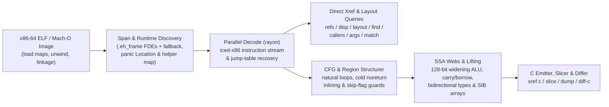

<!-- translation-source: f50daf123e003bc29cb807306845aae1d49e8837 -->
> Ce document est une traduction de la version anglaise disponible au commit [`f50daf1`](https://github.com/alex09x/xref/blob/f50daf123e003bc29cb807306845aae1d49e8837/README.md). La version canonique et à jour se trouve toujours sur le [README en anglais](https://github.com/alex09x/xref/blob/main/README.md).

<div align="center">

[English](https://github.com/alex09x/xref/blob/main/README.md) | [Русский](https://github.com/alex09x/xref/blob/main/readme/README.ru.md) | [简体中文](https://github.com/alex09x/xref/blob/main/readme/README.zh-CN.md) | [Español](https://github.com/alex09x/xref/blob/main/readme/README.es.md) | [Português (Brasil)](https://github.com/alex09x/xref/blob/main/readme/README.pt-BR.md) | [日本語](https://github.com/alex09x/xref/blob/main/readme/README.ja.md) | [Deutsch](https://github.com/alex09x/xref/blob/main/readme/README.de.md) | [**Français**](https://github.com/alex09x/xref/blob/main/readme/README.fr.md) | [한국어](https://github.com/alex09x/xref/blob/main/readme/README.ko.md) | [العربية](https://github.com/alex09x/xref/blob/main/readme/README.ar.md)

</div>

<div align="center">


<br/><br/>

**Références croisées ultrarapides, reconstruction de l'agencement de structures, découpage de programmes et pseudo-C structuré pour les binaires ELF / Mach-O x86-64.**

Analyse de binaires sans index préalable en Rust pur et sûr (`#![forbid(unsafe_code)]`). Les délimitations des fonctions proviennent directement des tables de déroulement `.eh_frame` (avec repli automatique sur les intervalles) et les requêtes portant sur l'ensemble du binaire sont décodées sur tous les cœurs du processeur en quelques millisecondes — même sur les binaires de production Rust entièrement dépouillés (*stripped*), où les tables de symboles sont vides.

<br/>

[**Atelier interactif (xrefcode.com)**](https://xrefcode.com) · Par [Alexander Panasenko](https://prod.codes/about/)

<br/>

[](https://github.com/alex09x/xref/releases)
[](https://crates.io/crates/xref-code)
[](https://doi.org/10.5281/zenodo.23878789)
[](https://github.com/alex09x/xref/actions)
[](../LICENSE-MIT)
[](../Cargo.toml)
[](../Cargo.toml)

<br/>

[**Pourquoi**](#why) · [**Installation**](#installation) · [**Démarrage rapide**](#quick-start) · [**Exemples enregistrés**](#recorded-examples) · [**Référence des commandes**](#command-reference) · [**Architecture**](#architecture) · [**Performances**](#recorded-performance) · [**Limites**](#scope--limitations) · [**Citation**](#citation)

</div>

---

<a name="why"></a>
## Pourquoi

Les suites d'ingénierie inverse traditionnelles présupposent un analyste interactif disposé à attendre plusieurs minutes pour l'importation préalable d'une base de données du programme complet avant de poser la première question. Les binaires Rust dépouillés (*stripped*) aggravent cela : les symboles disparaissent, les chaînes deviennent des segments `(ptr, len)` non terminés par un NUL dans les zones `.rodata`, et les paniques de contrôle de limites fragmentent les boucles en embranchements froids qui transforment les décompilateurs naïfs en un enchevêtrement illisible de `goto`.

**XRef** (`xref`) est conçu pour une investigation itérative rapide, aussi bien pour les ingénieurs en rétro-ingénierie que pour les agents d'IA autonomes :

- **Pas d'index préalable, pas de cache obsolète.** Les commandes d'analyse projettent l'image ELF en mémoire, extraient les plages exactes des fonctions depuis les enregistrements de déroulement `.eh_frame` (avec repli automatique sur les bornes) et parcourent les fonctions en parallèle via `rayon`. `xref field` fait exception : il conserve un index optionnel sur disque lié au contenu de l'entrée et de l'exécutable xref, et peut rejouer un rapport enregistré ou interroger un field daemon en arrière-plan, tous deux liés au chemin canonique du fichier et à ses métadonnées (périphérique, inode, taille, dates de modification et de changement). Toute modification entraîne leur reconstruction ou leur contournement.
- **Pseudo-C natif structuré et typé (`xref c`).** Convertit le code machine x86-64 directement en langage C lisible sans outil externe — reconstituant les signatures immuables `arg_0..arg_5`, les réseaux SSA de définitions et d'utilisations (`ptr_*`, `v_*`, `slot_*`), les tableaux SIB indexés par élément, les opérations d'élargissement à 1 opérande de `128-bit` `mul`/`imul`/`div`/`idiv`, les chaînes de retenue/emprunt multi-précision `adc`/`sbb`, les intrinsèques de débordement arithmétique signé et les blocs structurés `if`/`else`/`while`/`do-while`/`switch`. Il reconstitue aussi les opérations flottantes scalaires SSE/AVX (paramètres, retours et résultats d’appel `f32`/`f64`) et les appels indirects via des vtables constantes, avec la condition de branchement sélectionnant chaque cible.
- **Reconstruction adaptée aux binaires Rust dépouillés.** Reconnaît les fonctions d'assistance de runtime Rust dépouillées (`rust_panic_bounds_check`, `rust_slice_index_fail`, `rust_capacity_overflow`), extrait les littéraux `&str` sous forme de segments `(ptr, len)` exacts, relie les descripteurs `core::panic::Location` (`file:line:col`) aux chemins d'origine des crates et résout les branches des tables de saut pour `Display`.
- **Découpage de programme et comparaison entre versions (`xref slice`, `xref match`, `xref diff-c`).** Isole les instructions équilibrées et les conditions de contrôle atteignant un appel ou un pointeur d'instruction (IP) précis, relocalise les fonctions dépouillées déplacées entre différentes compilations et compare le pseudo-C normalisé en éliminant les adresses hexadécimales volatiles.
- **Recherche de champs sérialisés (`xref field`).** Relie des chaînes de clés sérialisées à des décalages de champs de structure avec des instructions témoins et classe les fonctions candidates qui écrivent ces champs, éventuellement seulement celles qui écrivent via un pointeur retourné, d'argument ou chargé (`--writer-root`). Les résultats sont des candidats avec leurs preuves, pas une preuve du type source.
- **Origines des erreurs et arguments constants (`xref origin`, `xref callargs`).** `origin` part d’un message d’erreur et liste le code qui le construit : écritures de son tag d’enum dont la valeur, la largeur et la disposition correspondent, conversions de l’intérieur vers l’extérieur, appels passant le tag à l’écriture et conditions protégeant chaque site. Le tag transmis est suivi à travers les copies préservées par l’appelé, les spills, objets et pointeurs de pile, emplacements d’arguments sur la pile, copies dans des enregistrements et boucles qui lisent ensuite ces enregistrements par valeur. `callargs` liste chaque appel passant une constante, regroupé par fonction appelée. Les sites sont des candidats accompagnés de leurs preuves.
- **Provenance et données typées (`xref deps`, `xref data`).** Lit le manifeste des dépendances incorporé par [`cargo-auditable`](https://github.com/rust-secure-code/cargo-auditable) dans les binaires Rust (`.dep-v0`) et la liste des modules Go (`.go.buildinfo`), avec les chaînes du compilateur/éditeur de liens et le Build-ID ; `data` lit des valeurs typées (`u8`..`u64`, `f32`/`f64`, octets, chaînes) à une adresse virtuelle.
- **Sortie structurée pour les agents (`xref query`, `xref mcp`).** JSON versionné pour une image immuable : `info` commence par un premier diagnostic (langage, chaînes d’outils, dépendances incorporées, prochaines requêtes prêtes à exécuter), chaque réponse porte un niveau de confiance (`observed`, `derived`, `inferred`) et un identifiant de preuve déterministe, et le contenu binaire est marqué comme donnée non fiable. `--compact` raccourcit les réponses MCP.
- **Inspection de processus Linux en cours d'exécution (`xref live`).** Rattache la vue statique à un processus Linux x86-64 en cours d'exécution : trouve des valeurs dans sa mémoire, résout les pointeurs d'exécution vers des fonctions statiques, compte appels et appelants avec des uprobes bornées, désigne par points d'arrêt matériels l'instruction qui écrit un champ, enregistre des fenêtres d'appels ordonnées par thread (`live trace`) et des profils CPU bornés (`live profile`) — chaque résultat indique sa couverture et ses limites.
- **Profils et traces hors ligne (`xref profile`, `xref symbolize`, `xref edges`).** Résume, annote et compare des enregistrements `.xprof`, importe `perf.data` (y compris un décodage Intel PT borné) et du texte `perf script`, et rattache des piles sauvegardées et des arêtes d'appel observées à l'exécutable sélectionné.

Découvrez **114 exécutions CLI enregistrées textuellement** sur le binaire dépouillé d'`xref` lui-même dans l'atelier web statique à l'adresse **[xrefcode.com](https://xrefcode.com)**.

---

<a name="installation"></a>
## Installation

### En une ligne (macOS Apple Silicon et Linux `x86_64`)

```bash
curl -fsSL https://xrefcode.com/install.sh | sh
```

Le script choisit lui-même la méthode : le binaire publié pour votre plateforme, vérifié avec son SHA-256 publié, ou `cargo install xref-code --locked` lorsqu’aucun binaire précompilé ne convient. `XREF_VERSION=v0.5.0` fixe une version ; `XREF_INSTALL_DIR` choisit le répertoire (par défaut `/usr/local/bin` s’il est accessible en écriture, sinon `~/.local/bin`). Si vous préférez, [lisez le script](https://xrefcode.com/install.sh) avant.

### Homebrew (macOS Apple Silicon et Linux `x86_64`)

Installe le binaire précompilé `xref` directement depuis le tap [`alex09x/homebrew-apps`](https://github.com/alex09x/homebrew-apps) (aucune compilation Cargo requise) :

```bash
brew tap alex09x/apps
brew install xref
xref --version
```

### Archives tarball précompilées des versions (Linux `x86_64` et macOS `arm64`)

Les archives précompilées (`x86_64-unknown-linux-gnu`, nécessitant `glibc >= 2.34`, et `aarch64-apple-darwin`) contiennent `xref`, `README.md`, `LICENSE-MIT`, `LICENSE-APACHE` et `CITATION.cff` :

```bash
curl -fsSLO https://github.com/alex09x/xref/releases/download/v0.5.0/xref-v0.5.0-x86_64-unknown-linux-gnu.tar.gz
curl -fsSLO https://github.com/alex09x/xref/releases/download/v0.5.0/xref-v0.5.0-x86_64-unknown-linux-gnu.tar.gz.sha256
sha256sum -c xref-v0.5.0-x86_64-unknown-linux-gnu.tar.gz.sha256
tar -xzf xref-v0.5.0-x86_64-unknown-linux-gnu.tar.gz
./xref --version
```

### Cargo & `crates.io` (Linux et macOS)

Publié sur [`crates.io` sous le nom `xref-code`](https://crates.io/crates/xref-code), ce qui installe le binaire CLI `xref` (nécessite `rustc 1.88+` pour les chaînes de `let` de l'édition 2024 ; les binaires précompilés fonctionnent également via [`cargo-binstall`](https://github.com/cargo-bins/cargo-binstall)) :

```bash
cargo install xref-code --locked
# or prebuilt via cargo-binstall:
cargo binstall xref-code -y
# or directly from the pinned release tag:
cargo install --git https://github.com/alex09x/xref --tag v0.5.0 --locked
```

---

<a name="quick-start"></a>
## Démarrage rapide

Indiquez `-b <BINARY>` à chaque commande ou définissez `XREF_BIN=/path/to/binary` par session. Les adresses sont des VA statiques en hexadécimal `0x` ou en décimal ; la base des RVA Mach-O est `__TEXT.vmaddr`.

```bash
export XREF_BIN=./xref.stripped

xref stats                                      # function count, .text bytes, pointers, panic locations
xref refs "goto L_"                             # code & data references to strings or addresses (--inline)
xref where src/loops.rs                         # stripped function ranges compiled from a Rust source file
xref layout 0xa2270 --reg rsi --callees         # recover struct field offsets, sizes, strides & 1-hop callees
xref c 0x9a8a0 --fields                         # structured typed pseudo-C with inferred ->f_<off> hints
xref c 0x9a8a0 --only-paths-to 0x9a950          # pseudo-C containing only basic blocks that reach ADDR
xref slice 0xc7d60 --to fn_160bb0               # backward slice of statements & guards reaching a target
xref origin "number out of range"               # code that builds an error message: tag stores, conversions, guards
xref deps                                       # embedded cargo-auditable / Go build manifest, toolchains, Build-ID
xref query '{"operation":"info"}'              # versioned JSON for one immutable image
xref mcp                                       # local read-only stdio MCP server
```

---

<a name="live-analysis-linux-x86-64"></a>
## Analyse en direct (Linux x86-64)

À partir de la version v0.3.0, `xref live` connecte un processus Linux x86-64 en cours d'exécution à l'analyse statique de son exécutable vérifié. Passez le même binaire ELF avec `-b` ; xref le valide par rapport à `/proc/<pid>/exe` (GNU build-id ou SHA-256) avant de traduire la moindre adresse.

```bash
xref -b ./app live maps --pid PID                        # mappings, binary match, PIE slide
xref -b ./app live memscan --pid PID 0x4441454d4f4e5632  # find u64 values; classify neighbouring words
xref -b ./app live resolve --pid PID 0x55d1c0ffc9d0      # runtime address -> static VA, function, file offset
sudo xref -b ./app live probe --pid PID --callers 0x1f9f0       # bounded uprobe hit counts, callers, registers
sudo xref -b ./app live watch --pid PID 0x55d1e1c3adc8          # DR0-DR3 write watch: writer instruction and value
sudo xref -b ./app live trace --pid PID --start 0x1f9f0 --stop-return 0x1f9f0 --callees-of 0x1f9f0 # ordered per-thread call windows
sudo xref -b ./app live profile --pid PID --duration 10s --out app.xprof # bounded CPU sampling profile
xref -b ./app mcp --allow-live-pid PID                   # opt-in xref_live MCP tool pinned to one process
```

- `maps`, `resolve` et `memscan` lisent uniquement `/proc/<pid>/maps` et `/proc/<pid>/mem` (l'accès ptrace à la cible est requis ; le processus n'est pas interrompu).
- `probe` et `watch` ouvrent des événements perf sur la cible et nécessitent un accès privilégié perf (root ou `CAP_PERFMON`). Chaque déclenchement constitue une interruption (trap) dans la cible, gardez donc des fenêtres d'observation courtes sur les processus très sollicités.
- `trace` utilise une instance uprobe `tracefs` isolée et nécessite un tracefs accessible en écriture (normalement root) ; ses fenêtres se ferment à l'adresse d'arrêt ou au retour indiqués et s'arrêtent à des limites explicites de fenêtres, d'événements et de temps. `profile` échantillonne avec des événements perf et échoue lorsque la politique du noyau n'autorise pas les événements demandés, au lieu de les remplacer silencieusement.
- Les résultats distinguent rigoureusement l'observation de l'inférence : un décompte nul ne couvre que la fenêtre et les threads déclarés, une instruction d'écriture signalée est une candidate assortie d'un indice de confiance explicite, et les événements perdus ou les threads attachés tardivement font des compteurs une borne inférieure.

Session enregistrée pas à pas (recherche en mémoire → fonction statique → comptage des appels → écriture de champ → déplacement de tampon) : **[Guide interactif d'analyse en direct (Live Analysis walkthrough)](https://xrefcode.com/live-walkthrough)**. Spécifications et limites : [docs/live.md](https://github.com/alex09x/xref/blob/main/docs/live.md) ; MCP : [docs/mcp.md](https://github.com/alex09x/xref/blob/main/docs/mcp.md).

---

<a name="recorded-examples"></a>
## Exemples enregistrés

Toutes les sorties ci-dessous proviennent d'exécutions complètes et non modifiées capturées sur `xref.stripped` (`1,962,608` octets, `0` symbole, `sha256:3f3ba3b311f3eca8e26a929285d4fc9ffef4e4b6e8fc015105766180a2a6869d`) et vérifiées en intégration continue (CI) pour correspondre ligne par ligne avec `docs/recorded-data.js` (aux espaces de fin de ligne près).

### 1. Pseudo-C structuré et typé avec indices de décalage de champs (`xref c --fields`)

```c
$ xref -b xref.stripped c 0x9a8a0 --fields
/* field offsets: arg_0 [+0x0:u64, +0x8:u64, +0x10:u64, +0x18:u64] */
/*
 * fn_9a8a0 — 0x9a8a0..0x9a97a (218 bytes, 1 direct caller; synthetic FDE entry)
 *   source: src/cfg.rs:154:22, src/cfg.rs:75:25, src/cfg.rs:154:57
 *   params:
 *     arg_0 (rdi): const void * — reads +0x0 (8B), +0x8 (8B), +0x10 (8B), +0x18 (8B)
 *     arg_1 (rsi): unk64 — 64-bit register (signedness unconstrained)
 *     arg_2 (rdx): unk64 — 64-bit register (signedness unconstrained)
 *   return: u8 in rax (consumed by 1/1 direct call site)
 */
u8 fn_9a8a0(const void *arg_0, unk64 arg_1, unk64 arg_2) {
  usize v_1 = arg_1; /* rsi */
  u64 v_6; /* rbx */
  const u8 *ptr_9; /* rax */
  unk64 slot_0; /* [rsp+0x0], addr-taken */
  unk64 slot_8; /* [rsp+0x8] */

  if (v_1 == 0) {
    ptr_9 = 0;
    return ptr_9;
  }
  u64 v_2 = arg_0->f_8;
  if (v_1 >= v_2) {
    usize v_12 = v_1;
    /* [runtime] rust_panic_bounds_check(index, len, loc) -> noreturn */
    rust_panic_bounds_check(v_12, v_2, "src/cfg.rs:154:22");
  }
  if (((u64 *)arg_0->f_0)[v_1] != 1) {
    ptr_9 = 0;
    return ptr_9;
  }
  const void *ptr_3 = arg_0->f_18;
  unk64 v_4 = *(u64 *)(arg_0->f_10);
  if (v_1 == v_4 + 2) {
    usize v_5 = (v_4 + 1);
    v_6 = *(u64 *)(ptr_3 + 16);
    if (v_5 >= v_6) {
      /* [runtime] rust_panic_bounds_check(index, len, loc) -> noreturn */
      rust_panic_bounds_check(v_5, v_6, "src/cfg.rs:154:57");
    }
    usize v_7 = v_1;
    unk64 v_8 = ((v_5 * 96) + *(u64 *)(ptr_3 + 8));
    slot_8 = arg_2;
    slot_0 = 1;
    /* fn_fb8e0: calls fn_fb9c6, fn_fb920 */
    ptr_9 = fn_fb8e0(v_8, &slot_0);
    u32 v_10 = ptr_9;
    ptr_9 = 1;
    v_1 = v_7;
    if (v_10 != 0) {
      return ptr_9;
    }
  } else {
    v_6 = *(u64 *)(ptr_3 + 16);
  }
  usize v_11 = (v_1 - 1);
  if (v_11 < v_6) {
    ptr_9 = *(u64 *)(ptr_3 + 8);
    ptr_9 = (((u8 *)ptr_9)[(v_11 * 96)] & 5) != 0;
    return ptr_9;
  }
  usize v_13 = v_11;
  /* [runtime] rust_panic_bounds_check(index, len, loc) -> noreturn */
  rust_panic_bounds_check(v_13, v_6, "src/cfg.rs:75:25");
}
```

### 2. Reconstruction interprocédurale de l'agencement de structures (`xref layout --callees`)

```text
$ xref -b xref.stripped layout 0xa2270 --reg rsi --callees
layout of rsi in 0xa2270..0xa2566:
  +0       size  4  u32   r:0  w:2
  +8       size  8  u64   r:2  w:0
  +10      size  8  u64   r:2  w:0
  +20      size  8  u64   r:1  w:0
  +28      size  8  u64   r:1  w:0
5 fields (min span 0x30)
other pointer args: rdi (3 fields), rdx (1 fields)  (use --reg <REG>)
```

### 3. Découpage rétrospectif de programme (`xref slice`)

```c
$ xref -b xref.stripped slice 0xc7d60 --to fn_160bb0
/* slice of 0xc7d60..0xc7fbf -> fn_160bb0 (37/131 lines) */
void fn_c7d60(void *arg_0, const void *arg_1, usize arg_2) {
  u8 slot_28; /* [rsp+0x28], addr-taken */
  usize slot_30; /* [rsp+0x30] */
  unk64 slot_40; /* [rsp+0x40], addr-taken */
  if (arg_2 == 0) {
    return; /* callers ignore rax */
  }
  const void *ptr_1 = arg_1;
  const void *v_2 = arg_1 + arg_2 * 24;
  void *v_4 = &slot_40;
  do {
    const u8 *ptr_6 = *(u64 *)(ptr_1 + 8);
    usize v_7 = *(u64 *)(ptr_1 + 16);
    /* fn_160550: source core/src/str/pattern.rs:1398; calls fn_1606e0, fn_160a43, fn_1605f8 */
    fn_160550(v_4, ptr_6, v_7, "goto L_", 7);
    /* fn_124d50: source core/src/str/pattern.rs:1131; calls fn_124e3a, fn_160bb0, fn_124e29 */
    fn_124d50(&slot_28, v_4);
    if (slot_28 != 0) {
      usize v_8 = slot_30;
      usize v_9 = (v_8 + 7);
      if (v_9 != 0) {
        if (v_9 < v_7) {
          if ((i8)((u8 *)ptr_6)[v_9] < -64) {
            /* fn_160bb0: noreturn; source core/src/str/mod.rs:486; calls fn_160bc0 */
            fn_160bb0(ptr_6, v_7, v_9, v_7, "src/loops.rs:45:36");
          }
        } else {
          if (v_9 != v_7) {
            /* fn_160bb0: noreturn; source core/src/str/mod.rs:486; calls fn_160bc0 */
            fn_160bb0(ptr_6, v_7, v_9, v_7, "src/loops.rs:45:36");
          }
        }
      }
    }
    ptr_1 = (ptr_1 + 24);
  } while (ptr_1 != v_2);
}
```

### 4. Relocalisation entre versions & comparaison de pseudo-C normalisé (`xref diff-c`)

Les lignes indentées avec `  ...` ci-dessous sont générées directement par `xref diff-c` pour indiquer les zones normalisées inchangées en dehors du bloc de diff :

```diff
$ xref -b xref.stripped diff-c --other xref-v0.0.2.stripped 0xd57c0
  warning: scores, ratios and pseudo-C similarities are heuristics, not calibrated probabilities or semantic equivalence proof
  warning: candidate list capped at 128 of 396; omitted plausible candidates keep ambiguity
  warning: pseudo-C ordering is heuristic inference; structural scores remain explicit
=== diff 0xd57c0..0xd6301 (current) vs 0xd5530..0xd6071 (other, score 384: locs:240 strs:0 imms:4 disps:10 nbrs:105 size:0xb41 callees:8) ===
  ...
      }
      @var_11 = (@slot_10 + @var_8);
-     @var_1 = 0xc2bc;
+     @var_1 = 0xc518;
      @var_32 = @slot_9;
      switch (*(u64 *)(@var_11)) {
  ...
```

---

<a name="command-reference"></a>
## Référence des commandes

Les [options avancées](https://github.com/alex09x/xref/blob/main/docs/advanced-options.md) décrivent la recherche de déplacements sur la pile et la sortie conservant les étiquettes de saut.

Les [requêtes structurées et le MCP local](https://github.com/alex09x/xref/blob/main/docs/mcp.md) donnent un accès programmatique au même moteur d’analyse.

Les [investigations bornées](https://github.com/alex09x/xref/blob/main/docs/investigations.md) relient chaînes, références, appels, preuves des arguments et tranche choisie explicitement, en conservant les alternatives et les limites.

Les [investigations sur l’origine des champs](https://github.com/alex09x/xref/blob/main/docs/field-origin.md) distinguent les adresses relatives au registre d’entrée des valeurs chargées et fournissent les instructions d’accès mémoire et des fonctions appelées.

### Inventaire, symboles et références croisées
```text
xref -b BIN stats                                    # functions, .text bytes, pointers, imports, panic locations
xref -b BIN sym PATTERN                              # symbol search (non-stripped binaries)
xref -b BIN func 0xa1b50                             # function span containing an address
xref -b BIN refs "goto L_" 0xa1b50                   # .rodata / pointer / code xrefs (--inline for mov/movabs stores)
xref -b BIN istr "text"                              # shorthand for refs --inline
xref -b BIN imm 24 --in 0xa1b50                      # immediate constants (--store, --cmp, --in FN)
xref -b BIN find --src src/loops.rs --calls 0x160bb0 # single-pass multi-predicate function search (--any K)
xref -b BIN find --insn 'divsd xmm*' --size 0x10..0x400 # functions containing matching instructions
```

### Agencements de structures, déplacements et graphes d'appels
```text
xref -b BIN disp 0x20 0x28 --all                     # field loads/stores/leas (--write, --lea, --stride, --in FN)
xref -b BIN layout 0xa2270 --reg rsi --callees       # aggregate field offsets, widths, strides & 1-hop callees
xref -b BIN card 0xa2270                             # function summary card: inputs, exits, stores, callees (--json)
xref -b BIN field --keys c,m,e --write --writes-all-of m,e # serialized keys -> field layout & ranked writers
xref -b BIN callers 0xcafb0                          # direct calls/tail-jumps, address-taken & pointer-table xrefs
xref -b BIN calls 0xcafb0                            # outgoing calls and tail-jumps in instruction order
xref -b BIN args 0xa2270 --max 20                    # constant & symbolic arguments across all call sites
xref -b BIN args 0xa2270 --filter 'rdx == 0'         # preflight probe filter against call-site arguments
xref -b BIN callargs 39 --arg r9                     # every call passing 39 in r9, grouped by callee
xref -b BIN path 0xc7fc0 0x160bb0 --depth 8          # shortest call chains between two functions
xref -b BIN tree 0xd0aa0 --callers --depth 2         # indented caller/callee tree with panic source anchors
```

### Désassemblage, pseudo-C, découpage, export de crate et différences
```text
xref -b BIN asm 0xc7d60 --from A --to B              # annotated Intel disassembly (strings, slots, targets)
xref -b BIN c 0x9a8a0 --fields                       # structured typed pseudo-C (--out DIR for parallel batch export)
xref -b BIN slice 0xc7d60 --to fn_160bb0 --fields    # backward slice to target call, hex IP, offset, or string
xref -b BIN slice 0xc7d60 --to-field "+0x10 of rax@0xc7d60" # slice focused on accesses to a struct field
xref -b BIN dump --out DIR --src src/loops.rs        # parallel modular .c export grouped by panic source paths
xref -b BIN match --other OLD_BIN 0xc7d60 --top 3    # relocate shifted stripped functions across two builds
xref -b BIN diff-c --other OLD_BIN 0xd57c0           # normalized cross-build pseudo-C LCS diff
```

### Emplacements du code source Rust et tables de saut d'énumérations
```text
xref -b BIN src 0x9a8a0                              # core::panic::Location (file:line:col) descriptors in function
xref -b BIN where src/image.rs --line 46             # stripped functions referencing a Rust file (and line)
xref -b BIN files src/                               # distinct Rust source files recovered from panic descriptors
xref -b BIN error "invalid"                          # jump-table discriminant whose Display arm names text
xref -b BIN variant 0xc7fc0 1 2                      # inverse of error: texts referenced by jump-table arms
xref -b BIN arm 0xc8010                              # jump-table indices whose arm contains an address
```

### Origines des erreurs, provenance et données typées
```text
xref -b BIN origin "number out of range"            # tag stores, conversions, passed tags, guards & record readers
xref -b BIN deps --filter tokio --json               # embedded cargo-auditable / Go manifest, toolchains, Build-ID
xref -b BIN data 0x492c0b --as str                   # typed values at a VA (u8..u64, i8..i64, f32, f64, bytes, str)
xref -b BIN table 0x1da3e0 --stride 0x20             # fixed-size records / vtables with their relocated pointers
```

### Profils et traces hors ligne
```text
xref -b BIN profile report app.xprof --by function --top 30 # summarize a recorded or imported profile
xref -b BIN profile annotate app.xprof 0x1234 --c    # sample shares on pseudo-C (or assembly without --c)
xref -b BIN profile diff before.xprof after.xprof    # compare two profiles normalized by their sample counts
xref -b BIN profile import perf.data --out app.xprof # native perf.data / perf script import (bounded Intel PT)
xref -b BIN symbolize --input addresses.txt --base 0x555555554000 # saved addresses/stacks -> static functions
xref -b BIN edges import --format perf --input stacks.perf.txt --out observed.json # observed call edges for callers/tree/path
```

---

<a name="architecture"></a>
## Architecture



---

<a name="recorded-performance"></a>
## Performances enregistrées

Temps d'exécution réels en ligne de commande pour une passe unique rapportés par `xref 0.0.5` (`stderr`) sur `AMD Ryzen 9 9950X` (16 cœurs / 32 threads, Linux 6.8 `x86_64`, cache de pages système chaud) lors de l'analyse du binaire dépouillé `xref.stripped` (`1.96 MB`, `1,974` fonctions, `0` symbole) :

| Opération | Commande | Chargement ELF | Temps total |
|---|---|---:|---:|
| Inventaire du binaire (`1,974` fonctions, `588` emplacements de panique) | `xref -b xref.stripped stats` | `0.84 ms` | **`2.2 ms`** |
| Recherche globale de références croisées de chaînes et pointeurs | `xref -b xref.stripped refs "goto L_"` | `0.80 ms` | **`3.9 ms`** |
| Correspondance des modules Rust depuis les emplacements de panique | `xref -b xref.stripped where src/loops.rs` | `0.79 ms` | **`3.4 ms`** |
| Reconstruction interprocédurale de l'agencement de structures (appels directs à 1 saut) | `xref -b xref.stripped layout 0xa2270 --reg rsi --callees` | `0.81 ms` | **`2.6 ms`** |
| Découpage rétrospectif de programme + indices de décalage de champs | `xref -b xref.stripped slice 0xc7d60 --to fn_160bb0 --fields` | `0.81 ms` | **`5.1 ms`** |
| Correspondance de fonctions entre builds et diff de pseudo-C normalisé | `xref -b xref.stripped diff-c --other xref-v0.0.2.stripped 0xc7d60` | `0.86 ms` | **`13.4 ms`** |

---

<a name="scope--limitations"></a>
## Portée et limites

- **Entrées prises en charge :** binaires et objets partagés ELF `x86-64` (`ET_EXEC`, `ET_DYN`). Depuis v0.2.0, xref accepte aussi les exécutables, dylibs et bundles Mach-O thin x86-64 little-endian avec DWARF unwind ; voir [entrées Mach-O](https://github.com/alex09x/xref/blob/main/docs/macho.md). La v0.1.0 publiée reste limitée à ELF. ARM64, PE, fat/universal et les entrées uniquement compact unwind ne sont pas pris en charge.
- **Détection des délimitations de fonctions :** Les plages exactes de fonctions proviennent des tables de déroulement `.eh_frame` (émises par défaut par `rustc`, `clang` et `gcc` sur `x86-64` même après `strip --strip-all`), avec un mécanisme de secours par intervalle/cible d'appel en cas d'absence d'entrées de déroulement. Les binaires dépourvus de `.eh_frame` (`strip -R .eh_frame`) reposent sur des frontières d'intervalles heuristiques.
- **Analyse en direct :** Linux x86-64 uniquement, un exécutable cible par session. Les instructions d'écriture et les appelants situés dans des bibliothèques partagées sont signalés comme extérieurs à l'exécutable cible, sans fonction statique ni valeur écrite. `probe`, `watch` et `trace` nécessitent un accès privilégié à perf ou à tracefs et ajoutent des interruptions au processus observé. Le fonctionnement de `profile` sans privilèges dépend de la politique du noyau `perf_event_paranoid`, de l'accès ptrace à la cible et des événements choisis ; son mode `--trigger-probe` nécessite un accès perf à l'échelle du système et un tracefs accessible en écriture.
- **Recherche de champs sérialisés :** le classement des écrivains est une heuristique fondée sur des preuves d'instructions, pas une preuve qu'une fonction manipule un objet donné. Les analyses de l'image entière sont bornées (262 144 fonctions, 128 Mio de code, budgets d'arêtes et de 30 secondes) et signalent dans leur couverture qu'une limite a été atteinte.
- **Origines des erreurs :** `origin` liste les sites candidats classés selon la correspondance de la valeur, de la largeur et de la disposition du tag, avec leurs conditions ; il ne prouve pas qu’un site s’exécute. Un tag transmis est suivi sur au plus `--arg-depth` appels et 64 fonctions ; un champ d’enregistrement déplacé par un chargement vectoriel de 16 ou 32 octets est listé à ce chargement et n’est pas suivi plus loin.
- **Provenance :** `deps` ne rapporte que ce que le binaire incorpore. Un binaire Rust construit sans `cargo-auditable` n’a pas de manifeste et les crates ne sont pas devinés à partir des chaînes ; les versions sont les chaînes enregistrées, sans vérification auprès d’un registre ou d’une base d’avis.
- **Pseudo-C statique et inférence de décalages :** Les signatures de paramètres (`arg_*`), les types inférés de pointeurs/entiers (`const void *`, `usize`, `unk64`, etc.) et les indices de décalage de `--fields` (`->f_<off>`) sont des reconstitutions statiques prudentes déduites de l'utilisation en code machine, et non des types sources DWARF. Les instructions SIMD/système non modélisées sont conservées en ligne sous forme de commentaires d'assemblage explicites `/* 0xaddr: ... */` au lieu d'être ignorées silencieusement — contre-vérifiez toujours les invariants critiques avec `xref asm`.

---

<a name="development--testing"></a>
## Développement et tests

`rustc` doit être accessible dans le `PATH` lors de l'exécution des tests : la suite de tests de bout en bout compile `tests/fixtures/sample.rs` en un binaire ELF temporaire et vérifie les sous-commandes CLI sur celui-ci.

```bash
cargo fmt --all -- --check
cargo clippy --workspace --all-targets --locked -- -D warnings
cargo test --workspace --locked
```

---

<a name="citation"></a>
## Citation

L'entrée ci-dessous correspond au dernier instantané archivé (`v0.4.0`) ; instantané antérieur `v0.3.0` : [10.5281/zenodo.23932112](https://doi.org/10.5281/zenodo.23932112) ; `v0.2.0` : [10.5281/zenodo.23902824](https://doi.org/10.5281/zenodo.23902824) ; instantané `v0.1.0` : [10.5281/zenodo.23878790](https://doi.org/10.5281/zenodo.23878790).

```bibtex
@software{panasenko_2026_23968336,
  author       = {Panasenko, Alexander},
  title        = {XRef — Ultra Blazing Fast x86-64 ELF and Mach-O
                   Analysis, Live Linux Process Inspection, Pseudo-C
                   and Local MCP
                  },
  month        = nov,
  year         = 2026,
  publisher    = {Zenodo},
  version      = {0.4.0},
  doi          = {10.5281/zenodo.23968336},
  url          = {https://doi.org/10.5281/zenodo.23968336}
}
```

- Alexander Panasenko (2026). *XRef — Ultra Blazing Fast x86-64 ELF and Mach-O Analysis, Live Linux Process Inspection, Pseudo-C and Local MCP* (v0.4.0). Zenodo. https://doi.org/10.5281/zenodo.23968336 ([concept DOI: 10.5281/zenodo.23878789](https://doi.org/10.5281/zenodo.23878789))

---

<a name="license"></a>
## Licence

Copyright © 2026 [Alexander Panasenko](https://prod.codes/about/) (`alex@prod.codes`).

Distribué sous double licence au choix :
- **Licence Apache, Version 2.0** ([`LICENSE-APACHE`](../LICENSE-APACHE) ou http://www.apache.org/licenses/LICENSE-2.0)
- **Licence MIT** ([`LICENSE-MIT`](../LICENSE-MIT) ou http://opensource.org/licenses/MIT)

selon votre convenance.
