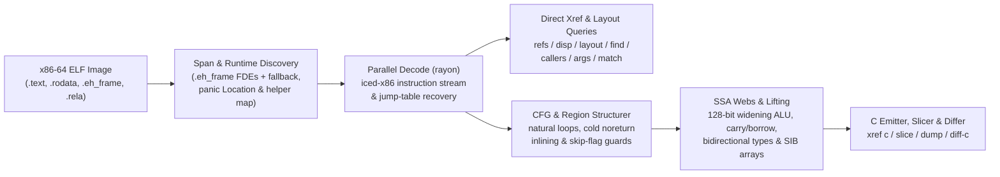

<!-- translation-source: 4d53038bb901ff93c8c807043c13a9670e58c9d7 -->
> Ce document est une traduction de la version anglaise disponible au commit [`4d53038`](https://github.com/alex09x/xref/blob/4d53038bb901ff93c8c807043c13a9670e58c9d7/README.md). La version canonique et à jour se trouve toujours sur le [README en anglais](https://github.com/alex09x/xref/blob/main/README.md).

<div align="center">

[English](https://github.com/alex09x/xref/blob/main/README.md) | [Русский](https://github.com/alex09x/xref/blob/main/readme/README.ru.md) | [简体中文](https://github.com/alex09x/xref/blob/main/readme/README.zh-CN.md) | [Español](https://github.com/alex09x/xref/blob/main/readme/README.es.md) | [Português (Brasil)](https://github.com/alex09x/xref/blob/main/readme/README.pt-BR.md) | [日本語](https://github.com/alex09x/xref/blob/main/readme/README.ja.md) | [Deutsch](https://github.com/alex09x/xref/blob/main/readme/README.de.md) | [**Français**](https://github.com/alex09x/xref/blob/main/readme/README.fr.md) | [한국어](https://github.com/alex09x/xref/blob/main/readme/README.ko.md) | [العربية](https://github.com/alex09x/xref/blob/main/readme/README.ar.md)

</div>

<div align="center">


<br/><br/>

**Références croisées ultrarapides, reconstruction de l'agencement de structures, découpage de programmes et pseudo-C structuré pour les binaires ELF x86-64.**

Analyse de binaires sans index préalable en Rust pur et sûr (`#![forbid(unsafe_code)]`). Les délimitations des fonctions proviennent directement des tables de déroulement `.eh_frame` (avec repli automatique sur les intervalles) et les requêtes portant sur l'ensemble du binaire sont décodées sur tous les cœurs du processeur en quelques millisecondes — même sur les binaires de production Rust entièrement dépouillés (*stripped*), où les tables de symboles sont vides.

<br/>

[**Atelier interactif (xrefcode.com)**](https://xrefcode.com) · Par [Alexander Panasenko](https://prod.codes/about/)

<br/>

[](https://github.com/alex09x/xref/releases)
[](https://crates.io/crates/xref-code)
[](https://doi.org/10.5281/zenodo.23878789)
[](https://github.com/alex09x/xref/actions)
[](../LICENSE-MIT)
[](../Cargo.toml)
[](../Cargo.toml)

<br/>

[**Pourquoi**](#why) · [**Installation**](#installation) · [**Démarrage rapide**](#quick-start) · [**Exemples enregistrés**](#recorded-examples) · [**Référence des commandes**](#command-reference) · [**Architecture**](#architecture) · [**Performances**](#recorded-performance) · [**Limites**](#scope--limitations) · [**Citation**](#citation)

</div>

---

<a name="why"></a>
## Pourquoi

Les suites d'ingénierie inverse traditionnelles présupposent un analyste interactif disposé à attendre plusieurs minutes pour l'importation préalable d'une base de données du programme complet avant de poser la première question. Les binaires Rust dépouillés (*stripped*) aggravent cela : les symboles disparaissent, les chaînes deviennent des segments `(ptr, len)` non terminés par un NUL dans les zones `.rodata`, et les paniques de contrôle de limites fragmentent les boucles en embranchements froids qui transforment les décompilateurs naïfs en un plat d'adresses `goto` illisible.

**XRef Code** (`xref`) est conçu pour une investigation itérative rapide, aussi bien pour les ingénieurs en rétro-ingénierie que pour les agents d'IA autonomes :

- **Zéro indexation, zéro cache obsolète.** Chaque exécution mappe l'image ELF en mémoire, extrait les plages exactes de fonctions depuis les enregistrements de déroulement `.eh_frame` (avec repli automatique sur les intervalles) et scanne les fonctions en parallèle grâce à `rayon`.
- **Pseudo-C natif structuré et typé (`xref c`).** Convertit le code machine x86-64 directement en langage C lisible sans outil externe — reconstituant les signatures immuables `arg_0..arg_5`, les réseaux de portées de variables SSA (`ptr_*`, `v_*`, `slot_*`), les tableaux SIB indexés par élément, les opérations d'élargissement à 1 opérande de `128-bit` `mul`/`imul`/`div`/`idiv`, les chaînes de retenue/emprunt multi-précision `adc`/`sbb`, les intrinsèques de débordement arithmétique signé et les blocs structurés `if`/`else`/`while`/`do-while`/`switch`.
- **Reconstruction adaptée aux binaires Rust dépouillés.** Reconnaît les fonctions d'assistance de runtime Rust dépouillées (`rust_panic_bounds_check`, `rust_slice_index_fail`, `rust_capacity_overflow`), extrait les littéraux `&str` sous forme de segments `(ptr, len)` exacts, relie les descripteurs `core::panic::Location` (`file:line:col`) aux chemins d'origine des crates et résout les branches des tables de saut pour `Display`.
- **Découpage de programme et comparaison entre versions (`xref slice`, `xref match`, `xref diff-c`).** Isole les instructions équilibrées et les conditions de contrôle atteignant un appel ou un pointeur d'instruction (IP) précis, relocalise les fonctions dépouillées déplacées entre différentes compilations et compare le pseudo-C normalisé en éliminant les adresses hexadécimales volatiles.

Découvrez **114 exécutions CLI enregistrées textuellement** sur le binaire dépouillé d'`xref` lui-même dans l'atelier web statique à l'adresse **[xrefcode.com](https://xrefcode.com)**.

---

<a name="installation"></a>
## Installation

### Homebrew (macOS Apple Silicon et Linux `x86_64`)

Installe le binaire précompilé `xref` directement depuis le tap [`alex09x/homebrew-apps`](https://github.com/alex09x/homebrew-apps) (aucune compilation Cargo requise) :

```bash
brew tap alex09x/apps
brew install xref
xref --version
```

### Archives tarball précompilées des versions (Linux `x86_64` et macOS `arm64`)

Les archives précompilées (`x86_64-unknown-linux-gnu`, nécessitant `glibc >= 2.34`, et `aarch64-apple-darwin`) contiennent `xref`, `README.md`, `LICENSE-MIT`, `LICENSE-APACHE` et `CITATION.cff` :

```bash
curl -fsSLO https://github.com/alex09x/xref/releases/download/v0.1.0/xref-v0.1.0-x86_64-unknown-linux-gnu.tar.gz
curl -fsSLO https://github.com/alex09x/xref/releases/download/v0.1.0/xref-v0.1.0-x86_64-unknown-linux-gnu.tar.gz.sha256
sha256sum -c xref-v0.1.0-x86_64-unknown-linux-gnu.tar.gz.sha256
tar -xzf xref-v0.1.0-x86_64-unknown-linux-gnu.tar.gz
./xref --version
```

### Cargo & `crates.io` (Linux et macOS)

Publié sur [`crates.io` sous le nom `xref-code`](https://crates.io/crates/xref-code), ce qui installe le binaire CLI `xref` (nécessite `rustc 1.88+` pour les chaînes de `let` de l'édition 2024 ; les binaires précompilés fonctionnent également via [`cargo-binstall`](https://github.com/cargo-bins/cargo-binstall)) :

```bash
cargo install xref-code --locked
# or prebuilt via cargo-binstall:
cargo binstall xref-code -y
# or directly from the pinned release tag:
cargo install --git https://github.com/alex09x/xref --tag v0.1.0 --locked
```

---

<a name="quick-start"></a>
## Démarrage rapide

Spécifiez `-b <ELF>` sur chaque commande ou exportez `XREF_BIN=/chemin/vers/binaire.elf` une fois par session de terminal. Les adresses utilisent la numérotation virtuelle ELF (adresses `objdump`) en hexadécimal `0x` ou en décimal :

```bash
export XREF_BIN=./xref.stripped

xref stats                                      # function count, .text bytes, pointers, panic locations
xref refs "goto L_"                             # code & data references to strings or addresses (--inline)
xref where src/loops.rs                         # stripped function ranges compiled from a Rust source file
xref layout 0xa2270 --reg rsi --callees         # recover struct field offsets, sizes, strides & 1-hop callees
xref c 0x9a8a0 --fields                         # structured typed pseudo-C with inferred ->f_<off> hints
xref slice 0xc7d60 --to fn_160bb0               # backward slice of statements & guards reaching a target
```

---

<a name="recorded-examples"></a>
## Exemples enregistrés

Toutes les sorties ci-dessous proviennent d'exécutions complètes et non modifiées capturées sur `xref.stripped` (`1,962,608` octets, `0` symbole, `sha256:3f3ba3b311f3eca8e26a929285d4fc9ffef4e4b6e8fc015105766180a2a6869d`) et vérifiées en intégration continue (CI) pour correspondre ligne par ligne avec `docs/recorded-data.js` (aux espaces de fin de ligne près).

### 1. Pseudo-C structuré et typé avec indices de décalage de champs (`xref c --fields`)

```c
$ xref -b xref.stripped c 0x9a8a0 --fields
/* field offsets: arg_0 [+0x0:u64, +0x8:u64, +0x10:u64, +0x18:u64] */
/*
 * fn_9a8a0 — 0x9a8a0..0x9a97a (218 bytes, 1 direct caller; synthetic FDE entry)
 *   source: src/cfg.rs:154:22, src/cfg.rs:75:25, src/cfg.rs:154:57
 *   params:
 *     arg_0 (rdi): const void * — reads +0x0 (8B), +0x8 (8B), +0x10 (8B), +0x18 (8B)
 *     arg_1 (rsi): unk64 — 64-bit register (signedness unconstrained)
 *     arg_2 (rdx): unk64 — 64-bit register (signedness unconstrained)
 *   return: u8 in rax (consumed by 1/1 direct call site)
 */
u8 fn_9a8a0(const void *arg_0, unk64 arg_1, unk64 arg_2) {
  usize v_1 = arg_1; /* rsi */
  u64 v_6; /* rbx */
  const u8 *ptr_9; /* rax */
  unk64 slot_0; /* [rsp+0x0], addr-taken */
  unk64 slot_8; /* [rsp+0x8] */

  if (v_1 == 0) {
    ptr_9 = 0;
    return ptr_9;
  }
  u64 v_2 = arg_0->f_8;
  if (v_1 >= v_2) {
    usize v_12 = v_1;
    /* [runtime] rust_panic_bounds_check(index, len, loc) -> noreturn */
    rust_panic_bounds_check(v_12, v_2, "src/cfg.rs:154:22");
  }
  if (((u64 *)arg_0->f_0)[v_1] != 1) {
    ptr_9 = 0;
    return ptr_9;
  }
  const void *ptr_3 = arg_0->f_18;
  unk64 v_4 = *(u64 *)(arg_0->f_10);
  if (v_1 == v_4 + 2) {
    usize v_5 = (v_4 + 1);
    v_6 = *(u64 *)(ptr_3 + 16);
    if (v_5 >= v_6) {
      /* [runtime] rust_panic_bounds_check(index, len, loc) -> noreturn */
      rust_panic_bounds_check(v_5, v_6, "src/cfg.rs:154:57");
    }
    usize v_7 = v_1;
    unk64 v_8 = ((v_5 * 96) + *(u64 *)(ptr_3 + 8));
    slot_8 = arg_2;
    slot_0 = 1;
    /* fn_fb8e0: calls fn_fb9c6, fn_fb920 */
    ptr_9 = fn_fb8e0(v_8, &slot_0);
    u32 v_10 = ptr_9;
    ptr_9 = 1;
    v_1 = v_7;
    if (v_10 != 0) {
      return ptr_9;
    }
  } else {
    v_6 = *(u64 *)(ptr_3 + 16);
  }
  usize v_11 = (v_1 - 1);
  if (v_11 < v_6) {
    ptr_9 = *(u64 *)(ptr_3 + 8);
    ptr_9 = (((u8 *)ptr_9)[(v_11 * 96)] & 5) != 0;
    return ptr_9;
  }
  usize v_13 = v_11;
  /* [runtime] rust_panic_bounds_check(index, len, loc) -> noreturn */
  rust_panic_bounds_check(v_13, v_6, "src/cfg.rs:75:25");
}
```

### 2. Reconstruction interprocédurale de l'agencement de structures (`xref layout --callees`)

```text
$ xref -b xref.stripped layout 0xa2270 --reg rsi --callees
layout of rsi in 0xa2270..0xa2566:
  +0       size  4  u32   r:0  w:2
  +8       size  8  u64   r:2  w:0
  +10      size  8  u64   r:2  w:0
  +20      size  8  u64   r:1  w:0
  +28      size  8  u64   r:1  w:0
5 fields (min span 0x30)
other pointer args: rdi (3 fields), rdx (1 fields)  (use --reg <REG>)
```

### 3. Découpage rétrospectif de programme (`xref slice`)

```c
$ xref -b xref.stripped slice 0xc7d60 --to fn_160bb0
/* slice of 0xc7d60..0xc7fbf -> fn_160bb0 (37/131 lines) */
void fn_c7d60(void *arg_0, const void *arg_1, usize arg_2) {
  u8 slot_28; /* [rsp+0x28], addr-taken */
  usize slot_30; /* [rsp+0x30] */
  unk64 slot_40; /* [rsp+0x40], addr-taken */
  if (arg_2 == 0) {
    return; /* callers ignore rax */
  }
  const void *ptr_1 = arg_1;
  const void *v_2 = arg_1 + arg_2 * 24;
  void *v_4 = &slot_40;
  do {
    const u8 *ptr_6 = *(u64 *)(ptr_1 + 8);
    usize v_7 = *(u64 *)(ptr_1 + 16);
    /* fn_160550: source core/src/str/pattern.rs:1398; calls fn_1606e0, fn_160a43, fn_1605f8 */
    fn_160550(v_4, ptr_6, v_7, "goto L_", 7);
    /* fn_124d50: source core/src/str/pattern.rs:1131; calls fn_124e3a, fn_160bb0, fn_124e29 */
    fn_124d50(&slot_28, v_4);
    if (slot_28 != 0) {
      usize v_8 = slot_30;
      usize v_9 = (v_8 + 7);
      if (v_9 != 0) {
        if (v_9 < v_7) {
          if ((i64)((u8 *)ptr_6)[v_9] < 192) {
            /* fn_160bb0: noreturn; source core/src/str/mod.rs:486; calls fn_160bc0 */
            fn_160bb0(ptr_6, v_7, v_9, v_7, "src/loops.rs:45:36");
          }
        } else {
          if (v_9 != v_7) {
            /* fn_160bb0: noreturn; source core/src/str/mod.rs:486; calls fn_160bc0 */
            fn_160bb0(ptr_6, v_7, v_9, v_7, "src/loops.rs:45:36");
          }
        }
      }
    }
    ptr_1 = (ptr_1 + 24);
  } while (ptr_1 != v_2);
}
```

### 4. Relocalisation entre versions & comparaison de pseudo-C normalisé (`xref diff-c`)

Les lignes indentées avec `  ...` ci-dessous sont générées directement par `xref diff-c` pour indiquer les zones normalisées inchangées en dehors du bloc de diff :

```diff
$ xref -b xref.stripped diff-c --other xref-v0.0.2.stripped 0xd57c0
=== diff 0xd57c0..0xd6301 (current) vs 0xd5530..0xd6071 (other, score 384: locs:240 strs:0 imms:4 disps:10 nbrs:105 size:0xb41 callees:8) ===
  ...
      }
      @var_11 = (@slot_10 + @var_8);
-     @var_1 = 0xc2bc;
+     @var_1 = 0xc518;
      @var_32 = @slot_9;
      switch (*(u64 *)(@var_11)) {
  ...
```

---

<a name="command-reference"></a>
## Référence des commandes

### Inventaire, symboles et références croisées
```text
xref -b BIN stats                                    # functions, .text bytes, pointers, imports, panic locations
xref -b BIN sym PATTERN                              # symbol search (non-stripped binaries)
xref -b BIN func 0xa1b50                             # function span containing an address
xref -b BIN refs "goto L_" 0xa1b50                   # .rodata / pointer / code xrefs (--inline for mov/movabs stores)
xref -b BIN istr "text"                              # shorthand for refs --inline
xref -b BIN imm 24 --in 0xa1b50                      # immediate constants (--store, --cmp, --in FN)
xref -b BIN find --src src/loops.rs --calls 0x160bb0 # single-pass multi-predicate function search (--any K)
```

### Agencements de structures, déplacements et graphes d'appels
```text
xref -b BIN disp 0x20 0x28 --all                     # field loads/stores/leas (--write, --lea, --stride, --in FN)
xref -b BIN layout 0xa2270 --reg rsi --callees       # aggregate field offsets, widths, strides & 1-hop callees
xref -b BIN callers 0xcafb0                          # direct calls/tail-jumps, address-taken & pointer-table xrefs
xref -b BIN calls 0xcafb0                            # outgoing calls and tail-jumps in instruction order
xref -b BIN args 0xa2270 --max 20                    # constant & symbolic arguments across all call sites
xref -b BIN path 0xc7fc0 0x160bb0 --depth 8          # shortest call chains between two functions
xref -b BIN tree 0xd0aa0 --callers --depth 2         # indented caller/callee tree with panic source anchors
```

### Désassemblage, pseudo-C, découpage, export de crate et différences
```text
xref -b BIN asm 0xc7d60 --from A --to B              # annotated Intel disassembly (strings, slots, targets)
xref -b BIN c 0x9a8a0 --fields                       # structured typed pseudo-C (--out DIR for parallel batch export)
xref -b BIN slice 0xc7d60 --to fn_160bb0 --fields    # backward slice to target call, hex IP, offset, or string
xref -b BIN dump --out DIR --src src/loops.rs        # parallel modular .c export grouped by panic source paths
xref -b BIN match --other OLD_BIN 0xc7d60 --top 3    # relocate shifted stripped functions across two builds
xref -b BIN diff-c --other OLD_BIN 0xd57c0           # normalized cross-build pseudo-C LCS diff
```

### Emplacements du code source Rust et tables de saut d'énumérations
```text
xref -b BIN src 0x9a8a0                              # core::panic::Location (file:line:col) descriptors in function
xref -b BIN where src/image.rs --line 46             # stripped functions referencing a Rust file (and line)
xref -b BIN files src/                               # distinct Rust source files recovered from panic descriptors
xref -b BIN error "invalid"                          # jump-table discriminant whose Display arm names text
xref -b BIN variant 0xc7fc0 1 2                      # inverse of error: texts referenced by jump-table arms
xref -b BIN arm 0xc8010                              # jump-table indices whose arm contains an address
```

---

<a name="architecture"></a>
## Architecture



---

<a name="recorded-performance"></a>
## Performances enregistrées

Temps d'exécution réels en ligne de commande pour une passe unique rapportés par `xref 0.0.5` (`stderr`) sur `AMD Ryzen 9 9950X` (16 cœurs / 32 threads, Linux 6.8 `x86_64`, cache de pages système chaud) lors de l'analyse du binaire dépouillé `xref.stripped` (`1.96 MB`, `1,974` fonctions, `0` symbole) :

| Opération | Commande | Chargement ELF | Temps total |
|---|---|---:|---:|
| Inventaire du binaire (`1,974` fonctions, `588` emplacements de panique) | `xref -b xref.stripped stats` | `0.84 ms` | **`2.2 ms`** |
| Recherche globale de références croisées de chaînes et pointeurs | `xref -b xref.stripped refs "goto L_"` | `0.80 ms` | **`3.9 ms`** |
| Correspondance des modules Rust depuis les emplacements de panique | `xref -b xref.stripped where src/loops.rs` | `0.79 ms` | **`3.4 ms`** |
| Reconstruction interprocédurale de l'agencement de structures (appels directs à 1 saut) | `xref -b xref.stripped layout 0xa2270 --reg rsi --callees` | `0.81 ms` | **`2.6 ms`** |
| Découpage rétrospectif de programme + indices de décalage de champs (`37 / 131` lignes) | `xref -b xref.stripped slice 0xc7d60 --to fn_160bb0 --fields` | `0.81 ms` | **`5.1 ms`** |
| Correspondance de fonctions entre builds et diff de pseudo-C normalisé | `xref -b xref.stripped diff-c --other xref-v0.0.2.stripped 0xc7d60` | `0.86 ms` | **`13.4 ms`** |

---

<a name="scope--limitations"></a>
## Portée et limites

- **Format d'entrée pris en charge :** Binaires et objets partagés ELF `x86-64` (`ET_EXEC`, `ET_DYN`). PE/Mach-O et AArch64 sont hors du périmètre actuel.
- **Détection des délimitations de fonctions :** Les plages exactes de fonctions proviennent des tables de déroulement `.eh_frame` (émises par défaut par `rustc`, `clang` et `gcc` sur `x86-64` même après `strip --strip-all`), avec un mécanisme de secours par intervalle/cible d'appel en cas d'absence d'entrées de déroulement. Les binaires dépourvus de `.eh_frame` (`strip -R .eh_frame`) reposent sur des frontières d'intervalles heuristiques.
- **Pseudo-C statique et inférence de décalages :** Les signatures de paramètres (`arg_*`), les types inférés de pointeurs/entiers (`const void *`, `usize`, `unk64`, etc.) et les indices de décalage de `--fields` (`->f_<off>`) sont des reconstitutions statiques prudentes déduites de l'utilisation en code machine, et non des types sources DWARF. Les instructions SIMD/système non modélisées sont conservées en ligne sous forme de commentaires d'assemblage explicites `/* 0xaddr: ... */` au lieu d'être ignorées silencieusement — contre-vérifiez toujours les invariants critiques avec `xref asm`.

---

<a name="development--testing"></a>
## Développement et tests

`rustc` doit être accessible dans le `PATH` lors de l'exécution des tests : la suite de tests de bout en bout compile `tests/fixtures/sample.rs` en un binaire ELF temporaire et vérifie les sous-commandes CLI sur celui-ci.

```bash
cargo fmt --all -- --check
cargo clippy --workspace --all-targets --locked -- -D warnings
cargo test --workspace --locked
```

---

<a name="citation"></a>
## Citation

Pour toute référence académique, de sécurité ou d'archivage, citez la version publiée `v0.1.0` via Zenodo ou [`CITATION.cff`](../CITATION.cff) :

```bibtex
@software{panasenko_2026_23878790,
  author       = {Panasenko, Alexander},
  title        = {XRef Code — Ultra Blazing Fast x86-64 ELF Cross-References \& Pseudo-C Decompiler},
  month        = nov,
  year         = 2026,
  publisher    = {Zenodo},
  version      = {0.1.0},
  doi          = {10.5281/zenodo.23878790},
  url          = {https://doi.org/10.5281/zenodo.23878790}
}
```

- Alexander Panasenko (2026). *XRef Code — Ultra Blazing Fast x86-64 ELF Cross-References & Pseudo-C Decompiler* (v0.1.0). Zenodo. https://doi.org/10.5281/zenodo.23878790 ([concept DOI: 10.5281/zenodo.23878789](https://doi.org/10.5281/zenodo.23878789))

---

<a name="license"></a>
## Licence

Copyright © 2026 [Alexander Panasenko](https://prod.codes/about/) (`alex@prod.codes`).

Distribué sous double licence au choix :
- **Licence Apache, Version 2.0** ([`LICENSE-APACHE`](../LICENSE-APACHE) ou http://www.apache.org/licenses/LICENSE-2.0)
- **Licence MIT** ([`LICENSE-MIT`](../LICENSE-MIT) ou http://opensource.org/licenses/MIT)

selon votre convenance.
