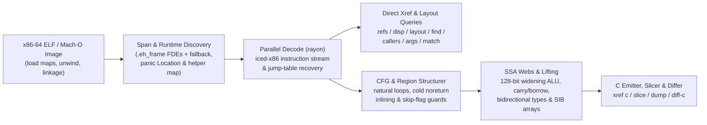

<!-- translation-source: ade25c980aa2ce3170972ba0ca6d31eedc45d838 -->
> **注意**: このドキュメントは英語版コミット [bd7f148](https://github.com/alex09x/xref/blob/ade25c980aa2ce3170972ba0ca6d31eedc45d838/README.md) からの翻訳です。最新の公式ドキュメントは [英語の README](https://github.com/alex09x/xref/blob/main/README.md) を参照してください。

[English](https://github.com/alex09x/xref/blob/main/README.md) | [Русский](https://github.com/alex09x/xref/blob/main/readme/README.ru.md) | [简体中文](https://github.com/alex09x/xref/blob/main/readme/README.zh-CN.md) | [Español](https://github.com/alex09x/xref/blob/main/readme/README.es.md) | [Português (Brasil)](https://github.com/alex09x/xref/blob/main/readme/README.pt-BR.md) | **[日本語](https://github.com/alex09x/xref/blob/main/readme/README.ja.md)** | [Deutsch](https://github.com/alex09x/xref/blob/main/readme/README.de.md) | [Français](https://github.com/alex09x/xref/blob/main/readme/README.fr.md) | [한국어](https://github.com/alex09x/xref/blob/main/readme/README.ko.md) | [العربية](https://github.com/alex09x/xref/blob/main/readme/README.ar.md)

<div align="center">


<br/><br/>

**x86-64 ELF / Mach-O バイナリ向けの超高速相互参照（クロスリファレンス）、構造体レイアウト復元、プログラムスライシング、および構造化疑似 C 言語生成ツール。**

純粋で安全な Rust（`#![forbid(unsafe_code)]`）によるゼロインデックス・バイナリ解析。関数境界は `.eh_frame` のアンワインドテーブルから直接取得され（スパンフォールバック機能付き）、シンボルテーブルが完全に空である stripped 状態の Rust リリースバイナリであっても、バイナリ全体のクエリを全 CPU コアで数ミリ秒以内に並列デコードします。

<br/>

[**インタラクティブ・ワークベンチ (xrefcode.com)**](https://xrefcode.com) · 開発者: [Alexander Panasenko](https://prod.codes/about/)

<br/>

[](https://github.com/alex09x/xref/releases)
[](https://crates.io/crates/xref-code)
[](https://doi.org/10.5281/zenodo.23878789)
[](https://github.com/alex09x/xref/actions)
[](../LICENSE-MIT)
[](../Cargo.toml)
[](../Cargo.toml)

<br/>

[**選ばれる理由**](#why) · [**インストール**](#installation) · [**クイックスタート**](#quick-start) · [**実例ログ**](#recorded-examples) · [**コマンドリファレンス**](#command-reference) · [**アーキテクチャ**](#architecture) · [**ベンチマーク**](#recorded-performance) · [**制約事項**](#scope--limitations) · [**文献引用**](#citation)

</div>

---

<a name="why"></a>
## 選ばれる理由

従来のリバースエンジニアリング・スイートは、最初の質問を投げかける前に、プログラム全体のデータベース事前インポートに数分間待機できる人間の対話型アナリストを前提としています。シンボルが除去（stripped）された Rust バイナリでは状況はさらに悪化します。シンボルは完全に消去され、文字列は `.rodata` プール内の NUL 終端を持たない `(ptr, len)` スライスであり、境界チェックのパニックによってループはコールドエッジ（cold edges）によって分断され、単純な逆コンパイラでは読むに耐えない `goto` スパゲッティコードへと変貌してしまいます。

**XRef Code**（`xref`）は、リバースエンジニアおよび自律型 AI エージェントの双方が迅速かつ反復的な調査を行えるよう設計されています：

- **事前インデックス不要、古いキャッシュも残りません。** 呼び出しごとに ELF イメージをメモリにマップし、`.eh_frame` のアンワインドレコードから正確な関数範囲を抽出し（自動スパンフォールバック付き）、`rayon` を介して関数を並列スキャンします。
- **ライブ解析：** Linux x86-64 のみ対応、1 セッションにつき 1 つの対象実行ファイル。共有ライブラリ内の書き込み命令や呼び出し元は、静的関数や書き込み値のない対象実行ファイル外として報告されます。`probe` および `watch` は特権 perf アクセスを必要とし、観測対象プロセスにトラップを導入します。
- **ネイティブで構造化された型付き疑似 C 言語（`xref c`）。** 外部ツールを一切使用せず、x86-64 マシン語を直接読みやすい C 言語へとリフト（引き上げ）します。不変の `arg_0..arg_5` シグネチャ、SSA ライブレンジウェブ（`ptr_*`, `v_*`, `slot_*`）、要素インデックス付き SIB 配列、128 ビットの中間値を用いる1オペランド拡張 `mul`/`imul`/`div`/`idiv`、多倍長精度の `adc`/`sbb` キャリー／ボローチェーン、符号付き算術オーバーフロー組み込み関数、そして構造化された `if`/`else`/`while`/`do-while`/`switch` 領域を復元します。
- **Rust 特有のパターンを考慮した stripped バイナリ復元。** シンボル除去された Rust ランタイムヘルパー（`rust_panic_bounds_check`, `rust_slice_index_fail`, `rust_capacity_overflow`）を認識し、正確な `(ptr, len)` の `&str` リテラルをスライスし、`core::panic::Location`（`file:line:col`）記述子を元のクレートソースパスへと逆マッピングし、`Display` ジャンプテーブルのアームを解決します。
- **スライシングとビルド間差分比較（`xref slice`, `xref match`, `xref diff-c`）。** 特定の呼び出しまたは命令 IP に到達する平衡化された文および制御ガードを分離し、ビルド間でアドレスがシフトした stripped 関数を再配置（リロケート）し、変動しやすい 16 進アドレスを抽象化した正規化疑似 C の diff を出力します。
- **Linux ライブプロセス検査 (`xref live`)。** 実行中の Linux x86-64 プロセスに静的ビューを接続：メモリ内の値を検索し、実行時ポインタを静的関数へ解決し、有界 uprobe で呼び出し回数と呼び出し元を計測し、書き込みを行う命令を特定します。

静的ブラウザワークベンチ **[xrefcode.com](https://xrefcode.com)** にて、stripped された `xref` 自体に対して記録された **114 回の逐字的な CLI 実行ログ** を体験してください。

---

<a name="installation"></a>
## インストール

### Homebrew（macOS Apple Silicon & Linux `x86_64`）

[`alex09x/homebrew-apps`](https://github.com/alex09x/homebrew-apps) タップからビルド済みの `xref` バイナリを直接インストールできます（Cargo によるコンパイルは不要です）：

```bash
brew tap alex09x/apps
brew install xref
xref --version
```

### ビルド済みリリースターボール（Linux `x86_64` & macOS `arm64`）

ビルド済みアーカイブ（`x86_64-unknown-linux-gnu` は `glibc >= 2.34` が必要、および `aarch64-apple-darwin`）には `xref`、`README.md`、`LICENSE-MIT`、`LICENSE-APACHE`、`CITATION.cff` がバンドルされています：

```bash
curl -fsSLO https://github.com/alex09x/xref/releases/download/v0.3.0/xref-v0.3.0-x86_64-unknown-linux-gnu.tar.gz
curl -fsSLO https://github.com/alex09x/xref/releases/download/v0.3.0/xref-v0.3.0-x86_64-unknown-linux-gnu.tar.gz.sha256
sha256sum -c xref-v0.3.0-x86_64-unknown-linux-gnu.tar.gz.sha256
tar -xzf xref-v0.3.0-x86_64-unknown-linux-gnu.tar.gz
./xref --version
```

### Cargo & `crates.io`（Linux & macOS）

[`crates.io` 上で `xref-code`](https://crates.io/crates/xref-code) として公開されており、`xref` CLI バイナリをインストールします（Edition 2024 の `let` chains 構文のため `rustc 1.88+` が必要です。[`cargo-binstall`](https://github.com/cargo-bins/cargo-binstall) 経由でのビルド済みバイナリ導入にも対応しています）：

```bash
cargo install xref-code --locked
# or prebuilt via cargo-binstall:
cargo binstall xref-code -y
# or directly from the pinned release tag:
cargo install --git https://github.com/alex09x/xref --tag v0.3.0 --locked
```

---

<a name="quick-start"></a>
## クイックスタート

各コマンドに `-b <BINARY>` を渡すか、シェルセッションで `XREF_BIN=/path/to/binary` を設定します。アドレスは静的イメージ VA を `0x` 16 進数または 10 進数で指定し、Mach-O の RVA 基準は `__TEXT.vmaddr` です。

```bash
export XREF_BIN=./xref.stripped

xref stats                                      # function count, .text bytes, pointers, panic locations
xref refs "goto L_"                             # code & data references to strings or addresses (--inline)
xref where src/loops.rs                         # stripped function ranges compiled from a Rust source file
xref layout 0xa2270 --reg rsi --callees         # recover struct field offsets, sizes, strides & 1-hop callees
xref c 0x9a8a0 --fields                         # structured typed pseudo-C with inferred ->f_<off> hints
xref slice 0xc7d60 --to fn_160bb0               # backward slice of statements & guards reaching a target
xref query '{"operation":"info"}'              # versioned JSON for one immutable image
xref mcp                                       # local read-only stdio MCP server
```

---

<a name="live-analysis-linux-x86-64"></a>
## ライブプロセス解析 (Linux x86-64)

v0.3.0 より、`xref live` は実行中の Linux x86-64 プロセスを検証済み実行ファイルの静的解析と連動させます。同一の ELF を `-b` で渡します。xref はアドレスを変換する前に `/proc/<pid>/exe`（GNU build-id または SHA-256）と照合します。

```bash
xref -b ./app live maps --pid PID                        # mappings, binary match, PIE slide
xref -b ./app live memscan --pid PID 0x4441454d4f4e5632  # find u64 values; classify neighbouring words
xref -b ./app live resolve --pid PID 0x55d1c0ffc9d0      # runtime address -> static VA, function, file offset
sudo xref -b ./app live probe --pid PID --callers 0x1f9f0       # bounded uprobe hit counts, callers, registers
sudo xref -b ./app live watch --pid PID 0x55d1e1c3adc8          # DR0-DR3 write watch: writer instruction and value
xref -b ./app mcp --allow-live-pid PID                   # opt-in xref_live MCP tool pinned to one process
```

- `maps`、`resolve`、`memscan` は `/proc/<pid>/maps` および `/proc/<pid>/mem` の読み取りのみを行います（対象への ptrace アクセス権が必要ですが、対象プロセスは停止しません）。
- `probe` および `watch` は対象上で perf イベントを開くため、特権 perf アクセス（root または `CAP_PERFMON`）が必要です。ヒットごとにプロセス内でトラップが発生するため、高負荷プロセスでは観測期間を短く設定してください。
- 結果は観測事実と推論を厳密に区別します。0 回のカウントは指定されたウィンドウおよびスレッドのみを対象とし、報告された書き込み箇所は明示的な信頼度を持つ候補であり、破棄されたイベントや後からアタッチされたスレッドがある場合、カウントは下限値となります。

ステップごとの記録セッション（メモリ検索 → 静的関数 → 呼び出しカウント → フィールド書き込み元 → バッファ移動）：**[ライブ解析ウォークスルー (Live Analysis walkthrough)](https://xrefcode.com/live-walkthrough)**。仕様と制限事項：[docs/live.md](https://github.com/alex09x/xref/blob/main/docs/live.md)、MCP：[docs/mcp.md](https://github.com/alex09x/xref/blob/main/docs/mcp.md)。

---

<a name="recorded-examples"></a>
## 実例ログ

以下の出力はすべて、`xref.stripped`（`1,962,608` バイト、シンボル数 `0`、`sha256:3f3ba3b311f3eca8e26a929285d4fc9ffef4e4b6e8fc015105766180a2a6869d`）に対して取得された完全かつ未編集の実行結果であり、CI において `docs/recorded-data.js` と行単位で一致することが検証されています（行末空白の差異を除く）。

### 1. フィールドオフセットのヒント付き構造化型付き疑似 C（`xref c --fields`）

```c
$ xref -b xref.stripped c 0x9a8a0 --fields
/* field offsets: arg_0 [+0x0:u64, +0x8:u64, +0x10:u64, +0x18:u64] */
/*
 * fn_9a8a0 — 0x9a8a0..0x9a97a (218 bytes, 1 direct caller; synthetic FDE entry)
 *   source: src/cfg.rs:154:22, src/cfg.rs:75:25, src/cfg.rs:154:57
 *   params:
 *     arg_0 (rdi): const void * — reads +0x0 (8B), +0x8 (8B), +0x10 (8B), +0x18 (8B)
 *     arg_1 (rsi): unk64 — 64-bit register (signedness unconstrained)
 *     arg_2 (rdx): unk64 — 64-bit register (signedness unconstrained)
 *   return: u8 in rax (consumed by 1/1 direct call site)
 */
u8 fn_9a8a0(const void *arg_0, unk64 arg_1, unk64 arg_2) {
  usize v_1 = arg_1; /* rsi */
  u64 v_6; /* rbx */
  const u8 *ptr_9; /* rax */
  unk64 slot_0; /* [rsp+0x0], addr-taken */
  unk64 slot_8; /* [rsp+0x8] */

  if (v_1 == 0) {
    ptr_9 = 0;
    return ptr_9;
  }
  u64 v_2 = arg_0->f_8;
  if (v_1 >= v_2) {
    usize v_12 = v_1;
    /* [runtime] rust_panic_bounds_check(index, len, loc) -> noreturn */
    rust_panic_bounds_check(v_12, v_2, "src/cfg.rs:154:22");
  }
  if (((u64 *)arg_0->f_0)[v_1] != 1) {
    ptr_9 = 0;
    return ptr_9;
  }
  const void *ptr_3 = arg_0->f_18;
  unk64 v_4 = *(u64 *)(arg_0->f_10);
  if (v_1 == v_4 + 2) {
    usize v_5 = (v_4 + 1);
    v_6 = *(u64 *)(ptr_3 + 16);
    if (v_5 >= v_6) {
      /* [runtime] rust_panic_bounds_check(index, len, loc) -> noreturn */
      rust_panic_bounds_check(v_5, v_6, "src/cfg.rs:154:57");
    }
    usize v_7 = v_1;
    unk64 v_8 = ((v_5 * 96) + *(u64 *)(ptr_3 + 8));
    slot_8 = arg_2;
    slot_0 = 1;
    /* fn_fb8e0: calls fn_fb9c6, fn_fb920 */
    ptr_9 = fn_fb8e0(v_8, &slot_0);
    u32 v_10 = ptr_9;
    ptr_9 = 1;
    v_1 = v_7;
    if (v_10 != 0) {
      return ptr_9;
    }
  } else {
    v_6 = *(u64 *)(ptr_3 + 16);
  }
  usize v_11 = (v_1 - 1);
  if (v_11 < v_6) {
    ptr_9 = *(u64 *)(ptr_3 + 8);
    ptr_9 = (((u8 *)ptr_9)[(v_11 * 96)] & 5) != 0;
    return ptr_9;
  }
  usize v_13 = v_11;
  /* [runtime] rust_panic_bounds_check(index, len, loc) -> noreturn */
  rust_panic_bounds_check(v_13, v_6, "src/cfg.rs:75:25");
}
```

### 2. 手続き間構造体レイアウト復元（`xref layout --callees`）

```text
$ xref -b xref.stripped layout 0xa2270 --reg rsi --callees
layout of rsi in 0xa2270..0xa2566:
  +0       size  4  u32   r:0  w:2
  +8       size  8  u64   r:2  w:0
  +10      size  8  u64   r:2  w:0
  +20      size  8  u64   r:1  w:0
  +28      size  8  u64   r:1  w:0
5 fields (min span 0x30)
other pointer args: rdi (3 fields), rdx (1 fields)  (use --reg <REG>)
```

### 3. バックワード・プログラムスライシング（`xref slice`）

```c
$ xref -b xref.stripped slice 0xc7d60 --to fn_160bb0
/* slice of 0xc7d60..0xc7fbf -> fn_160bb0 (37/131 lines) */
void fn_c7d60(void *arg_0, const void *arg_1, usize arg_2) {
  u8 slot_28; /* [rsp+0x28], addr-taken */
  usize slot_30; /* [rsp+0x30] */
  unk64 slot_40; /* [rsp+0x40], addr-taken */
  if (arg_2 == 0) {
    return; /* callers ignore rax */
  }
  const void *ptr_1 = arg_1;
  const void *v_2 = arg_1 + arg_2 * 24;
  void *v_4 = &slot_40;
  do {
    const u8 *ptr_6 = *(u64 *)(ptr_1 + 8);
    usize v_7 = *(u64 *)(ptr_1 + 16);
    /* fn_160550: source core/src/str/pattern.rs:1398; calls fn_1606e0, fn_160a43, fn_1605f8 */
    fn_160550(v_4, ptr_6, v_7, "goto L_", 7);
    /* fn_124d50: source core/src/str/pattern.rs:1131; calls fn_124e3a, fn_160bb0, fn_124e29 */
    fn_124d50(&slot_28, v_4);
    if (slot_28 != 0) {
      usize v_8 = slot_30;
      usize v_9 = (v_8 + 7);
      if (v_9 != 0) {
        if (v_9 < v_7) {
          if ((i8)((u8 *)ptr_6)[v_9] < -64) {
            /* fn_160bb0: noreturn; source core/src/str/mod.rs:486; calls fn_160bc0 */
            fn_160bb0(ptr_6, v_7, v_9, v_7, "src/loops.rs:45:36");
          }
        } else {
          if (v_9 != v_7) {
            /* fn_160bb0: noreturn; source core/src/str/mod.rs:486; calls fn_160bc0 */
            fn_160bb0(ptr_6, v_7, v_9, v_7, "src/loops.rs:45:36");
          }
        }
      }
    }
    ptr_1 = (ptr_1 + 24);
  } while (ptr_1 != v_2);
}
```

### 4. ビルド間リロケーションと正規化疑似 C の diff 比較（`xref diff-c`）

下記のインデントされた `  ...` 行は、diff ハンク外の変更されていない正規化コード行を示すために `xref diff-c` が直接出力したものです：

```diff
$ xref -b xref.stripped diff-c --other xref-v0.0.2.stripped 0xd57c0
=== diff 0xd57c0..0xd6301 (current) vs 0xd5530..0xd6071 (other, score 384: locs:240 strs:0 imms:4 disps:10 nbrs:105 size:0xb41 callees:8) ===
  ...
      }
      @var_11 = (@slot_10 + @var_8);
-     @var_1 = 0xc2bc;
+     @var_1 = 0xc518;
      @var_32 = @slot_9;
      switch (*(u64 *)(@var_11)) {
  ...
```

---

<a name="command-reference"></a>
## コマンドリファレンス

[詳細オプション](https://github.com/alex09x/xref/blob/main/docs/advanced-options.md)では、スタック上の変位検索とジャンプ先ラベルを保持する出力モードを説明します。

[構造化クエリとローカル MCP](https://github.com/alex09x/xref/blob/main/docs/mcp.md)により、同じ解析コアへプログラムからアクセスできます。

[範囲を限定した調査](https://github.com/alex09x/xref/blob/main/docs/investigations.md)では、文字列、参照、呼び出し、引数の証拠、明示的に選択したスライスを関連付け、候補と制限を保持します。

[フィールドの由来の調査](https://github.com/alex09x/xref/blob/main/docs/field-origin.md)では、入口レジスタを基準とするアドレスと読み込まれた値を区別し、メモリアクセスと呼び出し先の命令を証拠として保持します。

### インベントリ、シンボル、および相互参照

```text
xref -b BIN stats                                    # functions, .text bytes, pointers, imports, panic locations
xref -b BIN sym PATTERN                              # symbol search (non-stripped binaries)
xref -b BIN func 0xa1b50                             # function span containing an address
xref -b BIN refs "goto L_" 0xa1b50                   # .rodata / pointer / code xrefs (--inline for mov/movabs stores)
xref -b BIN istr "text"                              # shorthand for refs --inline
xref -b BIN imm 24 --in 0xa1b50                      # immediate constants (--store, --cmp, --in FN)
xref -b BIN find --src src/loops.rs --calls 0x160bb0 # single-pass multi-predicate function search (--any K)
```

### 構造体レイアウト、ディスプレイスメント、およびコールグラフ

```text
xref -b BIN disp 0x20 0x28 --all                     # field loads/stores/leas (--write, --lea, --stride, --in FN)
xref -b BIN layout 0xa2270 --reg rsi --callees       # aggregate field offsets, widths, strides & 1-hop callees
xref -b BIN callers 0xcafb0                          # direct calls/tail-jumps, address-taken & pointer-table xrefs
xref -b BIN calls 0xcafb0                            # outgoing calls and tail-jumps in instruction order
xref -b BIN args 0xa2270 --max 20                    # constant & symbolic arguments across all call sites
xref -b BIN path 0xc7fc0 0x160bb0 --depth 8          # shortest call chains between two functions
xref -b BIN tree 0xd0aa0 --callers --depth 2         # indented caller/callee tree with panic source anchors
```

### 逆アセンブル、疑似 C、スライシング、クレートエクスポート、および diff 比較

```text
xref -b BIN asm 0xc7d60 --from A --to B              # annotated Intel disassembly (strings, slots, targets)
xref -b BIN c 0x9a8a0 --fields                       # structured typed pseudo-C (--out DIR for parallel batch export)
xref -b BIN slice 0xc7d60 --to fn_160bb0 --fields    # backward slice to target call, hex IP, offset, or string
xref -b BIN dump --out DIR --src src/loops.rs        # parallel modular .c export grouped by panic source paths
xref -b BIN match --other OLD_BIN 0xc7d60 --top 3    # relocate shifted stripped functions across two builds
xref -b BIN diff-c --other OLD_BIN 0xd57c0           # normalized cross-build pseudo-C LCS diff
```

### Rust ソース位置および enum ジャンプテーブル

```text
xref -b BIN src 0x9a8a0                              # core::panic::Location (file:line:col) descriptors in function
xref -b BIN where src/image.rs --line 46             # stripped functions referencing a Rust file (and line)
xref -b BIN files src/                               # distinct Rust source files recovered from panic descriptors
xref -b BIN error "invalid"                          # jump-table discriminant whose Display arm names text
xref -b BIN variant 0xc7fc0 1 2                      # inverse of error: texts referenced by jump-table arms
xref -b BIN arm 0xc8010                              # jump-table indices whose arm contains an address
```

---

<a name="architecture"></a>
## アーキテクチャ



---

<a name="recorded-performance"></a>
## ベンチマーク

`AMD Ryzen 9 9950X`（16 コア / 32 スレッド、Linux 6.8 `x86_64`、ウォーム状態の OS ページキャッシュ）上で stripped された `xref.stripped`（`1.96 MB`、関数数 `1,974`、シンボル数 `0`）を解析した際に、`xref 0.0.5`（`stderr`）によって報告された単一実行の CLI 実経過時間（ウォールタイム）：

| 操作 | コマンド | ELF 読み込み | 合計時間 |
|---|---|---:|---:|
| バイナリインベントリ（`1,974` 関数、`588` パニック位置） | `xref -b xref.stripped stats` | `0.84 ms` | **`2.2 ms`** |
| 全バイナリ文字列およびポインタの相互参照スキャン | `xref -b xref.stripped refs "goto L_"` | `0.80 ms` | **`3.9 ms`** |
| 埋め込みパニック位置からの Rust モジュールマッピング | `xref -b xref.stripped where src/loops.rs` | `0.79 ms` | **`3.4 ms`** |
| 手続き間構造体レイアウト復元（1ホップの被呼び出し先） | `xref -b xref.stripped layout 0xa2270 --reg rsi --callees` | `0.81 ms` | **`2.6 ms`** |
| バックワード・プログラムスライス + フィールドオフセットヒント | `xref -b xref.stripped slice 0xc7d60 --to fn_160bb0 --fields` | `0.81 ms` | **`5.1 ms`** |
| ビルド間関数マッチングおよび正規化疑似 C の diff 比較 | `xref -b xref.stripped diff-c --other xref-v0.0.2.stripped 0xc7d60` | `0.86 ms` | **`13.4 ms`** |

---

<a name="scope--limitations"></a>
## 制約事項

- **対応入力:** `x86-64` ELF バイナリと共有オブジェクト（`ET_EXEC`、`ET_DYN`）。v0.3.0 以降では、DWARF unwind 情報を持つ thin リトルエンディアン x86-64 Mach-O の実行ファイル、dylib、bundle にも対応します。[Mach-O 入力](https://github.com/alex09x/xref/blob/main/docs/macho.md)を参照してください。公開済み v0.1.0 は ELF のみです。ARM64、PE、fat/universal、compact unwind のみの入力は未対応です。
- **関数境界の検出:** 正確な関数スパンは `.eh_frame` アンワインドテーブルから取得されます（`x86-64` では `strip --strip-all` 後であっても `rustc`、`clang`、`gcc` によってデフォルトで生成されます）。アンワインドエントリが存在しない場合は、ギャップ／呼び出しターゲットに基づくスパンフォールバックが適用されます。`.eh_frame` が完全に除去されたバイナリ（`strip -R .eh_frame`）ではヒューリスティックなスパン境界判定に依存します。
- **静的疑似 C およびオフセット推論:** パラメータシグネチャ（`arg_*`）、推論されたポインタ／整数型（`const void *`, `usize`, `unk64` など）、および `--fields` によるオフセットヒント（`->f_<off>`）は、マシン語の使用パターンから保守的に静的再構築されたものであり、DWARF ソース型情報ではありません。モデル化されていない SIMD／システム命令は、黙って破棄されることなく、明示的な `/* 0xaddr: ... */` アセンブリコメントとしてインラインに保持されます。重要な不変条件は常に `xref asm` でクロスチェックしてください。

---

<a name="development--testing"></a>
## 開発とテスト

テストを実行する際は `PATH` 上に `rustc` が必要です。エンドツーエンドのテストスイートは `tests/fixtures/sample.rs` を一時的な ELF フィクスチャとしてコンパイルし、それに対して各 CLI サブコマンドを検証します。

```bash
cargo fmt --all -- --check
cargo clippy --workspace --all-targets --locked -- -D warnings
cargo test --workspace --locked
```

---

<a name="citation"></a>
## 文献引用

機械可読なソフトウェアメタデータは [`CITATION.cff`](../CITATION.cff) を参照してください。以前の `v0.1.0` アーカイブスナップショット: [10.5281/zenodo.23878790](https://doi.org/10.5281/zenodo.23878790)。

```bibtex
@software{panasenko_2026_23902824,
  author       = {Panasenko, Alexander},
  title        = {XRef Code — Ultra Blazing Fast x86-64 ELF and Mach-O Analysis, Pseudo-C and Local MCP},
  month        = nov,
  year         = 2026,
  publisher    = {Zenodo},
  version      = {0.2.0},
  doi          = {10.5281/zenodo.23902824},
  url          = {https://doi.org/10.5281/zenodo.23902824}
}
```

- Alexander Panasenko (2026). *XRef Code — Ultra Blazing Fast x86-64 ELF and Mach-O Analysis, Pseudo-C and Local MCP* (v0.3.0). Zenodo. https://doi.org/10.5281/zenodo.23902824 ([concept DOI: 10.5281/zenodo.23878789](https://doi.org/10.5281/zenodo.23878789))

---

<a name="license"></a>
## ライセンス

Copyright © 2026 [Alexander Panasenko](https://prod.codes/about/) (`alex@prod.codes`).

以下のいずれかのライセンスに基づくデュアルライセンスです：
- **Apache License, Version 2.0** ([`LICENSE-APACHE`](../LICENSE-APACHE) または http://www.apache.org/licenses/LICENSE-2.0)
- **MIT License** ([`LICENSE-MIT`](../LICENSE-MIT) または http://opensource.org/licenses/MIT)

ご希望のライセンスを選択いただけます。
