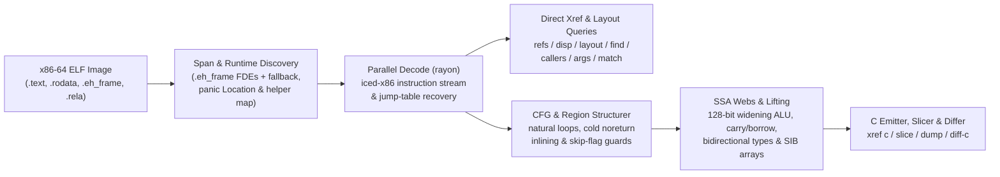

<!-- translation-source: 4d53038bb901ff93c8c807043c13a9670e58c9d7 -->
> **참고**: 이 문서는 영어 원본 커밋 [4d53038](https://github.com/alex09x/xref/blob/4d53038bb901ff93c8c807043c13a9670e58c9d7/README.md)의 번역본입니다. 최신 공식 문서는 [영어 README](https://github.com/alex09x/xref/blob/main/README.md)를 참조하십시오.

[English](https://github.com/alex09x/xref/blob/main/README.md) | [Русский](https://github.com/alex09x/xref/blob/main/readme/README.ru.md) | [简体中文](https://github.com/alex09x/xref/blob/main/readme/README.zh-CN.md) | [Español](https://github.com/alex09x/xref/blob/main/readme/README.es.md) | [Português (Brasil)](https://github.com/alex09x/xref/blob/main/readme/README.pt-BR.md) | [日本語](https://github.com/alex09x/xref/blob/main/readme/README.ja.md) | [Deutsch](https://github.com/alex09x/xref/blob/main/readme/README.de.md) | [Français](https://github.com/alex09x/xref/blob/main/readme/README.fr.md) | **[한국어](https://github.com/alex09x/xref/blob/main/readme/README.ko.md)** | [العربية](https://github.com/alex09x/xref/blob/main/readme/README.ar.md)

<div align="center">


<br/><br/>

**x86-64 ELF 바이너리를 위한 초고속 상호 참조(교차 참조), 구조체 레이아웃 복원, 프로그램 슬라이싱 및 구조화된 의사 C(pseudo-C) 생성 도구.**

순수 안전 Rust(`#![forbid(unsafe_code)]`) 기반의 제로 인덱스(zero-index) 바이너리 분석. 함수 경계는 `.eh_frame` 언와인드 테이블에서 직접 추출되며(스팬 대체 메커니즘 지원), 심볼 테이블이 완전히 비어 있는 스트립(stripped)된 Rust 릴리스 바이너리에서도 전체 바이너리 쿼리를 모든 CPU 코어에서 수 밀리초 만에 병렬로 디코딩합니다.

<br/>

[**인터랙티브 워크벤치 (xrefcode.com)**](https://xrefcode.com) · 개발자: [Alexander Panasenko](https://prod.codes/about/)

<br/>

[](https://github.com/alex09x/xref/releases)
[](https://crates.io/crates/xref-code)
[](https://doi.org/10.5281/zenodo.23878789)
[](https://github.com/alex09x/xref/actions)
[](../LICENSE-MIT)
[](../Cargo.toml)
[](../Cargo.toml)

<br/>

[**선택 이유**](#why) · [**설치**](#installation) · [**빠른 시작**](#quick-start) · [**실행 기록 예제**](#recorded-examples) · [**명령어 레퍼런스**](#command-reference) · [**아키텍처**](#architecture) · [**벤치마크 성능**](#recorded-performance) · [**적용 범위 및 한계**](#scope--limitations) · [**인용**](#citation)

</div>

---

<a name="why"></a>
## 선택 이유

전통적인 리버스 엔지니어링 도구 모음은 첫 질문을 던지기 전에 전체 프로그램 데이터베이스를 사전에 임포트하느라 수 분간 기다릴 의향이 있는 대화형 분석가를 전제로 합니다. 심볼이 제거(stripped)된 Rust 바이너리에서는 상황이 더 나빠집니다. 심볼은 사라지고, 문자열은 `.rodata` 풀에 존재하는 NUL 종료자가 없는 `(ptr, len)` 슬라이스이며, 경계 검사 패닉으로 인해 루프가 콜드 에지(cold edge)로 산산조각 나면서 단순한 디컴파일러는 읽을 수 없는 `goto` 스파게티 코드를 만들어 냅니다.

**XRef Code**(`xref`)는 리버스 엔지니어와 자율 AI 에이전트 모두의 신속하고 반복적인 조사를 위해 설계되었습니다:

- **제로 인덱스, 오래된 캐시 없음.** 실행할 때마다 메모리에 ELF 이미지를 매핑하고, `.eh_frame` 언와인드 레코드에서 정확한 함수 범위를 추출하며(자동 스팬 대체 지원), `rayon`을 통해 함수를 병렬로 스캔합니다.
- **네이티브 구조화 타입 의사 C (`xref c`).** 외부 도구 없이 x86-64 기계어를 읽기 쉬운 C 코드로 직접 리프팅합니다. 불변 `arg_0..arg_5` 서명, SSA 라이브 레인지 웹(`ptr_*`, `v_*`, `slot_*`), 요소 인덱스 방식의 SIB 배열, 단일 피연산자 `128비트` 확장 `mul`/`imul`/`div`/`idiv`, 다중 정밀도 `adc`/`sbb` 캐리/빌림 체인, 부호 있는 산술 오버플로 인트린식, 그리고 구조화된 `if`/`else`/`while`/`do-while`/`switch` 영역을 복원합니다.
- **Rust 바이너리 특화 스트립 복원.** 심볼이 제거된 Rust 런타임 헬퍼(`rust_panic_bounds_check`, `rust_slice_index_fail`, `rust_capacity_overflow`)를 인식하고, 정확한 `(ptr, len)` `&str` 리터럴을 슬라이스하며, `core::panic::Location`(`file:line:col`) 설명자를 원래의 크레이트 소스 경로로 역매핑하고, `Display` 점프 테이블 암(arm)을 확인합니다.
- **슬라이싱 및 빌드 간 비교 (`xref slice`, `xref match`, `xref diff-c`).** 특정 호출 또는 명령어 IP에 도달하는 균형 잡힌 구문과 제어 가드를 분리하고, 빌드 간에 이동된 스트립 함수를 재배치하며, 가변적인 16진수 주소를 추상화한 정규화된 의사 C로 diff를 생성합니다.

정적 브라우저 워크벤치인 **[xrefcode.com](https://xrefcode.com)**에서 스트립된 `xref` 자체를 대상으로 기록된 **114개의 축자 CLI 실행 결과**를 직접 살펴보십시오.

---

<a name="installation"></a>
## 설치

### Homebrew (macOS Apple Silicon 및 Linux `x86_64`)

[`alex09x/homebrew-apps`](https://github.com/alex09x/homebrew-apps) 탭에서 사전 빌드된 `xref` 바이너리를 직접 설치합니다 (Cargo 컴파일 불필요):

```bash
brew tap alex09x/apps
brew install xref
xref --version
```

### 사전 빌드 릴리스 압축 파일 (Linux `x86_64` 및 macOS `arm64`)

사전 빌드된 아카이브(`x86_64-unknown-linux-gnu`는 `glibc >= 2.34` 필요, 및 `aarch64-apple-darwin`)는 `xref`, `README.md`, `LICENSE-MIT`, `LICENSE-APACHE`, `CITATION.cff`를 함께 제공합니다:

```bash
curl -fsSLO https://github.com/alex09x/xref/releases/download/v0.1.0/xref-v0.1.0-x86_64-unknown-linux-gnu.tar.gz
curl -fsSLO https://github.com/alex09x/xref/releases/download/v0.1.0/xref-v0.1.0-x86_64-unknown-linux-gnu.tar.gz.sha256
sha256sum -c xref-v0.1.0-x86_64-unknown-linux-gnu.tar.gz.sha256
tar -xzf xref-v0.1.0-x86_64-unknown-linux-gnu.tar.gz
./xref --version
```

### Cargo 및 `crates.io` (Linux 및 macOS)

[`crates.io`에 `xref-code`](https://crates.io/crates/xref-code)로 등록되어 있어 `xref` CLI 바이너리를 설치할 수 있습니다 (Edition 2024의 `let` 체인 지원을 위해 `rustc 1.88+` 필요; 사전 빌드된 바이너리는 [`cargo-binstall`](https://github.com/cargo-bins/cargo-binstall)을 통해서도 설치 가능):

```bash
cargo install xref-code --locked
# or prebuilt via cargo-binstall:
cargo binstall xref-code -y
# or directly from the pinned release tag:
cargo install --git https://github.com/alex09x/xref --tag v0.1.0 --locked
```

---

<a name="quick-start"></a>
## 빠른 시작

각 명령어마다 `-b <ELF>`를 지정하거나 셸 세션당 한 번 `export XREF_BIN=/path/to/binary.elf`를 설정하십시오. 주소는 `0x` 16진수 또는 10진수로 된 ELF 가상 주소 번호(`objdump` 주소)를 사용합니다:

```bash
export XREF_BIN=./xref.stripped

xref stats                                      # function count, .text bytes, pointers, panic locations
xref refs "goto L_"                             # code & data references to strings or addresses (--inline)
xref where src/loops.rs                         # stripped function ranges compiled from a Rust source file
xref layout 0xa2270 --reg rsi --callees         # recover struct field offsets, sizes, strides & 1-hop callees
xref c 0x9a8a0 --fields                         # structured typed pseudo-C with inferred ->f_<off> hints
xref slice 0xc7d60 --to fn_160bb0               # backward slice of statements & guards reaching a target
```

---

<a name="recorded-examples"></a>
## 실행 기록 예제

아래의 모든 출력은 `xref.stripped`(`1,962,608` 바이트, 심볼 `0`개, `sha256:3f3ba3b311f3eca8e26a929285d4fc9ffef4e4b6e8fc015105766180a2a6869d`)를 대상으로 캡처된 편집되지 않은 전체 실행 결과이며, CI에서 `docs/recorded-data.js`와 한 줄 한 줄 정확히 일치하는지 검증되었습니다 (줄 끝 후행 공백 제외).

### 1. 필드 오프셋 힌트가 포함된 구조화 타입 의사 C (`xref c --fields`)

```c
$ xref -b xref.stripped c 0x9a8a0 --fields
/* field offsets: arg_0 [+0x0:u64, +0x8:u64, +0x10:u64, +0x18:u64] */
/*
 * fn_9a8a0 — 0x9a8a0..0x9a97a (218 bytes, 1 direct caller; synthetic FDE entry)
 *   source: src/cfg.rs:154:22, src/cfg.rs:75:25, src/cfg.rs:154:57
 *   params:
 *     arg_0 (rdi): const void * — reads +0x0 (8B), +0x8 (8B), +0x10 (8B), +0x18 (8B)
 *     arg_1 (rsi): unk64 — 64-bit register (signedness unconstrained)
 *     arg_2 (rdx): unk64 — 64-bit register (signedness unconstrained)
 *   return: u8 in rax (consumed by 1/1 direct call site)
 */
u8 fn_9a8a0(const void *arg_0, unk64 arg_1, unk64 arg_2) {
  usize v_1 = arg_1; /* rsi */
  u64 v_6; /* rbx */
  const u8 *ptr_9; /* rax */
  unk64 slot_0; /* [rsp+0x0], addr-taken */
  unk64 slot_8; /* [rsp+0x8] */

  if (v_1 == 0) {
    ptr_9 = 0;
    return ptr_9;
  }
  u64 v_2 = arg_0->f_8;
  if (v_1 >= v_2) {
    usize v_12 = v_1;
    /* [runtime] rust_panic_bounds_check(index, len, loc) -> noreturn */
    rust_panic_bounds_check(v_12, v_2, "src/cfg.rs:154:22");
  }
  if (((u64 *)arg_0->f_0)[v_1] != 1) {
    ptr_9 = 0;
    return ptr_9;
  }
  const void *ptr_3 = arg_0->f_18;
  unk64 v_4 = *(u64 *)(arg_0->f_10);
  if (v_1 == v_4 + 2) {
    usize v_5 = (v_4 + 1);
    v_6 = *(u64 *)(ptr_3 + 16);
    if (v_5 >= v_6) {
      /* [runtime] rust_panic_bounds_check(index, len, loc) -> noreturn */
      rust_panic_bounds_check(v_5, v_6, "src/cfg.rs:154:57");
    }
    usize v_7 = v_1;
    unk64 v_8 = ((v_5 * 96) + *(u64 *)(ptr_3 + 8));
    slot_8 = arg_2;
    slot_0 = 1;
    /* fn_fb8e0: calls fn_fb9c6, fn_fb920 */
    ptr_9 = fn_fb8e0(v_8, &slot_0);
    u32 v_10 = ptr_9;
    ptr_9 = 1;
    v_1 = v_7;
    if (v_10 != 0) {
      return ptr_9;
    }
  } else {
    v_6 = *(u64 *)(ptr_3 + 16);
  }
  usize v_11 = (v_1 - 1);
  if (v_11 < v_6) {
    ptr_9 = *(u64 *)(ptr_3 + 8);
    ptr_9 = (((u8 *)ptr_9)[(v_11 * 96)] & 5) != 0;
    return ptr_9;
  }
  usize v_13 = v_11;
  /* [runtime] rust_panic_bounds_check(index, len, loc) -> noreturn */
  rust_panic_bounds_check(v_13, v_6, "src/cfg.rs:75:25");
}
```

### 2. 프로시저 간 구조체 레이아웃 복원 (`xref layout --callees`)

```text
$ xref -b xref.stripped layout 0xa2270 --reg rsi --callees
layout of rsi in 0xa2270..0xa2566:
  +0       size  4  u32   r:0  w:2
  +8       size  8  u64   r:2  w:0
  +10      size  8  u64   r:2  w:0
  +20      size  8  u64   r:1  w:0
  +28      size  8  u64   r:1  w:0
5 fields (min span 0x30)
other pointer args: rdi (3 fields), rdx (1 fields)  (use --reg <REG>)
```

### 3. 역방향 프로그램 슬라이싱 (`xref slice`)

```c
$ xref -b xref.stripped slice 0xc7d60 --to fn_160bb0
/* slice of 0xc7d60..0xc7fbf -> fn_160bb0 (37/131 lines) */
void fn_c7d60(void *arg_0, const void *arg_1, usize arg_2) {
  u8 slot_28; /* [rsp+0x28], addr-taken */
  usize slot_30; /* [rsp+0x30] */
  unk64 slot_40; /* [rsp+0x40], addr-taken */
  if (arg_2 == 0) {
    return; /* callers ignore rax */
  }
  const void *ptr_1 = arg_1;
  const void *v_2 = arg_1 + arg_2 * 24;
  void *v_4 = &slot_40;
  do {
    const u8 *ptr_6 = *(u64 *)(ptr_1 + 8);
    usize v_7 = *(u64 *)(ptr_1 + 16);
    /* fn_160550: source core/src/str/pattern.rs:1398; calls fn_1606e0, fn_160a43, fn_1605f8 */
    fn_160550(v_4, ptr_6, v_7, "goto L_", 7);
    /* fn_124d50: source core/src/str/pattern.rs:1131; calls fn_124e3a, fn_160bb0, fn_124e29 */
    fn_124d50(&slot_28, v_4);
    if (slot_28 != 0) {
      usize v_8 = slot_30;
      usize v_9 = (v_8 + 7);
      if (v_9 != 0) {
        if (v_9 < v_7) {
          if ((i64)((u8 *)ptr_6)[v_9] < 192) {
            /* fn_160bb0: noreturn; source core/src/str/mod.rs:486; calls fn_160bc0 */
            fn_160bb0(ptr_6, v_7, v_9, v_7, "src/loops.rs:45:36");
          }
        } else {
          if (v_9 != v_7) {
            /* fn_160bb0: noreturn; source core/src/str/mod.rs:486; calls fn_160bc0 */
            fn_160bb0(ptr_6, v_7, v_9, v_7, "src/loops.rs:45:36");
          }
        }
      }
    }
    ptr_1 = (ptr_1 + 24);
  } while (ptr_1 != v_2);
}
```

### 4. 빌드 간 함수 재배치 및 정규화된 의사 C diff (`xref diff-c`)

아래에 들여쓰기된 `  ...` 줄은 diff 헝크 외부에서 변경되지 않은 정규화된 코드 줄을 표시하기 위해 `xref diff-c`가 직접 출력한 내용입니다:

```diff
$ xref -b xref.stripped diff-c --other xref-v0.0.2.stripped 0xd57c0
=== diff 0xd57c0..0xd6301 (current) vs 0xd5530..0xd6071 (other, score 384: locs:240 strs:0 imms:4 disps:10 nbrs:105 size:0xb41 callees:8) ===
  ...
      }
      @var_11 = (@slot_10 + @var_8);
-     @var_1 = 0xc2bc;
+     @var_1 = 0xc518;
      @var_32 = @slot_9;
      switch (*(u64 *)(@var_11)) {
  ...
```

---

<a name="command-reference"></a>
## 명령어 레퍼런스

### 인벤토리, 심볼 및 상호 참조

```text
xref -b BIN stats                                    # functions, .text bytes, pointers, imports, panic locations
xref -b BIN sym PATTERN                              # symbol search (non-stripped binaries)
xref -b BIN func 0xa1b50                             # function span containing an address
xref -b BIN refs "goto L_" 0xa1b50                   # .rodata / pointer / code xrefs (--inline for mov/movabs stores)
xref -b BIN istr "text"                              # shorthand for refs --inline
xref -b BIN imm 24 --in 0xa1b50                      # immediate constants (--store, --cmp, --in FN)
xref -b BIN find --src src/loops.rs --calls 0x160bb0 # single-pass multi-predicate function search (--any K)
```

### 구조체 레이아웃, 변위 및 호출 그래프

```text
xref -b BIN disp 0x20 0x28 --all                     # field loads/stores/leas (--write, --lea, --stride, --in FN)
xref -b BIN layout 0xa2270 --reg rsi --callees       # aggregate field offsets, widths, strides & 1-hop callees
xref -b BIN callers 0xcafb0                          # direct calls/tail-jumps, address-taken & pointer-table xrefs
xref -b BIN calls 0xcafb0                            # outgoing calls and tail-jumps in instruction order
xref -b BIN args 0xa2270 --max 20                    # constant & symbolic arguments across all call sites
xref -b BIN path 0xc7fc0 0x160bb0 --depth 8          # shortest call chains between two functions
xref -b BIN tree 0xd0aa0 --callers --depth 2         # indented caller/callee tree with panic source anchors
```

### 디스어셈블리, 의사 C, 슬라이싱, 크레이트 내보내기 및 diff

```text
xref -b BIN asm 0xc7d60 --from A --to B              # annotated Intel disassembly (strings, slots, targets)
xref -b BIN c 0x9a8a0 --fields                       # structured typed pseudo-C (--out DIR for parallel batch export)
xref -b BIN slice 0xc7d60 --to fn_160bb0 --fields    # backward slice to target call, hex IP, offset, or string
xref -b BIN dump --out DIR --src src/loops.rs        # parallel modular .c export grouped by panic source paths
xref -b BIN match --other OLD_BIN 0xc7d60 --top 3    # relocate shifted stripped functions across two builds
xref -b BIN diff-c --other OLD_BIN 0xd57c0           # normalized cross-build pseudo-C LCS diff
```

### Rust 소스 위치 및 열거형 점프 테이블

```text
xref -b BIN src 0x9a8a0                              # core::panic::Location (file:line:col) descriptors in function
xref -b BIN where src/image.rs --line 46             # stripped functions referencing a Rust file (and line)
xref -b BIN files src/                               # distinct Rust source files recovered from panic descriptors
xref -b BIN error "invalid"                          # jump-table discriminant whose Display arm names text
xref -b BIN variant 0xc7fc0 1 2                      # inverse of error: texts referenced by jump-table arms
xref -b BIN arm 0xc8010                              # jump-table indices whose arm contains an address
```

---

<a name="architecture"></a>
## 아키텍처



---

<a name="recorded-performance"></a>
## 벤치마크 성능

스트립된 `xref.stripped`(`1.96 MB`, `1,974`개 함수, `0`개 심볼)를 분석할 때 `AMD Ryzen 9 9950X`(16코어 / 32스레드, Linux 6.8 `x86_64`, 웜 OS 페이지 캐시) 환경에서 `xref 0.0.5`(`stderr`)가 보고한 단일 실행 CLI 경과 시간:

| 작업 | 명령어 | ELF 로드 | 총 소요 시간 |
|---|---|---:|---:|
| 바이나리 인벤토리 (`1,974`개 함수, `588`개 패닉 위치) | `xref -b xref.stripped stats` | `0.84 ms` | **`2.2 ms`** |
| 전체 바이나리 문자열 및 포인터 상호 참조 스캔 | `xref -b xref.stripped refs "goto L_"` | `0.80 ms` | **`3.9 ms`** |
| 내장 패닉 위치 기반 Rust 모듈 매핑 | `xref -b xref.stripped where src/loops.rs` | `0.79 ms` | **`3.4 ms`** |
| 프로시저 간 구조체 레이아웃 복원 (1홉 피호출 함수) | `xref -b xref.stripped layout 0xa2270 --reg rsi --callees` | `0.81 ms` | **`2.6 ms`** |
| 역방향 프로그램 슬라이스 + 필드 오프셋 힌트 (`37 / 131` 라인) | `xref -b xref.stripped slice 0xc7d60 --to fn_160bb0 --fields` | `0.81 ms` | **`5.1 ms`** |
| 빌드 간 함수 매칭 및 정규화된 의사 C diff | `xref -b xref.stripped diff-c --other xref-v0.0.2.stripped 0xc7d60` | `0.86 ms` | **`13.4 ms`** |

---

<a name="scope--limitations"></a>
## 적용 범위 및 한계

- **지원되는 입력 형식:** `x86-64` ELF 바이나리 및 공유 객체(`ET_EXEC`, `ET_DYN`). PE/Mach-O 및 AArch64는 현재 지원 범위에 포함되지 않습니다.
- **함수 경계 탐색:** 정확한 함수 범위는 `.eh_frame` 언와인드 테이블에서 가져옵니다(`x86-64`에서는 `strip --strip-all` 이후에도 `rustc`, `clang`, `gcc`가 기본적으로 생성함). 언와인드 항목이 없는 경우 갭/호출 대상 스팬 대체 기능이 작동합니다. `.eh_frame`까지 제거된 바이나리(`strip -R .eh_frame`)는 휴리스틱 스팬 경계에 의존합니다.
- **정적 의사 C 및 오프셋 추론:** 매개변수 서명(`arg_*`), 추론된 포인터/정수 타입(`const void *`, `usize`, `unk64` 등) 및 `--fields` 오프셋 힌트(`->f_<off>`)는 DWARF 소스 타입이 아니라 기계어 명령어 사용 패턴을 기반으로 보수적으로 정적 재구성한 것입니다. 모델링되지 않은 SIMD/시스템 명령어는 자동으로 무시되지 않고 명시적인 `/* 0xaddr: ... */` 어셈블리 주석으로 인라인 보존됩니다. 중요한 불변 조건은 항상 `xref asm`으로 교차 확인하십시오.

---

<a name="development--testing"></a>
## 개발 및 테스트

테스트를 실행할 때 `PATH`에 `rustc`가 있어야 합니다. 엔드투엔드 테스트 스위트는 `tests/fixtures/sample.rs`를 임시 ELF 픽스처로 컴파일하고 이에 대해 CLI 하위 명령어를 검증합니다.

```bash
cargo fmt --all -- --check
cargo clippy --workspace --all-targets --locked -- -D warnings
cargo test --workspace --locked
```

---

<a name="citation"></a>
## 인용

학술, 보안 또는 아카이브 목적으로 참조할 경우 Zenodo 또는 [`CITATION.cff`](../CITATION.cff)를 통해 게시된 `v0.1.0` 릴리스를 인용하십시오:

```bibtex
@software{panasenko_2026_23878790,
  author       = {Panasenko, Alexander},
  title        = {XRef Code — Ultra Blazing Fast x86-64 ELF Cross-References \& Pseudo-C Decompiler},
  month        = nov,
  year         = 2026,
  publisher    = {Zenodo},
  version      = {0.1.0},
  doi          = {10.5281/zenodo.23878790},
  url          = {https://doi.org/10.5281/zenodo.23878790}
}
```

- Alexander Panasenko (2026). *XRef Code — Ultra Blazing Fast x86-64 ELF Cross-References & Pseudo-C Decompiler* (v0.1.0). Zenodo. https://doi.org/10.5281/zenodo.23878790 ([concept DOI: 10.5281/zenodo.23878789](https://doi.org/10.5281/zenodo.23878789))

---

<a name="license"></a>
## 라이선스

저작권 © 2026 [Alexander Panasenko](https://prod.codes/about/) (`alex@prod.codes`).

다음 중 하나의 라이선스에 따라 이중 라이선스가 적용됩니다:
- **Apache License, Version 2.0** ([`LICENSE-APACHE`](../LICENSE-APACHE) 또는 http://www.apache.org/licenses/LICENSE-2.0)
- **MIT License** ([`LICENSE-MIT`](../LICENSE-MIT) 또는 http://opensource.org/licenses/MIT)

선택에 따라 사용할 수 있습니다.
