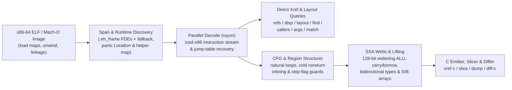

<!-- translation-source: d121640b6c86df945d14ce103a21b0bb32dec2fc -->
> Este documento é uma tradução da versão em inglês disponível no commit [`d121640`](https://github.com/alex09x/xref/blob/d121640b6c86df945d14ce103a21b0bb32dec2fc/README.md). A versão canônica e mais atualizada está sempre no [README em inglês](https://github.com/alex09x/xref/blob/main/README.md).

<div align="center">

[English](https://github.com/alex09x/xref/blob/main/README.md) | [Русский](https://github.com/alex09x/xref/blob/main/readme/README.ru.md) | [简体中文](https://github.com/alex09x/xref/blob/main/readme/README.zh-CN.md) | [Español](https://github.com/alex09x/xref/blob/main/readme/README.es.md) | [**Português (Brasil)**](https://github.com/alex09x/xref/blob/main/readme/README.pt-BR.md) | [日本語](https://github.com/alex09x/xref/blob/main/readme/README.ja.md) | [Deutsch](https://github.com/alex09x/xref/blob/main/readme/README.de.md) | [Français](https://github.com/alex09x/xref/blob/main/readme/README.fr.md) | [한국어](https://github.com/alex09x/xref/blob/main/readme/README.ko.md) | [العربية](https://github.com/alex09x/xref/blob/main/readme/README.ar.md)

</div>

<div align="center">


<br/><br/>

**Referências cruzadas ultrarrápidas, recuperação de layout de structs, fatiamento de programas e pseudo-C estruturado para binários ELF / Mach-O x86-64.**

Análise binária com índice zero em Rust seguro puro (`#![forbid(unsafe_code)]`). Os limites de funções são obtidos diretamente das tabelas de desenrolamento `.eh_frame` (com fallback automático baseado em intervalos) e consultas em binários inteiros decodificam em todos os núcleos da CPU em milissegundos — mesmo em binários de release Rust totalmente despidos de símbolos (*stripped*), onde as tabelas de símbolos estão vazias.

<br/>

[**Bancada interativa (xrefcode.com)**](https://xrefcode.com) · Por [Alexander Panasenko](https://prod.codes/about/)

<br/>

[](https://github.com/alex09x/xref/releases)
[](https://crates.io/crates/xref-code)
[](https://doi.org/10.5281/zenodo.23878789)
[](https://github.com/alex09x/xref/actions)
[](../LICENSE-MIT)
[](../Cargo.toml)
[](../Cargo.toml)

<br/>

[**Por que**](#why) · [**Instalação**](#installation) · [**Início Rápido**](#quick-start) · [**Exemplos Gravados**](#recorded-examples) · [**Referência de Comandos**](#command-reference) · [**Arquitetura**](#architecture) · [**Desempenho**](#recorded-performance) · [**Limitações**](#scope--limitations) · [**Citação**](#citation)

</div>

---

<a name="why"></a>
## Por que

As suítes tradicionais de engenharia reversa assumem um analista interativo disposto a esperar minutos pela importação prévia de um banco de dados do programa inteiro antes de fazer a primeira pergunta. Binários Rust despidos de símbolos (*stripped*) pioram isso: os símbolos desaparecem, strings tornam-se fatias `(ptr, len)` sem terminação NUL em pools de `.rodata`, e pânicos de verificação de limites despedaçam laços em ramificações frias que transformam descompiladores ingênuos em um espaguete ilegível de `goto`.

O **XRef** (`xref`) foi desenvolvido para uma investigação iterativa rápida tanto por engenheiros reversos quanto por agentes autônomos de IA:

- **Sem índice prévio, sem cache desatualizado.** Os comandos de análise mapeiam a imagem ELF na memória, extraem os intervalos exatos das funções dos registros de desenrolamento `.eh_frame` (com fallback automático de limites) e varrem as funções em paralelo via `rayon`. A exceção é o `xref field`: ele mantém um índice opcional em disco vinculado ao conteúdo da entrada e do executável do xref, e pode reproduzir um relatório salvo ou consultar um field daemon em segundo plano, ambos vinculados ao caminho canônico do arquivo e a seus metadados (dispositivo, inode, tamanho, horários de modificação e de alteração). Qualquer alteração faz com que sejam reconstruídos ou ignorados.
- **Pseudo-C nativo estruturado e tipado (`xref c`).** Eleva código de máquina x86-64 diretamente para C legível sem ferramentas externas — recuperando assinaturas imutáveis `arg_0..arg_5`, redes SSA de intervalos de vida (`ptr_*`, `v_*`, `slot_*`), arrays SIB indexados por elementos, operações de alargamento de 1 operando de `128-bit` `mul`/`imul`/`div`/`idiv`, cadeias de carry/borrow para aritmética de múltipla precisão `adc`/`sbb`, operações intrínsecas de detecção de overflow da aritmética com sinal e regiões estruturadas `if`/`else`/`while`/`do-while`/`switch`.
- **Recuperação consciente de binários Rust sem símbolos.** Reconhece auxiliares de tempo de execução de Rust despidos (`rust_panic_bounds_check`, `rust_slice_index_fail`, `rust_capacity_overflow`), extrai literais `&str` exatos de `(ptr, len)`, mapeia descritores `core::panic::Location` (`file:line:col`) de volta para caminhos originais dos crates e resolve braços de tabelas de salto para `Display`.
- **Fatiamento e comparação entre builds (`xref slice`, `xref match`, `xref diff-c`).** Isola instruções balanceadas e condições de controle que atingem uma chamada ou IP de instrução exata, realoca funções despidas deslocadas entre builds e compara pseudo-C normalizado com endereços hexadecimais voláteis abstraídos.
- **Busca de campos serializados (`xref field`).** Relaciona strings de chaves serializadas a deslocamentos de campos de structs com instruções de evidência e classifica funções candidatas que escrevem esses campos, opcionalmente apenas as que escrevem por meio de um ponteiro retornado, de argumento ou carregado (`--writer-root`). Os resultados são candidatos com suas evidências, não prova do tipo de origem.
- **Inspeção de processos Linux em execução (`xref live`).** Conecta a visão estática a um processo Linux x86-64 em execução: encontra valores na memória, resolve ponteiros de tempo de execução para funções estáticas, conta chamadas e chamadores com uprobes limitados, identifica com watchpoints de hardware a instrução que escreve um campo, registra janelas de chamadas ordenadas por thread (`live trace`) e perfis de CPU limitados (`live profile`) — cada resultado informa sua cobertura e seus limites.
- **Perfis e traces offline (`xref profile`, `xref symbolize`, `xref edges`).** Resume, anota e compara gravações `.xprof`, importa `perf.data` (incluindo decodificação limitada de Intel PT) e texto de `perf script`, e associa pilhas salvas e arestas de chamada observadas ao executável selecionado.

Explore **114 execuções de CLI gravadas literalmente** contra o próprio `xref` sem símbolos no ambiente interativo estático do navegador em **[xrefcode.com](https://xrefcode.com)**.

---

<a name="installation"></a>
## Instalação

### Homebrew (macOS Apple Silicon & Linux `x86_64`)

Instala o binário pré-compilado do `xref` diretamente do tap [`alex09x/homebrew-apps`](https://github.com/alex09x/homebrew-apps) (sem necessidade de compilação pelo Cargo):

```bash
brew tap alex09x/apps
brew install xref
xref --version
```

### Arquivos Tarball Pré-compilados de Lançamento (Linux `x86_64` & macOS `arm64`)

Arquivos pré-compilados (`x86_64-unknown-linux-gnu`, exigindo `glibc >= 2.34`, e `aarch64-apple-darwin`) incluem `xref`, `README.md`, `LICENSE-MIT`, `LICENSE-APACHE` e `CITATION.cff`:

```bash
curl -fsSLO https://github.com/alex09x/xref/releases/download/v0.4.0/xref-v0.4.0-x86_64-unknown-linux-gnu.tar.gz
curl -fsSLO https://github.com/alex09x/xref/releases/download/v0.4.0/xref-v0.4.0-x86_64-unknown-linux-gnu.tar.gz.sha256
sha256sum -c xref-v0.4.0-x86_64-unknown-linux-gnu.tar.gz.sha256
tar -xzf xref-v0.4.0-x86_64-unknown-linux-gnu.tar.gz
./xref --version
```

### Cargo & `crates.io` (Linux & macOS)

Publicado no [`crates.io` como `xref-code`](https://crates.io/crates/xref-code), que instala o binário CLI `xref` (requer `rustc 1.88+` para encadeamento `let` da Edição 2024; binários pré-compilados também funcionam via [`cargo-binstall`](https://github.com/cargo-bins/cargo-binstall)):

```bash
cargo install xref-code --locked
# or prebuilt via cargo-binstall:
cargo binstall xref-code -y
# or directly from the pinned release tag:
cargo install --git https://github.com/alex09x/xref --tag v0.4.0 --locked
```

---

<a name="quick-start"></a>
## Início Rápido

Passe `-b <BINARY>` em cada comando ou defina `XREF_BIN=/path/to/binary` por sessão. Os endereços são VAs estáticos em hexadecimal `0x` ou decimal; a base de RVA do Mach-O é `__TEXT.vmaddr`.

```bash
export XREF_BIN=./xref.stripped

xref stats                                      # function count, .text bytes, pointers, panic locations
xref refs "goto L_"                             # code & data references to strings or addresses (--inline)
xref where src/loops.rs                         # stripped function ranges compiled from a Rust source file
xref layout 0xa2270 --reg rsi --callees         # recover struct field offsets, sizes, strides & 1-hop callees
xref c 0x9a8a0 --fields                         # structured typed pseudo-C with inferred ->f_<off> hints
xref c 0x9a8a0 --only-paths-to 0x9a950          # pseudo-C containing only basic blocks that reach ADDR
xref slice 0xc7d60 --to fn_160bb0               # backward slice of statements & guards reaching a target
xref query '{"operation":"info"}'              # versioned JSON for one immutable image
xref mcp                                       # local read-only stdio MCP server
```

---

<a name="live-analysis-linux-x86-64"></a>
## Análise ao vivo (Linux x86-64)

A partir da versão v0.3.0, o `xref live` conecta um processo Linux x86-64 em execução à análise estática de seu executável verificado. Passe o mesmo ELF com `-b`; o xref o valida contra `/proc/<pid>/exe` (GNU build-id ou SHA-256) antes de traduzir qualquer endereço.

```bash
xref -b ./app live maps --pid PID                        # mappings, binary match, PIE slide
xref -b ./app live memscan --pid PID 0x4441454d4f4e5632  # find u64 values; classify neighbouring words
xref -b ./app live resolve --pid PID 0x55d1c0ffc9d0      # runtime address -> static VA, function, file offset
sudo xref -b ./app live probe --pid PID --callers 0x1f9f0       # bounded uprobe hit counts, callers, registers
sudo xref -b ./app live watch --pid PID 0x55d1e1c3adc8          # DR0-DR3 write watch: writer instruction and value
sudo xref -b ./app live trace --pid PID --start 0x1f9f0 --stop-return 0x1f9f0 --callees-of 0x1f9f0 # ordered per-thread call windows
sudo xref -b ./app live profile --pid PID --duration 10s --out app.xprof # bounded CPU sampling profile
xref -b ./app mcp --allow-live-pid PID                   # opt-in xref_live MCP tool pinned to one process
```

- `maps`, `resolve` e `memscan` apenas leem `/proc/<pid>/maps` e `/proc/<pid>/mem` (é necessário acesso ptrace ao alvo; o processo não é interrompido).
- `probe` e `watch` abrem eventos perf no alvo e exigem acesso perf privilegiado (root ou `CAP_PERFMON`). Cada ocorrência gera uma interrupção (trap) no alvo; mantenha janelas de observação curtas em processos com alta carga.
- `trace` usa uma instância isolada de uprobes em `tracefs` e exige tracefs gravável (normalmente root); suas janelas fecham no endereço de parada ou retorno informado e param em limites explícitos de janelas, eventos e tempo. `profile` amostra com eventos perf e falha quando a política do kernel não permite os eventos solicitados, em vez de substituí-los silenciosamente.
- Os resultados distinguem rigorosamente observação de inferência: contagem zero cobre estritamente a janela e os threads informados, uma instrução gravadora reportada é uma candidata com confiança explícita, e eventos descartados ou threads anexados tardiamente tornam as contagens um limite inferior.

Sessão gravada passo a passo (busca em memória → função estática → contagens de chamadas → gravador de campo → deslocamento de buffer): **[Guia passo a passo de análise ao vivo (Live Analysis walkthrough)](https://xrefcode.com/live-walkthrough)**. Contrato e limites: [docs/live.md](https://github.com/alex09x/xref/blob/main/docs/live.md); MCP: [docs/mcp.md](https://github.com/alex09x/xref/blob/main/docs/mcp.md).

---

<a name="recorded-examples"></a>
## Exemplos Gravados

Todas as saídas abaixo são execuções completas e não editadas capturadas contra o `xref.stripped` (`1,962,608` bytes, `0` símbolos, `sha256:3f3ba3b311f3eca8e26a929285d4fc9ffef4e4b6e8fc015105766180a2a6869d`) e verificadas em CI para corresponder linha por linha com `docs/recorded-data.js` (a menos de espaços em branco ao final das linhas).

### 1. Pseudo-C Estruturado e Tipado com Dicas de Deslocamento de Campos (`xref c --fields`)

```c
$ xref -b xref.stripped c 0x9a8a0 --fields
/* field offsets: arg_0 [+0x0:u64, +0x8:u64, +0x10:u64, +0x18:u64] */
/*
 * fn_9a8a0 — 0x9a8a0..0x9a97a (218 bytes, 1 direct caller; synthetic FDE entry)
 *   source: src/cfg.rs:154:22, src/cfg.rs:75:25, src/cfg.rs:154:57
 *   params:
 *     arg_0 (rdi): const void * — reads +0x0 (8B), +0x8 (8B), +0x10 (8B), +0x18 (8B)
 *     arg_1 (rsi): unk64 — 64-bit register (signedness unconstrained)
 *     arg_2 (rdx): unk64 — 64-bit register (signedness unconstrained)
 *   return: u8 in rax (consumed by 1/1 direct call site)
 */
u8 fn_9a8a0(const void *arg_0, unk64 arg_1, unk64 arg_2) {
  usize v_1 = arg_1; /* rsi */
  u64 v_6; /* rbx */
  const u8 *ptr_9; /* rax */
  unk64 slot_0; /* [rsp+0x0], addr-taken */
  unk64 slot_8; /* [rsp+0x8] */

  if (v_1 == 0) {
    ptr_9 = 0;
    return ptr_9;
  }
  u64 v_2 = arg_0->f_8;
  if (v_1 >= v_2) {
    usize v_12 = v_1;
    /* [runtime] rust_panic_bounds_check(index, len, loc) -> noreturn */
    rust_panic_bounds_check(v_12, v_2, "src/cfg.rs:154:22");
  }
  if (((u64 *)arg_0->f_0)[v_1] != 1) {
    ptr_9 = 0;
    return ptr_9;
  }
  const void *ptr_3 = arg_0->f_18;
  unk64 v_4 = *(u64 *)(arg_0->f_10);
  if (v_1 == v_4 + 2) {
    usize v_5 = (v_4 + 1);
    v_6 = *(u64 *)(ptr_3 + 16);
    if (v_5 >= v_6) {
      /* [runtime] rust_panic_bounds_check(index, len, loc) -> noreturn */
      rust_panic_bounds_check(v_5, v_6, "src/cfg.rs:154:57");
    }
    usize v_7 = v_1;
    unk64 v_8 = ((v_5 * 96) + *(u64 *)(ptr_3 + 8));
    slot_8 = arg_2;
    slot_0 = 1;
    /* fn_fb8e0: calls fn_fb9c6, fn_fb920 */
    ptr_9 = fn_fb8e0(v_8, &slot_0);
    u32 v_10 = ptr_9;
    ptr_9 = 1;
    v_1 = v_7;
    if (v_10 != 0) {
      return ptr_9;
    }
  } else {
    v_6 = *(u64 *)(ptr_3 + 16);
  }
  usize v_11 = (v_1 - 1);
  if (v_11 < v_6) {
    ptr_9 = *(u64 *)(ptr_3 + 8);
    ptr_9 = (((u8 *)ptr_9)[(v_11 * 96)] & 5) != 0;
    return ptr_9;
  }
  usize v_13 = v_11;
  /* [runtime] rust_panic_bounds_check(index, len, loc) -> noreturn */
  rust_panic_bounds_check(v_13, v_6, "src/cfg.rs:75:25");
}
```

### 2. Recuperação Interprocedural de Layout de Structs (`xref layout --callees`)

```text
$ xref -b xref.stripped layout 0xa2270 --reg rsi --callees
layout of rsi in 0xa2270..0xa2566:
  +0       size  4  u32   r:0  w:2
  +8       size  8  u64   r:2  w:0
  +10      size  8  u64   r:2  w:0
  +20      size  8  u64   r:1  w:0
  +28      size  8  u64   r:1  w:0
5 fields (min span 0x30)
other pointer args: rdi (3 fields), rdx (1 fields)  (use --reg <REG>)
```

### 3. Fatiamento Retrospectivo de Programas (`xref slice`)

```c
$ xref -b xref.stripped slice 0xc7d60 --to fn_160bb0
/* slice of 0xc7d60..0xc7fbf -> fn_160bb0 (37/131 lines) */
void fn_c7d60(void *arg_0, const void *arg_1, usize arg_2) {
  u8 slot_28; /* [rsp+0x28], addr-taken */
  usize slot_30; /* [rsp+0x30] */
  unk64 slot_40; /* [rsp+0x40], addr-taken */
  if (arg_2 == 0) {
    return; /* callers ignore rax */
  }
  const void *ptr_1 = arg_1;
  const void *v_2 = arg_1 + arg_2 * 24;
  void *v_4 = &slot_40;
  do {
    const u8 *ptr_6 = *(u64 *)(ptr_1 + 8);
    usize v_7 = *(u64 *)(ptr_1 + 16);
    /* fn_160550: source core/src/str/pattern.rs:1398; calls fn_1606e0, fn_160a43, fn_1605f8 */
    fn_160550(v_4, ptr_6, v_7, "goto L_", 7);
    /* fn_124d50: source core/src/str/pattern.rs:1131; calls fn_124e3a, fn_160bb0, fn_124e29 */
    fn_124d50(&slot_28, v_4);
    if (slot_28 != 0) {
      usize v_8 = slot_30;
      usize v_9 = (v_8 + 7);
      if (v_9 != 0) {
        if (v_9 < v_7) {
          if ((i8)((u8 *)ptr_6)[v_9] < -64) {
            /* fn_160bb0: noreturn; source core/src/str/mod.rs:486; calls fn_160bc0 */
            fn_160bb0(ptr_6, v_7, v_9, v_7, "src/loops.rs:45:36");
          }
        } else {
          if (v_9 != v_7) {
            /* fn_160bb0: noreturn; source core/src/str/mod.rs:486; calls fn_160bc0 */
            fn_160bb0(ptr_6, v_7, v_9, v_7, "src/loops.rs:45:36");
          }
        }
      }
    }
    ptr_1 = (ptr_1 + 24);
  } while (ptr_1 != v_2);
}
```

### 4. Realocação Entre Builds & Diferenças em Pseudo-C Normalizado (`xref diff-c`)

As linhas indentadas com `  ...` abaixo são emitidas diretamente por `xref diff-c` para indicar trechos normalizados sem alterações fora do bloco de diferenças:

```diff
$ xref -b xref.stripped diff-c --other xref-v0.0.2.stripped 0xd57c0
  warning: scores, ratios and pseudo-C similarities are heuristics, not calibrated probabilities or semantic equivalence proof
  warning: candidate list capped at 128 of 396; omitted plausible candidates keep ambiguity
  warning: pseudo-C ordering is heuristic inference; structural scores remain explicit
=== diff 0xd57c0..0xd6301 (current) vs 0xd5530..0xd6071 (other, score 384: locs:240 strs:0 imms:4 disps:10 nbrs:105 size:0xb41 callees:8) ===
  ...
      }
      @var_11 = (@slot_10 + @var_8);
-     @var_1 = 0xc2bc;
+     @var_1 = 0xc518;
      @var_32 = @slot_9;
      switch (*(u64 *)(@var_11)) {
  ...
```

---

<a name="command-reference"></a>
## Referência de Comandos

As [opções avançadas](https://github.com/alex09x/xref/blob/main/docs/advanced-options.md) explicam a busca de deslocamentos na pilha e a saída que preserva os rótulos de salto.

As [consultas estruturadas e o MCP local](https://github.com/alex09x/xref/blob/main/docs/mcp.md) oferecem acesso programático ao mesmo núcleo de análise.

As [investigações delimitadas](https://github.com/alex09x/xref/blob/main/docs/investigations.md) conectam strings, referências, chamadas, evidências dos argumentos e um recorte escolhido explicitamente, preservando alternativas e limites.

As [investigações da origem dos campos](https://github.com/alex09x/xref/blob/main/docs/field-origin.md) distinguem endereços relativos ao registrador de entrada de valores carregados e incluem evidências das instruções de memória e das funções chamadas.

### Inventário, Símbolos e Referências Cruzadas
```text
xref -b BIN stats                                    # functions, .text bytes, pointers, imports, panic locations
xref -b BIN sym PATTERN                              # symbol search (non-stripped binaries)
xref -b BIN func 0xa1b50                             # function span containing an address
xref -b BIN refs "goto L_" 0xa1b50                   # .rodata / pointer / code xrefs (--inline for mov/movabs stores)
xref -b BIN istr "text"                              # shorthand for refs --inline
xref -b BIN imm 24 --in 0xa1b50                      # immediate constants (--store, --cmp, --in FN)
xref -b BIN find --src src/loops.rs --calls 0x160bb0 # single-pass multi-predicate function search (--any K)
xref -b BIN find --insn 'divsd xmm*' --size 0x10..0x400 # functions containing matching instructions
```

### Layouts de Structs, Deslocamentos e Grafos de Chamadas
```text
xref -b BIN disp 0x20 0x28 --all                     # field loads/stores/leas (--write, --lea, --stride, --in FN)
xref -b BIN layout 0xa2270 --reg rsi --callees       # aggregate field offsets, widths, strides & 1-hop callees
xref -b BIN card 0xa2270                             # function summary card: inputs, exits, stores, callees (--json)
xref -b BIN field --keys c,m,e --write --writes-all-of m,e # serialized keys -> field layout & ranked writers
xref -b BIN callers 0xcafb0                          # direct calls/tail-jumps, address-taken & pointer-table xrefs
xref -b BIN calls 0xcafb0                            # outgoing calls and tail-jumps in instruction order
xref -b BIN args 0xa2270 --max 20                    # constant & symbolic arguments across all call sites
xref -b BIN args 0xa2270 --filter 'rdx == 0'         # preflight probe filter against call-site arguments
xref -b BIN path 0xc7fc0 0x160bb0 --depth 8          # shortest call chains between two functions
xref -b BIN tree 0xd0aa0 --callers --depth 2         # indented caller/callee tree with panic source anchors
```

### Desmontagem, Pseudo-C, Fatiamento, Exportação de Crate e Diff
```text
xref -b BIN asm 0xc7d60 --from A --to B              # annotated Intel disassembly (strings, slots, targets)
xref -b BIN c 0x9a8a0 --fields                       # structured typed pseudo-C (--out DIR for parallel batch export)
xref -b BIN slice 0xc7d60 --to fn_160bb0 --fields    # backward slice to target call, hex IP, offset, or string
xref -b BIN slice 0xc7d60 --to-field "+0x10 of rax@0xc7d60" # slice focused on accesses to a struct field
xref -b BIN dump --out DIR --src src/loops.rs        # parallel modular .c export grouped by panic source paths
xref -b BIN match --other OLD_BIN 0xc7d60 --top 3    # relocate shifted stripped functions across two builds
xref -b BIN diff-c --other OLD_BIN 0xd57c0           # normalized cross-build pseudo-C LCS diff
```

### Localizações no Código-Fonte Rust & Tabelas de Salto de Enums
```text
xref -b BIN src 0x9a8a0                              # core::panic::Location (file:line:col) descriptors in function
xref -b BIN where src/image.rs --line 46             # stripped functions referencing a Rust file (and line)
xref -b BIN files src/                               # distinct Rust source files recovered from panic descriptors
xref -b BIN error "invalid"                          # jump-table discriminant whose Display arm names text
xref -b BIN variant 0xc7fc0 1 2                      # inverse of error: texts referenced by jump-table arms
xref -b BIN arm 0xc8010                              # jump-table indices whose arm contains an address
```

### Perfis e traces offline
```text
xref -b BIN profile report app.xprof --by function --top 30 # summarize a recorded or imported profile
xref -b BIN profile annotate app.xprof 0x1234 --c    # sample shares on pseudo-C (or assembly without --c)
xref -b BIN profile diff before.xprof after.xprof    # compare two profiles normalized by their sample counts
xref -b BIN profile import perf.data --out app.xprof # native perf.data / perf script import (bounded Intel PT)
xref -b BIN symbolize --input addresses.txt --base 0x555555554000 # saved addresses/stacks -> static functions
xref -b BIN edges import --format perf --input stacks.perf.txt --out observed.json # observed call edges for callers/tree/path
```

---

<a name="architecture"></a>
## Arquitetura



---

<a name="recorded-performance"></a>
## Desempenho Registrado

Tempos de execução decorridos de comando único da CLI relatados pelo `xref 0.0.5` (`stderr`) em um `AMD Ryzen 9 9950X` (16 núcleos / 32 threads, Linux 6.8 `x86_64`, cache de páginas aquecido) analisando o binário despido `xref.stripped` (`1.96 MB`, `1,974` funções, `0` símbolos):

| Operação | Comando | Carga de ELF | Tempo Total |
|---|---|---:|---:|
| Inventário binário (`1,974` funções, `588` locais de pânico) | `xref -b xref.stripped stats` | `0.84 ms` | **`2.2 ms`** |
| Varredura de referências cruzadas de strings e ponteiros em todo o binário | `xref -b xref.stripped refs "goto L_"` | `0.80 ms` | **`3.9 ms`** |
| Mapeamento de módulos Rust a partir de locais de pânico embutidos | `xref -b xref.stripped where src/loops.rs` | `0.79 ms` | **`3.4 ms`** |
| Recuperação interprocedural de layout de structs (callees diretos a 1 salto) | `xref -b xref.stripped layout 0xa2270 --reg rsi --callees` | `0.81 ms` | **`2.6 ms`** |
| Fatiamento retrospectivo de programa + dicas de deslocamento de campos | `xref -b xref.stripped slice 0xc7d60 --to fn_160bb0 --fields` | `0.81 ms` | **`5.1 ms`** |
| Correspondência de funções entre builds e diff de pseudo-C normalizado | `xref -b xref.stripped diff-c --other xref-v0.0.2.stripped 0xc7d60` | `0.86 ms` | **`13.4 ms`** |

---

<a name="scope--limitations"></a>
## Escopo e Limitações

- **Entrada suportada:** binários e objetos compartilhados ELF `x86-64` (`ET_EXEC`, `ET_DYN`). A partir da v0.2.0, xref também suporta executáveis, dylibs e bundles Mach-O thin x86-64 little-endian com DWARF unwind; veja [entradas Mach-O](https://github.com/alex09x/xref/blob/main/docs/macho.md). A v0.1.0 publicada suporta apenas ELF. ARM64, PE, fat/universal e entradas somente com compact unwind não são suportados.
- **Descoberta de limites de funções:** Intervalos exatos de funções vêm das tabelas de desenrolamento `.eh_frame` (emitidas por padrão por `rustc`, `clang` e `gcc` em `x86-64`, mesmo após `strip --strip-all`), com fallback por lacuna/alvo de chamada quando entradas de desenrolamento estiverem ausentes. Binários sem `.eh_frame` (`strip -R .eh_frame`) dependem de limites heurísticos baseados em intervalos.
- **Análise ao vivo:** apenas Linux x86-64, um executável alvo por sessão. Instruções de escrita e chamadores dentro de bibliotecas compartilhadas são reportados como fora do executável alvo, sem função estática ou valor escrito. `probe`, `watch`, `trace` e `profile` exigem acesso privilegiado a perf ou tracefs; `probe`, `watch` e `trace` adicionam traps ao processo observado.
- **Busca de campos serializados:** a classificação de escritores é uma heurística sobre evidências de instruções, não prova de que uma função manipula determinado objeto. As varreduras da imagem inteira são limitadas (262.144 funções, 128 MiB de código, orçamentos de arestas e de 30 segundos) e informam na cobertura quando um limite foi atingido.
- **Pseudo-C estático & inferência de deslocamentos:** Assinaturas de parâmetros (`arg_*`), tipos inferidos de ponteiros/inteiros (`const void *`, `usize`, `unk64`, etc.) e dicas de deslocamento de `--fields` (`->f_<off>`) são reconstruções estáticas conservadoras baseadas em usos no código de máquina, não tipos DWARF originais. Instruções SIMD/sistema não modeladas são preservadas inline como comentários explícitos em assembly `/* 0xaddr: ... */` em vez de serem silenciosamente omitidas — sempre verifique invariantes críticas com `xref asm`.

---

<a name="development--testing"></a>
## Desenvolvimento e Testes

O `rustc` precisa estar disponível no `PATH` ao executar os testes: a suíte de testes ponta a ponta compila `tests/fixtures/sample.rs` em um binário ELF temporário e valida os subcomandos da CLI contra ele.

```bash
cargo fmt --all -- --check
cargo clippy --workspace --all-targets --locked -- -D warnings
cargo test --workspace --locked
```

---

<a name="citation"></a>
## Citação

A entrada abaixo corresponde à versão arquivada mais recente (`v0.4.0`); versão `v0.3.0` anterior: [10.5281/zenodo.23932112](https://doi.org/10.5281/zenodo.23932112); `v0.2.0` anterior: [10.5281/zenodo.23902824](https://doi.org/10.5281/zenodo.23902824); versão `v0.1.0`: [10.5281/zenodo.23878790](https://doi.org/10.5281/zenodo.23878790).

```bibtex
@software{panasenko_2026_23968336,
  author       = {Panasenko, Alexander},
  title        = {XRef — Ultra Blazing Fast x86-64 ELF and Mach-O
                   Analysis, Live Linux Process Inspection, Pseudo-C
                   and Local MCP
                  },
  month        = nov,
  year         = 2026,
  publisher    = {Zenodo},
  version      = {0.4.0},
  doi          = {10.5281/zenodo.23968336},
  url          = {https://doi.org/10.5281/zenodo.23968336}
}
```

- Alexander Panasenko (2026). *XRef — Ultra Blazing Fast x86-64 ELF and Mach-O Analysis, Live Linux Process Inspection, Pseudo-C and Local MCP* (v0.4.0). Zenodo. https://doi.org/10.5281/zenodo.23968336 ([concept DOI: 10.5281/zenodo.23878789](https://doi.org/10.5281/zenodo.23878789))

---

<a name="license"></a>
## Licença

Copyright © 2026 [Alexander Panasenko](https://prod.codes/about/) (`alex@prod.codes`).

Sob licença dupla sob qualquer uma das opções:
- **Licença Apache, Versão 2.0** ([`LICENSE-APACHE`](../LICENSE-APACHE) ou http://www.apache.org/licenses/LICENSE-2.0)
- **Licença MIT** ([`LICENSE-MIT`](../LICENSE-MIT) ou http://opensource.org/licenses/MIT)

à sua escolha.
