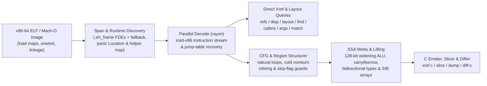

<!-- translation-source: c1d3da09a6eb16eff66bb88185215917ca727765 -->

> [!NOTE]
> Это перевод официальной англоязычной документации [коммита c1d3da0](https://github.com/alex09x/xref/blob/c1d3da09a6eb16eff66bb88185215917ca727765/README.md). Каноническая и самая актуальная версия всегда доступна на [английском языке](https://github.com/alex09x/xref/blob/main/README.md).

<div align="center">

[English](https://github.com/alex09x/xref/blob/main/README.md) | **[Русский](https://github.com/alex09x/xref/blob/main/readme/README.ru.md)** | [简体中文](https://github.com/alex09x/xref/blob/main/readme/README.zh-CN.md) | [Español](https://github.com/alex09x/xref/blob/main/readme/README.es.md) | [Português (Brasil)](https://github.com/alex09x/xref/blob/main/readme/README.pt-BR.md) | [日本語](https://github.com/alex09x/xref/blob/main/readme/README.ja.md) | [Deutsch](https://github.com/alex09x/xref/blob/main/readme/README.de.md) | [Français](https://github.com/alex09x/xref/blob/main/readme/README.fr.md) | [한국어](https://github.com/alex09x/xref/blob/main/readme/README.ko.md) | [العربية](https://github.com/alex09x/xref/blob/main/readme/README.ar.md)

<br/>


<br/><br/>

**Сверхбыстрый поиск перекрёстных ссылок, восстановление расположения полей структур, построение срезов программ и структурированный псевдо-C для исполняемых файлов x86-64 ELF / Mach-O.**

Анализ бинарных файлов без предварительной индексации на чистом безопасном Rust (`#![forbid(unsafe_code)]`). Границы функций извлекаются напрямую из таблиц раскрутки стека `.eh_frame` (с запасным вычислением диапазонов), а запросы по всему бинарному файлу декодируются на всех ядрах процессора за считанные миллисекунды — даже для полностью очищенных (stripped) релизных сборок Rust, где таблицы символов пусты.

<br/>

[**Интерактивный верстак (xrefcode.com)**](https://xrefcode.com) · Автор: [Alexander Panasenko](https://prod.codes/about/)

<br/>

[](https://github.com/alex09x/xref/releases)
[](https://crates.io/crates/xref-code)
[](https://doi.org/10.5281/zenodo.23878789)
[](https://github.com/alex09x/xref/actions)
[](../LICENSE-MIT)
[](../Cargo.toml)
[](../Cargo.toml)

<br/>

[**Почему**](#why) · [**Установка**](#installation) · [**Быстрый старт**](#quick-start) · [**Записанные примеры**](#recorded-examples) · [**Справочник CLI**](#command-reference) · [**Архитектура**](#architecture) · [**Производительность**](#recorded-performance) · [**Ограничения**](#scope--limitations) · [**Цитирование**](#citation)

</div>

---

<a name="why"></a>
## Почему

Классические инструменты реверс-инжиниринга ориентированы на работу одного аналитика-человека, готового перед первым запросом ждать минуты, пока вся программа импортируется в базу данных. С бинарными файлами Rust, из которых удалены символы (stripped), ситуация ещё сложнее: символы удалены, строки представлены не завершающимися нулём срезами `(ptr, len)` в пулах `.rodata`, а паники при проверке границ массива дробят циклы на холодные рёбра графа управления, превращая вывод наивных декомпиляторов в нечитаемое спагетти из `goto`.

**XRef** (`xref`) создан для быстрого итеративного анализа как исследователями, так и автономными ИИ-агентами:

- **Без предварительного индекса и устаревающего кэша.** При каждом запуске файл ELF отображается в память, точные диапазоны функций извлекаются из записей раскрутки `.eh_frame` (с автоматическим резервным вычислением интервалов), а сканирование функций выполняется параллельно через `rayon`.
- **Живой анализ:** Только для Linux x86-64, один целевой исполняемый файл на сессию. Инструкции записи и вызывающие функции внутри разделяемых библиотек помечаются как находящиеся вне целевого исполняемого файла без указания статической функции или записанного значения. `probe` и `watch` требуют привилегированного доступа perf и добавляют прерывания (traps) в наблюдаемый процесс.
- **Нативный структурированный типизированный псевдо-C (`xref c`).** Поднимает машинный код x86-64 напрямую в читаемый C без внешних инструментов — восстанавливая неизменяемые сигнатуры параметров `arg_0..arg_5`, группы значений SSA с разделёнными диапазонами жизни (`ptr_*`, `v_*`, `slot_*`), поэлементную индексацию при адресации SIB, расширяющие однооперандные операции с 128-битными промежуточными значениями `mul`/`imul`/`div`/`idiv`, многоразрядные цепочки переноса/заёма `adc`/`sbb`, операции проверки переполнения знаковой арифметики и структурированные конструкции `if`/`else`/`while`/`do-while`/`switch`.
- **Восстановление с учётом специфики очищенных бинарников Rust.** Распознаёт вспомогательные функции среды выполнения Rust в бинарниках без символов (`rust_panic_bounds_check`, `rust_slice_index_fail`, `rust_capacity_overflow`), вырезает точные строковые литералы `&str` `(ptr, len)`, сопоставляет дескрипторы `core::panic::Location` (`файл:строка:колонка`) с исходными путями в крейтах и восстанавливает ветви таблиц переходов `Display`.
- **Слайсинг и межсборочное сравнение (`xref slice`, `xref match`, `xref diff-c`).** Изолирует сбалансированные инструкции и условия ветвления, ведущие к определённому вызову или адресу инструкции IP, находит смещённые очищенные функции между сборками и сравнивает нормализованный псевдо-C с абстрагированием изменяющихся шестнадцатеричных адресов.
- **Анализ запущенных процессов Linux (`xref live`).** Привязывает статический анализ к работающему процессу Linux x86-64: находит значения в памяти, сопоставляет адреса времени выполнения со статическими функциями, подсчитывает вызовы и вызывающие функции через ограниченные uprobe и указывает инструкцию, выполняющую запись.

Ознакомьтесь со **114 неизменёнными записями запусков CLI** для самого очищенного `xref` на статическом интерактивном стенде на сайте **[xrefcode.com](https://xrefcode.com)**.

---

<a name="installation"></a>
## Установка

### Homebrew (macOS Apple Silicon и Linux `x86_64`)

Устанавливает предварительно скомпилированный бинарный файл `xref` напрямую из tap-репозитория [`alex09x/homebrew-apps`](https://github.com/alex09x/homebrew-apps) (компиляция через Cargo не требуется):

```bash
brew tap alex09x/apps
brew install xref
xref --version
```

### Предварительно собранные архивы релизов (Linux `x86_64` и macOS `arm64`)

Готовые архивы (`x86_64-unknown-linux-gnu`, требующий `glibc >= 2.34`, и `aarch64-apple-darwin`) содержат `xref`, `README.md`, `LICENSE-MIT`, `LICENSE-APACHE` и `CITATION.cff`:

```bash
curl -fsSLO https://github.com/alex09x/xref/releases/download/v0.3.0/xref-v0.3.0-x86_64-unknown-linux-gnu.tar.gz
curl -fsSLO https://github.com/alex09x/xref/releases/download/v0.3.0/xref-v0.3.0-x86_64-unknown-linux-gnu.tar.gz.sha256
sha256sum -c xref-v0.3.0-x86_64-unknown-linux-gnu.tar.gz.sha256
tar -xzf xref-v0.3.0-x86_64-unknown-linux-gnu.tar.gz
./xref --version
```

### Cargo и `crates.io` (Linux и macOS)

Опубликовано на [`crates.io` под именем `xref-code`](https://crates.io/crates/xref-code), устанавливает бинарный CLI `xref` (требуется `rustc 1.88+` для цепочек `let` в редакции 2024; готовые бинарники также доступны через [`cargo-binstall`](https://github.com/cargo-bins/cargo-binstall)):

```bash
cargo install xref-code --locked
# or prebuilt via cargo-binstall:
cargo binstall xref-code -y
# or directly from the pinned release tag:
cargo install --git https://github.com/alex09x/xref --tag v0.3.0 --locked
```

---

<a name="quick-start"></a>
## Быстрый старт

Передавайте `-b <BINARY>` в каждой команде или задайте `XREF_BIN=/path/to/binary` для сессии оболочки. Адреса — статические VA образа в шестнадцатеричном виде с `0x` или десятичном; база RVA Mach-O — `__TEXT.vmaddr`.

```bash
export XREF_BIN=./xref.stripped

xref stats                                      # function count, .text bytes, pointers, panic locations
xref refs "goto L_"                             # code & data references to strings or addresses (--inline)
xref where src/loops.rs                         # stripped function ranges compiled from a Rust source file
xref layout 0xa2270 --reg rsi --callees         # recover struct field offsets, sizes, strides & 1-hop callees
xref c 0x9a8a0 --fields                         # structured typed pseudo-C with inferred ->f_<off> hints
xref slice 0xc7d60 --to fn_160bb0               # backward slice of statements & guards reaching a target
xref query '{"operation":"info"}'              # versioned JSON for one immutable image
xref mcp                                       # local read-only stdio MCP server
```

---

<a name="live-analysis-linux-x86-64"></a>
## Живой анализ (Linux x86-64)

Начиная с версии v0.3.0, `xref live` связывает работающий процесс Linux x86-64 со статическим анализом его проверенного исполняемого файла. Передайте тот же ELF-файл через `-b`; xref проверяет его соответствие с `/proc/<pid>/exe` (по GNU build-id или SHA-256) перед преобразованием любых адресов.

```bash
xref -b ./app live maps --pid PID                        # mappings, binary match, PIE slide
xref -b ./app live memscan --pid PID 0x4441454d4f4e5632  # find u64 values; classify neighbouring words
xref -b ./app live resolve --pid PID 0x55d1c0ffc9d0      # runtime address -> static VA, function, file offset
sudo xref -b ./app live probe --pid PID --callers 0x1f9f0       # bounded uprobe hit counts, callers, registers
sudo xref -b ./app live watch --pid PID 0x55d1e1c3adc8          # DR0-DR3 write watch: writer instruction and value
xref -b ./app mcp --allow-live-pid PID                   # opt-in xref_live MCP tool pinned to one process
```

- `maps`, `resolve` и `memscan` только читают `/proc/<pid>/maps` и `/proc/<pid>/mem` (требуются права ptrace к целевому процессу; сам процесс не останавливается).
- `probe` и `watch` открывают perf-события для целевого процесса и требуют привилегированного доступа perf (root или `CAP_PERFMON`). Каждое срабатывание является ловушкой (trap) внутри целевого процесса, поэтому держите окна наблюдения короткими на высоконагруженных процессах.
- Результаты чётко разделяют наблюдение и логический вывод: нулевое число событий охватывает только указанное окно и потоки, найденная инструкция записи является кандидатом с явным уровнем достоверности, а отброшенные события или поздно подключённые потоки делают счётчики нижней оценкой.

Пошаговая записанная сессия (поиск в памяти → статическая функция → счётчики вызовов → запись в поле → перемещение буфера): **[Интерактивный сценарий живого анализа (Live Analysis walkthrough)](https://xrefcode.com/live-walkthrough)**. Контракт и ограничения: [docs/live.md](https://github.com/alex09x/xref/blob/main/docs/live.md); MCP: [docs/mcp.md](https://github.com/alex09x/xref/blob/main/docs/mcp.md).

---

<a name="recorded-examples"></a>
## Записанные примеры

Все приведённые ниже примеры представляют собой полные, неотредактированные запуски, снятые на файле `xref.stripped` (`1 962 608` байт, `0` символов, `sha256:3f3ba3b311f3eca8e26a929285d4fc9ffef4e4b6e8fc015105766180a2a6869d`) и проверенные в CI на построчное совпадение с `docs/recorded-data.js` (с точностью до пробелов в концах строк).

### 1. Структурированный типизированный псевдо-C с подсказками смещений полей (`xref c --fields`)

```c
$ xref -b xref.stripped c 0x9a8a0 --fields
/* field offsets: arg_0 [+0x0:u64, +0x8:u64, +0x10:u64, +0x18:u64] */
/*
 * fn_9a8a0 — 0x9a8a0..0x9a97a (218 bytes, 1 direct caller; synthetic FDE entry)
 *   source: src/cfg.rs:154:22, src/cfg.rs:75:25, src/cfg.rs:154:57
 *   params:
 *     arg_0 (rdi): const void * — reads +0x0 (8B), +0x8 (8B), +0x10 (8B), +0x18 (8B)
 *     arg_1 (rsi): unk64 — 64-bit register (signedness unconstrained)
 *     arg_2 (rdx): unk64 — 64-bit register (signedness unconstrained)
 *   return: u8 in rax (consumed by 1/1 direct call site)
 */
u8 fn_9a8a0(const void *arg_0, unk64 arg_1, unk64 arg_2) {
  usize v_1 = arg_1; /* rsi */
  u64 v_6; /* rbx */
  const u8 *ptr_9; /* rax */
  unk64 slot_0; /* [rsp+0x0], addr-taken */
  unk64 slot_8; /* [rsp+0x8] */

  if (v_1 == 0) {
    ptr_9 = 0;
    return ptr_9;
  }
  u64 v_2 = arg_0->f_8;
  if (v_1 >= v_2) {
    usize v_12 = v_1;
    /* [runtime] rust_panic_bounds_check(index, len, loc) -> noreturn */
    rust_panic_bounds_check(v_12, v_2, "src/cfg.rs:154:22");
  }
  if (((u64 *)arg_0->f_0)[v_1] != 1) {
    ptr_9 = 0;
    return ptr_9;
  }
  const void *ptr_3 = arg_0->f_18;
  unk64 v_4 = *(u64 *)(arg_0->f_10);
  if (v_1 == v_4 + 2) {
    usize v_5 = (v_4 + 1);
    v_6 = *(u64 *)(ptr_3 + 16);
    if (v_5 >= v_6) {
      /* [runtime] rust_panic_bounds_check(index, len, loc) -> noreturn */
      rust_panic_bounds_check(v_5, v_6, "src/cfg.rs:154:57");
    }
    usize v_7 = v_1;
    unk64 v_8 = ((v_5 * 96) + *(u64 *)(ptr_3 + 8));
    slot_8 = arg_2;
    slot_0 = 1;
    /* fn_fb8e0: calls fn_fb9c6, fn_fb920 */
    ptr_9 = fn_fb8e0(v_8, &slot_0);
    u32 v_10 = ptr_9;
    ptr_9 = 1;
    v_1 = v_7;
    if (v_10 != 0) {
      return ptr_9;
    }
  } else {
    v_6 = *(u64 *)(ptr_3 + 16);
  }
  usize v_11 = (v_1 - 1);
  if (v_11 < v_6) {
    ptr_9 = *(u64 *)(ptr_3 + 8);
    ptr_9 = (((u8 *)ptr_9)[(v_11 * 96)] & 5) != 0;
    return ptr_9;
  }
  usize v_13 = v_11;
  /* [runtime] rust_panic_bounds_check(index, len, loc) -> noreturn */
  rust_panic_bounds_check(v_13, v_6, "src/cfg.rs:75:25");
}
```

### 2. Межпроцедурное восстановление раскладки структур (`xref layout --callees`)

```text
$ xref -b xref.stripped layout 0xa2270 --reg rsi --callees
layout of rsi in 0xa2270..0xa2566:
  +0       size  4  u32   r:0  w:2
  +8       size  8  u64   r:2  w:0
  +10      size  8  u64   r:2  w:0
  +20      size  8  u64   r:1  w:0
  +28      size  8  u64   r:1  w:0
5 fields (min span 0x30)
other pointer args: rdi (3 fields), rdx (1 fields)  (use --reg <REG>)
```

### 3. Обратный срез программы (`xref slice`)

```c
$ xref -b xref.stripped slice 0xc7d60 --to fn_160bb0
/* slice of 0xc7d60..0xc7fbf -> fn_160bb0 (37/131 lines) */
void fn_c7d60(void *arg_0, const void *arg_1, usize arg_2) {
  u8 slot_28; /* [rsp+0x28], addr-taken */
  usize slot_30; /* [rsp+0x30] */
  unk64 slot_40; /* [rsp+0x40], addr-taken */
  if (arg_2 == 0) {
    return; /* callers ignore rax */
  }
  const void *ptr_1 = arg_1;
  const void *v_2 = arg_1 + arg_2 * 24;
  void *v_4 = &slot_40;
  do {
    const u8 *ptr_6 = *(u64 *)(ptr_1 + 8);
    usize v_7 = *(u64 *)(ptr_1 + 16);
    /* fn_160550: source core/src/str/pattern.rs:1398; calls fn_1606e0, fn_160a43, fn_1605f8 */
    fn_160550(v_4, ptr_6, v_7, "goto L_", 7);
    /* fn_124d50: source core/src/str/pattern.rs:1131; calls fn_124e3a, fn_160bb0, fn_124e29 */
    fn_124d50(&slot_28, v_4);
    if (slot_28 != 0) {
      usize v_8 = slot_30;
      usize v_9 = (v_8 + 7);
      if (v_9 != 0) {
        if (v_9 < v_7) {
          if ((i8)((u8 *)ptr_6)[v_9] < -64) {
            /* fn_160bb0: noreturn; source core/src/str/mod.rs:486; calls fn_160bc0 */
            fn_160bb0(ptr_6, v_7, v_9, v_7, "src/loops.rs:45:36");
          }
        } else {
          if (v_9 != v_7) {
            /* fn_160bb0: noreturn; source core/src/str/mod.rs:486; calls fn_160bc0 */
            fn_160bb0(ptr_6, v_7, v_9, v_7, "src/loops.rs:45:36");
          }
        }
      }
    }
    ptr_1 = (ptr_1 + 24);
  } while (ptr_1 != v_2);
}
```

### 4. Межсборочное сопоставление и сравнение нормализованного псевдо-C (`xref diff-c`)

Строки с отступом `  ...` ниже выводятся непосредственно командой `xref diff-c` для обозначения неизменённых нормализованных строк вне фрагмента диффа:

```diff
$ xref -b xref.stripped diff-c --other xref-v0.0.2.stripped 0xd57c0
=== diff 0xd57c0..0xd6301 (current) vs 0xd5530..0xd6071 (other, score 384: locs:240 strs:0 imms:4 disps:10 nbrs:105 size:0xb41 callees:8) ===
  ...
      }
      @var_11 = (@slot_10 + @var_8);
-     @var_1 = 0xc2bc;
+     @var_1 = 0xc518;
      @var_32 = @slot_9;
      switch (*(u64 *)(@var_11)) {
  ...
```

---

<a name="command-reference"></a>
## Справочник команд

[Дополнительные режимы](https://github.com/alex09x/xref/blob/main/docs/advanced-options.md): поиск стековых смещений и вывод с сохранением меток переходов.

[Структурированные запросы и локальный MCP](https://github.com/alex09x/xref/blob/main/docs/mcp.md) дают программный доступ к тому же ядру анализа.

[Ограниченные расследования](https://github.com/alex09x/xref/blob/main/docs/investigations.md) связывают строки, ссылки, вызовы, данные об аргументах и явно выбранный срез, сохраняя альтернативы и ограничения.

[Исследование происхождения полей](https://github.com/alex09x/xref/blob/main/docs/field-origin.md) различает адреса относительно входного регистра и загруженные значения, сохраняя инструкции обращений к памяти и вызываемых функций.

### Инвентаризация, символы и перекрёстные ссылки
```text
xref -b BIN stats                                    # functions, .text bytes, pointers, imports, panic locations
xref -b BIN sym PATTERN                              # symbol search (non-stripped binaries)
xref -b BIN func 0xa1b50                             # function span containing an address
xref -b BIN refs "goto L_" 0xa1b50                   # .rodata / pointer / code xrefs (--inline for mov/movabs stores)
xref -b BIN istr "text"                              # shorthand for refs --inline
xref -b BIN imm 24 --in 0xa1b50                      # immediate constants (--store, --cmp, --in FN)
xref -b BIN find --src src/loops.rs --calls 0x160bb0 # single-pass multi-predicate function search (--any K)
```

### Раскладка структур, смещения и графы вызовов
```text
xref -b BIN disp 0x20 0x28 --all                     # field loads/stores/leas (--write, --lea, --stride, --in FN)
xref -b BIN layout 0xa2270 --reg rsi --callees       # aggregate field offsets, widths, strides & 1-hop callees
xref -b BIN callers 0xcafb0                          # direct calls/tail-jumps, address-taken & pointer-table xrefs
xref -b BIN calls 0xcafb0                            # outgoing calls and tail-jumps in instruction order
xref -b BIN args 0xa2270 --max 20                    # constant & symbolic arguments across all call sites
xref -b BIN path 0xc7fc0 0x160bb0 --depth 8          # shortest call chains between two functions
xref -b BIN tree 0xd0aa0 --callers --depth 2         # indented caller/callee tree with panic source anchors
```

### Дизассемблирование, псевдо-C, срезы, экспорт крейта и сравнение
```text
xref -b BIN asm 0xc7d60 --from A --to B              # annotated Intel disassembly (strings, slots, targets)
xref -b BIN c 0x9a8a0 --fields                       # structured typed pseudo-C (--out DIR for parallel batch export)
xref -b BIN slice 0xc7d60 --to fn_160bb0 --fields    # backward slice to target call, hex IP, offset, or string
xref -b BIN dump --out DIR --src src/loops.rs        # parallel modular .c export grouped by panic source paths
xref -b BIN match --other OLD_BIN 0xc7d60 --top 3    # relocate shifted stripped functions across two builds
xref -b BIN diff-c --other OLD_BIN 0xd57c0           # normalized cross-build pseudo-C LCS diff
```

### Исходные файлы Rust и таблицы переходов enum
```text
xref -b BIN src 0x9a8a0                              # core::panic::Location (file:line:col) descriptors in function
xref -b BIN where src/image.rs --line 46             # stripped functions referencing a Rust file (and line)
xref -b BIN files src/                               # distinct Rust source files recovered from panic descriptors
xref -b BIN error "invalid"                          # jump-table discriminant whose Display arm names text
xref -b BIN variant 0xc7fc0 1 2                      # inverse of error: texts referenced by jump-table arms
xref -b BIN arm 0xc8010                              # jump-table indices whose arm contains an address
```

---

<a name="architecture"></a>
## Архитектура



---

<a name="recorded-performance"></a>
## Измеренная производительность

Реальное время выполнения команд CLI (по данным `stderr`), зарегистрированное версией `xref 0.0.5` на процессоре `AMD Ryzen 9 9950X` (16 ядер / 32 потока, Linux 6.8 `x86_64`, прогретый страничный кэш ОС) при анализе очищенного бинарного файла `xref.stripped` (`1.96 MB`, `1 974` функции, `0` символов):

| Операция | Команда | Загрузка ELF | Общее время |
|---|---|---:|---:|
| Инвентаризация бинарника (`1 974` функции, `588` мест паник) | `xref -b xref.stripped stats` | `0.84 ms` | **`2.2 ms`** |
| Поиск перекрёстных ссылок на строки и указатели по всему файлу | `xref -b xref.stripped refs "goto L_"` | `0.80 ms` | **`3.9 ms`** |
| Сопоставление модулей Rust по встроенным дескрипторам паник | `xref -b xref.stripped where src/loops.rs` | `0.79 ms` | **`3.4 ms`** |
| Межпроцедурное восстановление раскладки структур (1 уровень вызовов) | `xref -b xref.stripped layout 0xa2270 --reg rsi --callees` | `0.81 ms` | **`2.6 ms`** |
| Обратный срез программы + подсказки смещений полей | `xref -b xref.stripped slice 0xc7d60 --to fn_160bb0 --fields` | `0.81 ms` | **`5.1 ms`** |
| Сопоставление функций между сборками и дифф нормализованного псевдо-C | `xref -b xref.stripped diff-c --other xref-v0.0.2.stripped 0xc7d60` | `0.86 ms` | **`13.4 ms`** |

---

<a name="scope--limitations"></a>
## Область применения и ограничения

- **Поддерживаемый вход:** исполняемые файлы и библиотеки `x86-64` ELF (`ET_EXEC`, `ET_DYN`). Начиная с v0.2.0 поддерживаются тонкие little-endian x86-64 Mach-O: executables, dylibs и bundles с DWARF unwind; см. [входы Mach-O](https://github.com/alex09x/xref/blob/main/docs/macho.md). Опубликованная v0.1.0 поддерживает только ELF. ARM64, PE, fat/universal и файлы только с compact unwind не поддерживаются.
- **Определение границ функций:** точные границы функций извлекаются из таблиц раскрутки стека `.eh_frame` (генерируются по умолчанию компиляторами `rustc`, `clang` и `gcc` под `x86-64` даже при запуске `strip --strip-all`), с переходом на эвристический расчёт интервалов по промежуткам и адресам вызовов при их отсутствии. Для бинарников, из которых секция `.eh_frame` удалена принудительно (`strip -R .eh_frame`), границы определяются эвристически.
- **Статический псевдо-C и вывод смещений:** сигнатуры параметров (`arg_*`), выведенные типы указателей/целых чисел (`const void *`, `usize`, `unk64` и т. д.) и подсказки смещений флага `--fields` (`->f_<off>`) представляют собой консервативные статические реконструкции на основе использования в машинном коде, а не отладочные типы DWARF. Несмоделированные инструкции SIMD и системные команды сохраняются как явные комментарии на ассемблере вида `/* 0xaddr: ... */`, а не отбрасываются — обязательно перепроверяйте критически важные инварианты с помощью `xref asm`.

---

<a name="development--testing"></a>
## Разработка и тестирование

При запуске тестов компилятор `rustc` должен быть доступен в переменной окружения `PATH`: сквозной набор тестов компилирует `tests/fixtures/sample.rs` во временный тестовый ELF-файл и проверяет подкоманды CLI на нём.

```bash
cargo fmt --all -- --check
cargo clippy --workspace --all-targets --locked -- -D warnings
cargo test --workspace --locked
```

---

<a name="citation"></a>
## Цитирование

Запись ниже представляет собой последний заархивированный снимок (`v0.3.0`); предыдущий снимок `v0.2.0`: [10.5281/zenodo.23902824](https://doi.org/10.5281/zenodo.23902824); снимок `v0.1.0`: [10.5281/zenodo.23878790](https://doi.org/10.5281/zenodo.23878790).

```bibtex
@software{panasenko_2026_23932112,
  author       = {Panasenko, Alexander},
  title        = {XRef — Ultra Blazing Fast x86-64 ELF and Mach-O
                   Analysis, Live Linux Process Inspection, Pseudo-C
                   and Local MCP
                  },
  month        = nov,
  year         = 2026,
  publisher    = {Zenodo},
  version      = {0.3.0},
  doi          = {10.5281/zenodo.23932112},
  url          = {https://doi.org/10.5281/zenodo.23932112}
}
```

- Alexander Panasenko (2026). *XRef — Ultra Blazing Fast x86-64 ELF and Mach-O Analysis, Live Linux Process Inspection, Pseudo-C and Local MCP* (v0.3.0). Zenodo. https://doi.org/10.5281/zenodo.23932112 ([concept DOI: 10.5281/zenodo.23878789](https://doi.org/10.5281/zenodo.23878789))

---

<a name="license"></a>
## Лицензия

Copyright © 2026 [Alexander Panasenko](https://prod.codes/about/) (`alex@prod.codes`).

Распространяется по двойной лицензии на выбор:
- **Лицензия Apache, версия 2.0** ([`LICENSE-APACHE`](../LICENSE-APACHE) или http://www.apache.org/licenses/LICENSE-2.0)
- **Лицензия MIT** ([`LICENSE-MIT`](../LICENSE-MIT) или http://opensource.org/licenses/MIT)

по вашему выбору.
