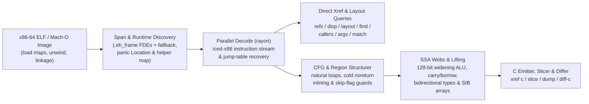

<!-- translation-source: f50daf123e003bc29cb807306845aae1d49e8837 -->
> **注意**：本文档翻译自英文源提交 [f50daf1](https://github.com/alex09x/xref/blob/f50daf123e003bc29cb807306845aae1d49e8837/README.md)；最新的权威文档请参阅 [英文 README](https://github.com/alex09x/xref/blob/main/README.md)。

[English](https://github.com/alex09x/xref/blob/main/README.md) | [Русский](https://github.com/alex09x/xref/blob/main/readme/README.ru.md) | **[简体中文](https://github.com/alex09x/xref/blob/main/readme/README.zh-CN.md)** | [Español](https://github.com/alex09x/xref/blob/main/readme/README.es.md) | [Português (Brasil)](https://github.com/alex09x/xref/blob/main/readme/README.pt-BR.md) | [日本語](https://github.com/alex09x/xref/blob/main/readme/README.ja.md) | [Deutsch](https://github.com/alex09x/xref/blob/main/readme/README.de.md) | [Français](https://github.com/alex09x/xref/blob/main/readme/README.fr.md) | [한국어](https://github.com/alex09x/xref/blob/main/readme/README.ko.md) | [العربية](https://github.com/alex09x/xref/blob/main/readme/README.ar.md)

<div align="center">


<br/><br/>

**面向 x86-64 ELF / Mach-O 二进制文件的极速交叉引用、结构体内存布局恢复、程序切片与结构化伪 C 生成工具。**

基于纯安全 Rust（`#![forbid(unsafe_code)]`）实现零索引二进制分析。函数边界直接提取自 `.eh_frame` 栈展开表（附带基于跨度的回退机制），针对整个二进制文件的分析查询在毫秒级内即可在所有 CPU 核心上完成并行解码——即使在符号表完全为空的 stripped Rust 发布版二进制上亦是如此。

<br/>

[**交互式工作台 (xrefcode.com)**](https://xrefcode.com) · 作者：[Alexander Panasenko](https://prod.codes/about/)

<br/>

[](https://github.com/alex09x/xref/releases)
[](https://crates.io/crates/xref-code)
[](https://doi.org/10.5281/zenodo.23878789)
[](https://github.com/alex09x/xref/actions)
[](../LICENSE-MIT)
[](../Cargo.toml)
[](../Cargo.toml)

<br/>

[**为何选择**](#why) · [**安装指南**](#installation) · [**快速上手**](#quick-start) · [**实录示例**](#recorded-examples) · [**命令参考**](#command-reference) · [**架构设计**](#architecture) · [**基准测试**](#recorded-performance) · [**局限说明**](#scope--limitations) · [**学术引用**](#citation)

</div>

---

<a name="why"></a>
## 为何选择

传统的逆向工程套件通常假定用户是一位愿意在提出第一个查询前、先等待数分钟完成全程序数据库预导入的交互式分析师。在被剥离符号（stripped）的 Rust 二进制文件中，情况更为严峻：符号信息荡然无存，字符串是位于 `.rodata` 内存池中非以 NUL 结尾的 `(ptr, len)` 切片，而越界检查引发的 panic 会将循环破碎为冷边（cold edges），导致朴素的反编译器生成难以阅读的 `goto` 意大利面式混乱代码。

**XRef**（`xref`）专为逆向工程师与自主 AI Agent 的快速迭代探索而设计：

- **无需预建索引，没有过期缓存。** 分析命令将 ELF 映像映射到内存，从 `.eh_frame` 展开记录中提取精确的函数范围（带自动跨度回退），并通过 `rayon` 并行扫描函数。`xref field` 是例外：它保留一个可选的磁盘索引，与输入文件和 xref 可执行文件的内容绑定；还可能重放已保存的报告或询问后台 field daemon，这两者与规范文件路径及其元数据（设备、inode、大小、修改时间和状态变更时间）绑定。任何变更都会使它们被重建或绕过。
- **原生结构化类型化伪 C（`xref c`）。** 无需外部工具，直接将 x86-64 机器码提升为可读的 C 代码——恢复不可变的 `arg_0..arg_5` 参数签名、SSA 活跃区间网络（`ptr_*`、`v_*`、`slot_*`）、基于元素索引的 SIB 数组寻址、使用 128 位中间值的单操作数扩展乘除法（`mul`/`imul`/`div`/`idiv`）、多精度进位/借位链（`adc`/`sbb`）、有符号算术溢出内部函数，以及结构化的 `if`/`else`/`while`/`do-while`/`switch` 区域。 还恢复标量 SSE/AVX 浮点运算（`f32`/`f64` 参数、返回值和调用结果），以及通过常量 vtable 的间接调用，并列出选择各目标的分支条件。
- **感知 Rust 特性的剥离二进制恢复。** 识别被剥离符号的 Rust 运行时辅助函数（`rust_panic_bounds_check`、`rust_slice_index_fail`、`rust_capacity_overflow`），切片出精确的 `(ptr, len)` `&str` 字面量，将 `core::panic::Location`（`file:line:col`）描述符映射回原始 crate 源代码路径，并解析 `Display` 跳转表分支。
- **切片与跨构建差异对比（`xref slice`、`xref match`、`xref diff-c`）。** 隔离到达特定调用或指令 IP 的平衡语句与控制守卫条件，在多次构建之间重定位发生偏移的剥离函数，并在抽象掉易变的十六进制地址后对归一化的伪 C 进行 diff 对比。
- **序列化字段搜索（`xref field`）。** 将序列化的键字符串与结构体字段偏移关联起来并给出指令证据，同时对写入这些字段的候选函数进行排序，可选择只保留通过返回值、参数或加载的指针写入的函数（`--writer-root`）。结果是附带证据的候选，而不是源类型的证明。
- **错误来源与常量参数（`xref origin`、`xref callargs`）。** `origin` 从错误消息出发，列出构造该消息的代码：值、宽度和布局匹配的枚举标签写入、由内向外的转换、将标签传给写入操作的调用，以及保护各位置的条件。它追踪传入标签经过被调用者保存的副本、溢出到栈、栈对象、帧指针、栈参数槽、复制到记录，以及随后按值读取记录的循环。`callargs` 按被调用函数分组列出所有传递常量的调用。位置是附有证据的候选。
- **来源与类型化数据（`xref deps`、`xref data`）。** 读取 [`cargo-auditable`](https://github.com/rust-secure-code/cargo-auditable) 嵌入 Rust 二进制文件的依赖清单（`.dep-v0`）和 Go 模块列表（`.go.buildinfo`），以及编译器/链接器字符串和 Build-ID；`data` 读取虚拟地址处的类型化值（`u8`..`u64`、`f32`/`f64`、字节、字符串）。
- **面向代理的结构化输出（`xref query`、`xref mcp`）。** 为一个不可变映像提供版本化 JSON：`info` 从初步诊断开始（语言、工具链、嵌入的依赖、可直接运行的后续查询），每个答案包含置信等级（`observed`、`derived`、`inferred`）和确定性的证据 ID，二进制内容标记为不可信数据。`--compact` 缩短 MCP 响应。
- **运行中 Linux 进程检查（`xref live`）。** 将静态视图关联到正在运行的 x86-64 Linux 进程：在内存中查找值，将运行时指针解析为静态函数，用有界 uprobe 统计调用次数和调用者，用硬件观察点定位写入字段的指令，记录按线程排序的调用窗口（`live trace`）和有界 CPU 性能剖析（`live profile`）——每个结果都说明其覆盖范围和限制。
- **性能剖析与离线跟踪（`xref profile`、`xref symbolize`、`xref edges`）。** 汇总、注释和比较 `.xprof` 记录，导入 `perf.data`（包括有界的 Intel PT 解码）和 `perf script` 文本，并将保存的调用栈和观察到的调用边映射到所选可执行文件。

欢迎在 **[xrefcode.com](https://xrefcode.com)** 上的纯静态浏览器工作台中探索针对 `xref` 自身剥离版本记录的 **114 个逐字命令行实录**。

---

<a name="installation"></a>
## 安装指南

### 一行安装（macOS Apple Silicon 与 Linux `x86_64`）

```bash
curl -fsSL https://xrefcode.com/install.sh | sh
```

脚本会自行选择安装方式：为当前平台下载发布版二进制并校验其公布的 SHA-256；若没有合适的预编译二进制，则使用 `cargo install xref-code --locked`。`XREF_VERSION=v0.5.0` 可固定版本；`XREF_INSTALL_DIR` 指定安装目录（默认在可写时为 `/usr/local/bin`，否则为 `~/.local/bin`）。如需，可先[阅读脚本](https://xrefcode.com/install.sh)。

### Homebrew（macOS Apple Silicon 与 Linux `x86_64`）

直接从 [`alex09x/homebrew-apps`](https://github.com/alex09x/homebrew-apps) tap 安装预构建的 `xref` 二进制程序（无需 Cargo 编译）：

```bash
brew tap alex09x/apps
brew install xref
xref --version
```

### 预构建发布包（Linux `x86_64` 与 macOS `arm64`）

预构建归档包（`x86_64-unknown-linux-gnu`，需要 `glibc >= 2.34`，以及 `aarch64-apple-darwin`）打包了 `xref`、`README.md`、`LICENSE-MIT`、`LICENSE-APACHE` 和 `CITATION.cff`：

```bash
curl -fsSLO https://github.com/alex09x/xref/releases/download/v0.5.0/xref-v0.5.0-x86_64-unknown-linux-gnu.tar.gz
curl -fsSLO https://github.com/alex09x/xref/releases/download/v0.5.0/xref-v0.5.0-x86_64-unknown-linux-gnu.tar.gz.sha256
sha256sum -c xref-v0.5.0-x86_64-unknown-linux-gnu.tar.gz.sha256
tar -xzf xref-v0.5.0-x86_64-unknown-linux-gnu.tar.gz
./xref --version
```

### Cargo 与 `crates.io`（Linux 与 macOS）

已发布至 [`crates.io`，包名为 `xref-code`](https://crates.io/crates/xref-code)，用于安装 `xref` CLI 二进制程序（因 Edition 2024 `let` chains 语法需要 `rustc 1.88+`；预构建二进制也可通过 [`cargo-binstall`](https://github.com/cargo-bins/cargo-binstall) 安装）：

```bash
cargo install xref-code --locked
# or prebuilt via cargo-binstall:
cargo binstall xref-code -y
# or directly from the pinned release tag:
cargo install --git https://github.com/alex09x/xref --tag v0.5.0 --locked
```

---

<a name="quick-start"></a>
## 快速上手

在每次命令中传入 `-b <BINARY>`，或为 shell 会话设置 `XREF_BIN=/path/to/binary`。地址为静态映像 VA，使用 `0x` 十六进制或十进制；Mach-O 的 RVA 基址为 `__TEXT.vmaddr`。

```bash
export XREF_BIN=./xref.stripped

xref stats                                      # function count, .text bytes, pointers, panic locations
xref refs "goto L_"                             # code & data references to strings or addresses (--inline)
xref where src/loops.rs                         # stripped function ranges compiled from a Rust source file
xref layout 0xa2270 --reg rsi --callees         # recover struct field offsets, sizes, strides & 1-hop callees
xref c 0x9a8a0 --fields                         # structured typed pseudo-C with inferred ->f_<off> hints
xref c 0x9a8a0 --only-paths-to 0x9a950          # pseudo-C containing only basic blocks that reach ADDR
xref slice 0xc7d60 --to fn_160bb0               # backward slice of statements & guards reaching a target
xref origin "number out of range"               # code that builds an error message: tag stores, conversions, guards
xref deps                                       # embedded cargo-auditable / Go build manifest, toolchains, Build-ID
xref query '{"operation":"info"}'              # versioned JSON for one immutable image
xref mcp                                       # local read-only stdio MCP server
```

---

<a name="live-analysis-linux-x86-64"></a>
## 在线进程分析 (Linux x86-64)

从 v0.3.0 开始，`xref live` 将正在运行的 Linux x86-64 进程与其验证过的可执行文件的静态分析连接起来。通过 `-b` 传入相同的 ELF；xref 在转换任何地址前都会对照 `/proc/<pid>/exe`（通过 GNU build-id 或 SHA-256）进行验证。

```bash
xref -b ./app live maps --pid PID                        # mappings, binary match, PIE slide
xref -b ./app live memscan --pid PID 0x4441454d4f4e5632  # find u64 values; classify neighbouring words
xref -b ./app live resolve --pid PID 0x55d1c0ffc9d0      # runtime address -> static VA, function, file offset
sudo xref -b ./app live probe --pid PID --callers 0x1f9f0       # bounded uprobe hit counts, callers, registers
sudo xref -b ./app live watch --pid PID 0x55d1e1c3adc8          # DR0-DR3 write watch: writer instruction and value
sudo xref -b ./app live trace --pid PID --start 0x1f9f0 --stop-return 0x1f9f0 --callees-of 0x1f9f0 # ordered per-thread call windows
sudo xref -b ./app live profile --pid PID --duration 10s --out app.xprof # bounded CPU sampling profile
xref -b ./app mcp --allow-live-pid PID                   # opt-in xref_live MCP tool pinned to one process
```

- `maps`、`resolve` 和 `memscan` 仅读取 `/proc/<pid>/maps` 与 `/proc/<pid>/mem`（需要对目标进程的 ptrace 权限；目标进程不会被挂起）。
- `probe` 和 `watch` 在目标上开启 perf 事件，需要特权级 perf 访问权限（root 或 `CAP_PERFMON`）。每次命中都会在目标进程中触发陷阱（trap），因此对于高负载进程请保持较短的观察窗口。
- `trace` 使用隔离的 `tracefs` uprobe 实例，需要可写的 tracefs（通常为 root）；其窗口在指定的停止地址或返回处关闭，并在明确的窗口数、事件数和时间上限处停止。`profile` 使用 perf 事件采样，当内核策略不允许所请求的事件时直接报错，而不会静默替换。
- 结果严格区分实测观测与推导：零次计数仅覆盖指定的时间窗口与线程，报告的写入点是带有显式置信度的候选指令，而丢弃的事件或晚附加的线程会使计数成为下界。

分步实录演示（内存检索 → 静态函数 → 调用计数 → 字段写入指令 → 缓冲区迁移）：**[在线分析实录演练 (Live Analysis walkthrough)](https://xrefcode.com/live-walkthrough)**。规范与限制：[docs/live.md](https://github.com/alex09x/xref/blob/main/docs/live.md)；MCP：[docs/mcp.md](https://github.com/alex09x/xref/blob/main/docs/mcp.md)。

---

<a name="recorded-examples"></a>
## 实录示例

以下所有输出均为针对 `xref.stripped`（`1,962,608` 字节，`0` 个符号，`sha256:3f3ba3b311f3eca8e26a929285d4fc9ffef4e4b6e8fc015105766180a2a6869d`）捕获的完整、未经编辑的实际运行结果，并在 CI 中经过严格验证，与 `docs/recorded-data.js` 逐行一致（允许行尾空白字符微调）。

### 1. 包含字段偏移提示的结构化类型化伪 C（`xref c --fields`）

```c
$ xref -b xref.stripped c 0x9a8a0 --fields
/* field offsets: arg_0 [+0x0:u64, +0x8:u64, +0x10:u64, +0x18:u64] */
/*
 * fn_9a8a0 — 0x9a8a0..0x9a97a (218 bytes, 1 direct caller; synthetic FDE entry)
 *   source: src/cfg.rs:154:22, src/cfg.rs:75:25, src/cfg.rs:154:57
 *   params:
 *     arg_0 (rdi): const void * — reads +0x0 (8B), +0x8 (8B), +0x10 (8B), +0x18 (8B)
 *     arg_1 (rsi): unk64 — 64-bit register (signedness unconstrained)
 *     arg_2 (rdx): unk64 — 64-bit register (signedness unconstrained)
 *   return: u8 in rax (consumed by 1/1 direct call site)
 */
u8 fn_9a8a0(const void *arg_0, unk64 arg_1, unk64 arg_2) {
  usize v_1 = arg_1; /* rsi */
  u64 v_6; /* rbx */
  const u8 *ptr_9; /* rax */
  unk64 slot_0; /* [rsp+0x0], addr-taken */
  unk64 slot_8; /* [rsp+0x8] */

  if (v_1 == 0) {
    ptr_9 = 0;
    return ptr_9;
  }
  u64 v_2 = arg_0->f_8;
  if (v_1 >= v_2) {
    usize v_12 = v_1;
    /* [runtime] rust_panic_bounds_check(index, len, loc) -> noreturn */
    rust_panic_bounds_check(v_12, v_2, "src/cfg.rs:154:22");
  }
  if (((u64 *)arg_0->f_0)[v_1] != 1) {
    ptr_9 = 0;
    return ptr_9;
  }
  const void *ptr_3 = arg_0->f_18;
  unk64 v_4 = *(u64 *)(arg_0->f_10);
  if (v_1 == v_4 + 2) {
    usize v_5 = (v_4 + 1);
    v_6 = *(u64 *)(ptr_3 + 16);
    if (v_5 >= v_6) {
      /* [runtime] rust_panic_bounds_check(index, len, loc) -> noreturn */
      rust_panic_bounds_check(v_5, v_6, "src/cfg.rs:154:57");
    }
    usize v_7 = v_1;
    unk64 v_8 = ((v_5 * 96) + *(u64 *)(ptr_3 + 8));
    slot_8 = arg_2;
    slot_0 = 1;
    /* fn_fb8e0: calls fn_fb9c6, fn_fb920 */
    ptr_9 = fn_fb8e0(v_8, &slot_0);
    u32 v_10 = ptr_9;
    ptr_9 = 1;
    v_1 = v_7;
    if (v_10 != 0) {
      return ptr_9;
    }
  } else {
    v_6 = *(u64 *)(ptr_3 + 16);
  }
  usize v_11 = (v_1 - 1);
  if (v_11 < v_6) {
    ptr_9 = *(u64 *)(ptr_3 + 8);
    ptr_9 = (((u8 *)ptr_9)[(v_11 * 96)] & 5) != 0;
    return ptr_9;
  }
  usize v_13 = v_11;
  /* [runtime] rust_panic_bounds_check(index, len, loc) -> noreturn */
  rust_panic_bounds_check(v_13, v_6, "src/cfg.rs:75:25");
}
```

### 2. 过程间结构体内存布局恢复（`xref layout --callees`）

```text
$ xref -b xref.stripped layout 0xa2270 --reg rsi --callees
layout of rsi in 0xa2270..0xa2566:
  +0       size  4  u32   r:0  w:2
  +8       size  8  u64   r:2  w:0
  +10      size  8  u64   r:2  w:0
  +20      size  8  u64   r:1  w:0
  +28      size  8  u64   r:1  w:0
5 fields (min span 0x30)
other pointer args: rdi (3 fields), rdx (1 fields)  (use --reg <REG>)
```

### 3. 反向程序切片（`xref slice`）

```c
$ xref -b xref.stripped slice 0xc7d60 --to fn_160bb0
/* slice of 0xc7d60..0xc7fbf -> fn_160bb0 (37/131 lines) */
void fn_c7d60(void *arg_0, const void *arg_1, usize arg_2) {
  u8 slot_28; /* [rsp+0x28], addr-taken */
  usize slot_30; /* [rsp+0x30] */
  unk64 slot_40; /* [rsp+0x40], addr-taken */
  if (arg_2 == 0) {
    return; /* callers ignore rax */
  }
  const void *ptr_1 = arg_1;
  const void *v_2 = arg_1 + arg_2 * 24;
  void *v_4 = &slot_40;
  do {
    const u8 *ptr_6 = *(u64 *)(ptr_1 + 8);
    usize v_7 = *(u64 *)(ptr_1 + 16);
    /* fn_160550: source core/src/str/pattern.rs:1398; calls fn_1606e0, fn_160a43, fn_1605f8 */
    fn_160550(v_4, ptr_6, v_7, "goto L_", 7);
    /* fn_124d50: source core/src/str/pattern.rs:1131; calls fn_124e3a, fn_160bb0, fn_124e29 */
    fn_124d50(&slot_28, v_4);
    if (slot_28 != 0) {
      usize v_8 = slot_30;
      usize v_9 = (v_8 + 7);
      if (v_9 != 0) {
        if (v_9 < v_7) {
          if ((i8)((u8 *)ptr_6)[v_9] < -64) {
            /* fn_160bb0: noreturn; source core/src/str/mod.rs:486; calls fn_160bc0 */
            fn_160bb0(ptr_6, v_7, v_9, v_7, "src/loops.rs:45:36");
          }
        } else {
          if (v_9 != v_7) {
            /* fn_160bb0: noreturn; source core/src/str/mod.rs:486; calls fn_160bc0 */
            fn_160bb0(ptr_6, v_7, v_9, v_7, "src/loops.rs:45:36");
          }
        }
      }
    }
    ptr_1 = (ptr_1 + 24);
  } while (ptr_1 != v_2);
}
```

### 4. 跨构建重定位与归一化伪 C 差异对比（`xref diff-c`）

下方缩进的 `  ...` 行由 `xref diff-c` 直接输出，用于标记差异块之外未发生变更的归一化代码行：

```diff
$ xref -b xref.stripped diff-c --other xref-v0.0.2.stripped 0xd57c0
  warning: scores, ratios and pseudo-C similarities are heuristics, not calibrated probabilities or semantic equivalence proof
  warning: candidate list capped at 128 of 396; omitted plausible candidates keep ambiguity
  warning: pseudo-C ordering is heuristic inference; structural scores remain explicit
=== diff 0xd57c0..0xd6301 (current) vs 0xd5530..0xd6071 (other, score 384: locs:240 strs:0 imms:4 disps:10 nbrs:105 size:0xb41 callees:8) ===
  ...
      }
      @var_11 = (@slot_10 + @var_8);
-     @var_1 = 0xc2bc;
+     @var_1 = 0xc518;
      @var_32 = @slot_9;
      switch (*(u64 *)(@var_11)) {
  ...
```

---

<a name="command-reference"></a>
## 命令参考

[高级选项](https://github.com/alex09x/xref/blob/main/docs/advanced-options.md)介绍栈内存偏移搜索和保留跳转标签的输出模式。

[结构化查询和本地 MCP](https://github.com/alex09x/xref/blob/main/docs/mcp.md)为同一分析核心提供机器可读接口。

[有界调查](https://github.com/alex09x/xref/blob/main/docs/investigations.md)串联字符串、引用、调用、参数证据和显式选择的切片，并保留候选项与限制信息。

[字段来源调查](https://github.com/alex09x/xref/blob/main/docs/field-origin.md)区分相对入口寄存器的地址与加载值，并保留内存访问和被调用函数的指令证据。

### 清单、符号与交叉引用

```text
xref -b BIN stats                                    # functions, .text bytes, pointers, imports, panic locations
xref -b BIN sym PATTERN                              # symbol search (non-stripped binaries)
xref -b BIN func 0xa1b50                             # function span containing an address
xref -b BIN refs "goto L_" 0xa1b50                   # .rodata / pointer / code xrefs (--inline for mov/movabs stores)
xref -b BIN istr "text"                              # shorthand for refs --inline
xref -b BIN imm 24 --in 0xa1b50                      # immediate constants (--store, --cmp, --in FN)
xref -b BIN find --src src/loops.rs --calls 0x160bb0 # single-pass multi-predicate function search (--any K)
xref -b BIN find --insn 'divsd xmm*' --size 0x10..0x400 # functions containing matching instructions
```

### 结构体布局、位移与调用图

```text
xref -b BIN disp 0x20 0x28 --all                     # field loads/stores/leas (--write, --lea, --stride, --in FN)
xref -b BIN layout 0xa2270 --reg rsi --callees       # aggregate field offsets, widths, strides & 1-hop callees
xref -b BIN card 0xa2270                             # function summary card: inputs, exits, stores, callees (--json)
xref -b BIN field --keys c,m,e --write --writes-all-of m,e # serialized keys -> field layout & ranked writers
xref -b BIN callers 0xcafb0                          # direct calls/tail-jumps, address-taken & pointer-table xrefs
xref -b BIN calls 0xcafb0                            # outgoing calls and tail-jumps in instruction order
xref -b BIN args 0xa2270 --max 20                    # constant & symbolic arguments across all call sites
xref -b BIN args 0xa2270 --filter 'rdx == 0'         # preflight probe filter against call-site arguments
xref -b BIN callargs 39 --arg r9                     # every call passing 39 in r9, grouped by callee
xref -b BIN path 0xc7fc0 0x160bb0 --depth 8          # shortest call chains between two functions
xref -b BIN tree 0xd0aa0 --callers --depth 2         # indented caller/callee tree with panic source anchors
```

### 反汇编、伪 C、切片、Crate 导出与差异对比

```text
xref -b BIN asm 0xc7d60 --from A --to B              # annotated Intel disassembly (strings, slots, targets)
xref -b BIN c 0x9a8a0 --fields                       # structured typed pseudo-C (--out DIR for parallel batch export)
xref -b BIN slice 0xc7d60 --to fn_160bb0 --fields    # backward slice to target call, hex IP, offset, or string
xref -b BIN slice 0xc7d60 --to-field "+0x10 of rax@0xc7d60" # slice focused on accesses to a struct field
xref -b BIN dump --out DIR --src src/loops.rs        # parallel modular .c export grouped by panic source paths
xref -b BIN match --other OLD_BIN 0xc7d60 --top 3    # relocate shifted stripped functions across two builds
xref -b BIN diff-c --other OLD_BIN 0xd57c0           # normalized cross-build pseudo-C LCS diff
```

### Rust 源代码位置与枚举跳转表

```text
xref -b BIN src 0x9a8a0                              # core::panic::Location (file:line:col) descriptors in function
xref -b BIN where src/image.rs --line 46             # stripped functions referencing a Rust file (and line)
xref -b BIN files src/                               # distinct Rust source files recovered from panic descriptors
xref -b BIN error "invalid"                          # jump-table discriminant whose Display arm names text
xref -b BIN variant 0xc7fc0 1 2                      # inverse of error: texts referenced by jump-table arms
xref -b BIN arm 0xc8010                              # jump-table indices whose arm contains an address
```

### 错误来源、来源信息与类型化数据
```text
xref -b BIN origin "number out of range"            # tag stores, conversions, passed tags, guards & record readers
xref -b BIN deps --filter tokio --json               # embedded cargo-auditable / Go manifest, toolchains, Build-ID
xref -b BIN data 0x492c0b --as str                   # typed values at a VA (u8..u64, i8..i64, f32, f64, bytes, str)
xref -b BIN table 0x1da3e0 --stride 0x20             # fixed-size records / vtables with their relocated pointers
```

### 性能剖析与离线跟踪
```text
xref -b BIN profile report app.xprof --by function --top 30 # summarize a recorded or imported profile
xref -b BIN profile annotate app.xprof 0x1234 --c    # sample shares on pseudo-C (or assembly without --c)
xref -b BIN profile diff before.xprof after.xprof    # compare two profiles normalized by their sample counts
xref -b BIN profile import perf.data --out app.xprof # native perf.data / perf script import (bounded Intel PT)
xref -b BIN symbolize --input addresses.txt --base 0x555555554000 # saved addresses/stacks -> static functions
xref -b BIN edges import --format perf --input stacks.perf.txt --out observed.json # observed call edges for callers/tree/path
```

---

<a name="architecture"></a>
## 架构设计



---

<a name="recorded-performance"></a>
## 基准测试

由 `xref 0.0.5`（`stderr`）在 `AMD Ryzen 9 9950X`（16 核 / 32 线程，Linux 6.8 `x86_64`，热 OS 页面缓存）上分析剥离二进制 `xref.stripped`（`1.96 MB`，`1,974` 个函数，`0` 个符号）所报告的单次 CLI 执行挂钟时间（wall time）：

| 操作 | 命令 | ELF 加载 | 总耗时 |
|---|---|---:|---:|
| 二进制资产清单（`1,974` 个函数，`588` 处 panic 位置） | `xref -b xref.stripped stats` | `0.84 ms` | **`2.2 ms`** |
| 全二进制字符串与指针交叉引用扫描 | `xref -b xref.stripped refs "goto L_"` | `0.80 ms` | **`3.9 ms`** |
| 基于内嵌 panic 位置的 Rust 模块映射 | `xref -b xref.stripped where src/loops.rs` | `0.79 ms` | **`3.4 ms`** |
| 过程间结构体内存布局恢复（1 跳被调用方） | `xref -b xref.stripped layout 0xa2270 --reg rsi --callees` | `0.81 ms` | **`2.6 ms`** |
| 反向程序切片 + 字段偏移提示 | `xref -b xref.stripped slice 0xc7d60 --to fn_160bb0 --fields` | `0.81 ms` | **`5.1 ms`** |
| 跨构建函数匹配与归一化伪 C 差异对比 | `xref -b xref.stripped diff-c --other xref-v0.0.2.stripped 0xc7d60` | `0.86 ms` | **`13.4 ms`** |

---

<a name="scope--limitations"></a>
## 局限说明

- **支持的输入：** `x86-64` ELF 二进制和共享目标文件（`ET_EXEC`、`ET_DYN`）。从 v0.2.0 起还支持带 DWARF 展开信息的 thin 小端 x86-64 Mach-O 可执行文件、dylib 和 bundle；见 [Mach-O 输入](https://github.com/alex09x/xref/blob/main/docs/macho.md)。已发布的 v0.1.0 仅支持 ELF。暂不支持 ARM64、PE、fat/universal 及仅有 compact unwind 的输入。
- **函数边界发现：** 精确的函数跨度直接来源于 `.eh_frame` 栈展开表（在 `x86-64` 平台上，即使执行 `strip --strip-all`，`rustc`、`clang` 与 `gcc` 默认仍会生成该表），在缺失展开项时提供间隙/调用目标跨度回退机制。被完全剥离 `.eh_frame` 的二进制文件（`strip -R .eh_frame`）则依赖启发式跨度边界分析。
- **实时分析：** 仅限 Linux x86-64，每个会话一个目标可执行文件。共享库中的写入指令和调用者会被报告为目标可执行文件之外，不提供静态函数或写入值。`probe`、`watch` 和 `trace` 需要 perf 或 tracefs 的特权访问，并会在被观察进程中加入陷阱。`profile` 能否以非特权方式运行取决于内核的 `perf_event_paranoid` 策略、对目标进程的 ptrace 访问权限以及所选事件；其 `--trigger-probe` 模式需要系统级 perf 访问和可写的 tracefs。
- **序列化字段搜索：** 写入者排序是基于指令证据的启发式方法，并不能证明某个函数处理特定对象。全映像扫描有界（262,144 个函数、128 MiB 代码、边数和 30 秒预算），达到上限时会在覆盖信息中报告。
- **错误来源：** `origin` 按标签的值、宽度和布局的匹配程度排列候选位置并列出守卫条件；它不证明该位置会执行。传入标签最多追踪 `--arg-depth` 次调用和 64 个函数；由 16 或 32 字节向量加载移动的记录字段在该加载处列出，不再继续追踪。
- **来源信息：** `deps` 只报告二进制文件嵌入的内容。未使用 `cargo-auditable` 构建的 Rust 二进制文件没有清单，工具不会从字符串猜测 crate；版本是记录的字符串，未与注册表或安全公告数据库核对。
- **静态伪 C 与偏移推断：** 参数签名（`arg_*`）、推断的指针/整数类型（`const void *`、`usize`、`unk64` 等）以及 `--fields` 偏移提示（`->f_<off>`）均为从机器码使用中进行的保守静态重构，并非 DWARF 源代码类型。未建模的 SIMD/系统指令将作为显式 `/* 0xaddr: ... */` 汇编注释内联保留，而绝不会被静默丢弃——请务必使用 `xref asm` 复核关键不变量。

---

<a name="development--testing"></a>
## 开发与测试

运行测试时 `PATH` 中必须包含 `rustc`：端到端测试套件会将 `tests/fixtures/sample.rs` 编译为一个临时的 ELF 测试固件，并针对它验证各 CLI 子命令。

```bash
cargo fmt --all -- --check
cargo clippy --workspace --all-targets --locked -- -D warnings
cargo test --workspace --locked
```

---

<a name="citation"></a>
## 学术引用

机器可读的软件元数据见 [`CITATION.cff`](../CITATION.cff)。以下条目为最新的归档快照（`v0.5.0`）；此前 `v0.4.0` 快照：[10.5281/zenodo.23968336](https://doi.org/10.5281/zenodo.23968336)；`v0.3.0` 快照：[10.5281/zenodo.23932112](https://doi.org/10.5281/zenodo.23932112)；`v0.2.0` 快照：[10.5281/zenodo.23902824](https://doi.org/10.5281/zenodo.23902824)；`v0.1.0` 快照：[10.5281/zenodo.23878790](https://doi.org/10.5281/zenodo.23878790)。

```bibtex
@software{panasenko_2026_24076380,
  author       = {Panasenko, Alexander},
  title        = {XRef — Ultra Blazing Fast x86-64 ELF and Mach-O
                   Analysis, Live Linux Process Inspection, Pseudo-C
                   and Local MCP
                  },
  month        = nov,
  year         = 2026,
  publisher    = {Zenodo},
  version      = {0.5.0},
  doi          = {10.5281/zenodo.24076380},
  url          = {https://doi.org/10.5281/zenodo.24076380}
}
```

- Alexander Panasenko (2026). *XRef — Ultra Blazing Fast x86-64 ELF and Mach-O Analysis, Live Linux Process Inspection, Pseudo-C and Local MCP* (v0.5.0). Zenodo. https://doi.org/10.5281/zenodo.24076380 ([concept DOI: 10.5281/zenodo.23878789](https://doi.org/10.5281/zenodo.23878789))

---

<a name="license"></a>
## 许可证

版权所有 © 2026 [Alexander Panasenko](https://prod.codes/about/) (`alex@prod.codes`)。

采用双重许可，可任选其一：
- **Apache License, Version 2.0**（[`LICENSE-APACHE`](../LICENSE-APACHE) 或 <http://www.apache.org/licenses/LICENSE-2.0>）
- **MIT License**（[`LICENSE-MIT`](../LICENSE-MIT) 或 <http://opensource.org/licenses/MIT>）

可根据您的意愿自由选择。
